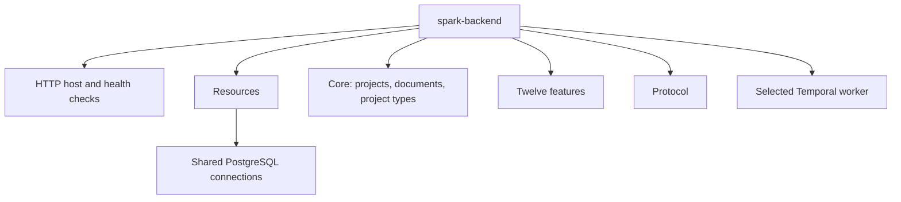

# SPARK Workflow backend

`@spark-workflow/spark-backend` is the SPARK Workflow backend: one Bun/Elysia program that serves the HTTP API of all features. Each running process can also run one Temporal worker, the part that executes background workflows. The features stay separate packages. This application puts them together, owns the database schema, and controls startup and shutdown.

## Core Features

- Core, the twelve features, and the protocol are served by one process with one OpenAPI description.
- `ACTIVE_FEATURE_WORKER` decides which Temporal worker a process runs: the AI analyses (`agent-orchestration`), document processing (`document-management`), project versions (`project-logic`), archival (`temporal-job`), or none.
- The tables of all features form one database schema with one migration history. The backend applies new migrations when it starts.
- A process only reports that it is ready once the migrations, the shared services, the initial data, and its worker are up. If its worker stops, the process shuts down instead of running without it.

## Architecture

### Overview

The backend is a modular monolith: one program built from separate packages. Each feature package keeps its routes, tables, and business rules. This application decides which features exist, connects them through their Resources (the typed interfaces features offer each other), and runs the process.



#### Deployment pools

A pool is a group of identical processes in the cluster. All pools run the same image and serve every HTTP route. They differ only in the worker they run, so each kind of background work can scale on its own, and any process can answer any request. `API_POOL` adds the pool name to the process's logs and metrics.

#### Startup and shutdown

`start()` runs these steps in order:

1. Apply the committed migrations.
2. Start all Resources, including the PostgreSQL connections.
3. Write the initial data of core and apply the SpiceDB permission definition. A database lock makes sure that only one process does this at a time.
4. Start the selected worker.
5. Start accepting HTTP requests.

If a step fails, the process closes what it already started. The health check `/startup` stays unavailable until all steps are done. `/ready` returns `200` only while the process accepts requests. The health checks do not check other services.

On shutdown, the process first stops accepting new requests, then stops the worker and the HTTP server and closes the Resources. If the worker stops or fails while the process runs, the process shuts down and exits with an error code.

### Components

| File | Purpose |
| --- | --- |
| `src/manifests.ts` | The registered features and the combined schema |
| `src/features.ts` | PostgreSQL and parsed configuration providers |
| `src/index.ts` | Route registry, worker selection, and process lifecycle |
| `src/env.ts` | Application settings |
| `src/migrations/` | Committed SQL migrations and their metadata |

### API Endpoints

Each feature has its own route prefix. Some prefixes are short forms of the names of the former separate services.

| Prefix | Feature |
| --- | --- |
| `/api/pls/v1` | Core projects (former project logic service) |
| `/api/dms/v1` | Core documents (former document management service) |
| `/api/vae/v1` | Administrative File Draft (Verwaltungsaktentwurf) |
| `/api/agent-orchestration/v1` | Agent Orchestration |
| `/api/comment/v1` | Comment |
| `/api/examination/v1` | Examination |
| `/api/feedback/v1` | Feedback |
| `/api/fcs/v1` | Formal Completeness Check |
| `/api/fpp/v1` | FPP Integration |
| `/api/identity` | Identity Management |
| `/api/oms/v1` | Objections Management |
| `/api/plausibility-notes/v1` | Plausibility Notes |
| `/api/protocol/v1` | Protocol |
| `/api/supplementary-requests/v1` | Supplementary Requests |
| `/api` | Temporal Job |

The generated REST routes of the newer v2 API are under `/api/v2/<feature>`. The feature READMEs describe their routes, and `/openapi` and `/openapi.json` document all of them. The health checks are `/healthz`, `/startup`, and `/ready`.

## Getting Started

### Prerequisites

Set up Bun, pnpm, PostgreSQL, Temporal, storage, authentication, and the AI modules through the [root setup guide](../../../README.md#getting-started). Run `pnpm install --frozen-lockfile` from the repository root.

### Environment Variables

`src/env.ts` requires these settings and has no defaults for them. The local stack supplies development values. Each feature reads its own settings in addition, as listed in its README and in the [core README](../../../packages/core/README.md#environment-variables).

| Variable | Description | Default | Required |
| --- | --- | --- | --- |
| `HOST`, `PORT` | HTTP bind address and port | none | yes |
| `DB_HOST`, `DB_PORT`, `DB_NAME` | Database for normal operation | none | yes |
| `DB_USER`, `DB_PASSWORD` | Database credentials for normal operation | none | yes |
| `DB_MIGRATE_HOST` | Database for migrations and seeding | none | yes |
| `DB_MIGRATE_USER`, `DB_MIGRATE_PASSWORD` | Credentials for migrations and seeding | none | yes |
| `ACTIVE_FEATURE_WORKER` | `none`, `agent-orchestration`, `document-management`, `project-logic`, or `temporal-job` | none | yes |
| `PROJECT_LOGIC_SERVICE_CORS_ORIGINS` | Comma-separated allowed browser origins | none | yes |
| `API_POOL` | Pool label for telemetry | none | no |

### Running the Module / Service

#### In Development

Start the local stack as described in the root README. With its services running and the environment supplied, start the backend from the repository root:

```sh
pnpm --filter @spark-workflow/spark-backend start
```

#### In Production

Build the executable from the repository root:

```sh
pnpm --filter @spark-workflow/spark-backend build
```

The build writes `02-backend/apps/spark-backend/dist` with the executable, the migrations, and the workflow bundles. Use that directory as the build context for `02-backend/apps/Dockerfile`. The image starts `/app/index.mjs`. Set `ACTIVE_FEATURE_WORKER` explicitly for each pool.

## Testing

From this directory:

```sh
pnpm test
pnpm typecheck
pnpm db:check
```

After a schema change, run `pnpm db:generate` to create the migration. If you add, remove, or rename a table with a `_history` table or an `updated_at` column, run `pnpm db:boundaries`. It generates the migration for the history triggers, the `updated_at` triggers, and the deferred foreign keys between versioned tables. `pnpm db:check` fails when these triggers do not match the schema. Commit the SQL, the journal, and the snapshots together.

Tests against external HTTP services, PostgreSQL, or Temporal need the variables described in each package's README.
