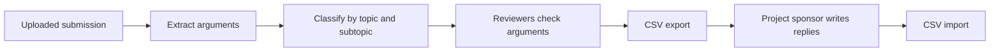

# Dienst Einwendungsverwaltung (Objections Management Service)

Handles the statements and objections that authorities and the public submit during participation. The AI splits each submission into arguments and sorts them by the project's topics. Reviewers check the result and exchange it with the project sponsor, the applicant who answers the arguments, as a CSV file.

## Core Features

- Each uploaded statement (`STELLUNGNAHME`), nature conservation statement (`NATURSCHUTZ`), or objection (`EINWENDUNG`) becomes a participation submission with its extracted text.
- The AI splits a submission into arguments. It keeps the text of each argument, the text around it, and where both appear in the submission.
- The AI assigns each argument a topic and a subtopic of the project, each with a confidence value. Reviewers move an argument from `open` through `subtopic_reviewed` to `done`. They can mark it as not a valid argument, or mark it for the decision draft.
- The CSV export lists every argument with its topic, the text around it, and its file. The project sponsor writes a reply into the `Erwiderung` column. Importing the file stores each reply on its argument.
- Some submissions contain text written to manipulate the AI (prompt injection). The feature gives such a submission the status `PROMPT_INJECTION_ERROR` instead of arguments.

## Architecture

### Overview



Agent Orchestration runs extraction and classification and writes the results through the `Objections` Resource. A submission's `extractionStatus` is `loading`, `SUCCESS`, `FAILED`, or `PROMPT_INJECTION_ERROR`. Its `classificationStatus` is `loading`, `done`, or `failed`.

Submissions and arguments belong to one project version. Every write through `Objections` names the project version and checks that this version can still be changed. A workflow therefore never writes into a newer version than the one it started on.

If a result arrives twice, the work is not done twice. When the arguments of a submission arrive again before it is classified, the feature returns the stored arguments. Classification only completes arguments that did not change since they were extracted, and only with topics and subtopics of the same project version.

#### CSV export and import

The export writes the columns `Argument-ID`, `Thema`, `Unterthema`, `Argument`, `Kontext`, `Erwiderung`, `Einordnung`, and `Datei`. The file starts with a UTF-8 byte order mark and uses semicolons, so spreadsheet programs open it directly. The feature stores it as an internal project file of type `erwiderungs_export` and returns its file ID.

The import reads a project file of type `erwiderungs_import`. It accepts semicolon or comma as delimiter, matches each row to an argument by `Argument-ID`, and stores the `Erwiderung` column. Each import writes the audit action `ERWIDERUNG_IMPORT`.

A cell that starts with `=`, `+`, `-`, `@`, or a tab could run as a spreadsheet formula. The export puts an apostrophe in front of such a cell, and the import removes exactly that apostrophe, so values come back from the spreadsheet unchanged.

### Dependencies

The [feature manifest](src/manifest.ts) declares what this feature needs from other features and what it provides to them. See [Resource contracts](../../../packages/resource/README.md) for why features talk through Resources.

| Needs | From | Why |
| --- | --- | --- |
| `Projects` | core | Writable project versions, project names, and topics |
| `DocumentFiles` | core | Submission files, and storing and reading the CSV files |

It provides `Objections`, which Agent Orchestration uses to read processed submissions and store the extracted and classified arguments. It also provides `ObjectionsVersioning`, which core uses to copy submissions and arguments into each new project version.

### API Endpoints

The backend serves these routes under `/api/oms/v1`. The generated REST routes of the newer v2 API for submissions and arguments are under `/api/v2/oms`.

| Method | Path | Description |
| --- | --- | --- |
| `GET` | `/:projectId/arguments/export` | Creates the CSV export as a project file |
| `POST` | `/:projectId/arguments/import` | Imports replies from an uploaded CSV file |
| `GET` | `/:projectId/ewms/processed-file-ids` | Lists files that already have a submission |
| `POST` | `/:projectId/ewms/argument-extraction` | Stores extracted arguments |
| `PATCH` | `/:projectId/ewms/classification` | Stores the topic classification |
| `PATCH` | `/:projectId/ewms/classification-failed` | Marks a classification as failed |
| `POST` | `/:projectId/ewms/injection-detected` | Marks submissions with detected prompt injection |

## Getting Started

### Prerequisites

Set up Bun, pnpm, and the local stack through the [root setup guide](../../../README.md#getting-started).

### Environment Variables

The package reads no variables of its own. The backend supplies the database and authentication settings described in the [backend environment](../../apps/spark-backend/README.md#environment-variables).

### Running the Module / Service

The package runs inside the SPARK Workflow backend. Start it as described in the [backend README](../../apps/spark-backend/README.md#running-the-module--service).

## Testing

From this package directory:

```sh
pnpm test
pnpm typecheck
```

The mutation tests run against a prepared database and a running backend. They are skipped unless `OBJECTIONS_MUTATION_BASE_URL` and `OBJECTIONS_MUTATION_DATABASE_URL` are set.
