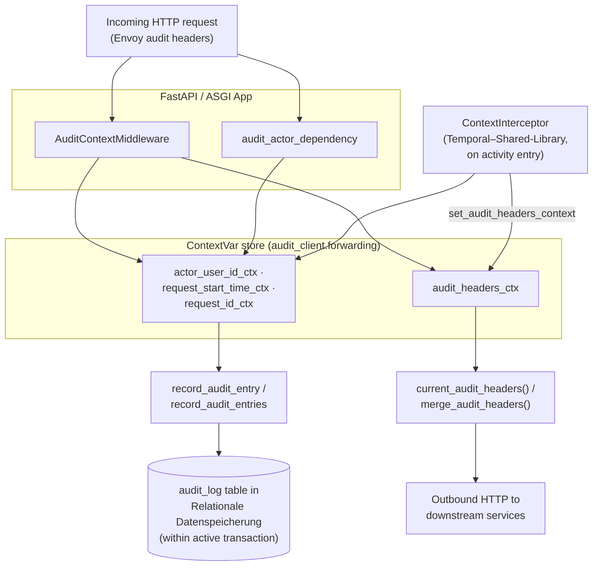

# Audit-Client-Library

The Audit-Client-Library provides shared utilities, ASGI middleware, and database models to capture and propagate audit log entries (requests, actors, and background activities) across platform services.

## Core Features

The library covers three intrinsic layers; a fourth is provided as a Temporal-side complement that lives in the **Temporal–Shared-Library** (`04-shared-services/temporal`) rather than in this package.

1. **Capture** — `AuditContextMiddleware` parses the six audit headers (`X-Actor-User-Id`, `X-Triggered-By-User-Id`, `X-Workflow-Run-Id`, `X-Workflow-Type`, `X-Request-Starttime`, `X-Request-Id`) into `request.state` and `ContextVar`s. Malformed UUIDs degrade silently to `None`.
2. **Persist** — `record_audit_entry` (single) and `record_audit_entries` (bulk, with the `AuditEntry` dataclass) insert into the caller's _active transaction_. The helpers never commit on their own; atomicity with the business write is the caller's responsibility. The helpers read **`actor_user_id`**, `request_start_time`, and `request_id` from `ContextVar`s as fallbacks — other attribution fields (`triggered_by_user_id`, `workflow_run_id`, `workflow_type`) must be passed explicitly.
3. **Forward (service-to-service)** — `current_audit_headers()` / `merge_audit_headers(extra)` read the active audit headers from the ContextVar so outbound HTTP clients can replay them downstream, keeping the attribution chain consistent across microservice hops.
4. **Temporal propagation (transparent, via `ContextInterceptor`)** — Activities cannot see HTTP context, so the `ContextInterceptor` in `04-shared-services/temporal/src/temporal/interceptors/context_interceptor.py` carries `actor_user_id` (and the bearer token) across the Temporal boundary using Temporal headers (`x-actor-user-id`, `x-bearer-token`). It injects them at `start_workflow` from the caller's `actor_user_id_ctx`, forwards them on every `start_activity` / `start_local_activity` / `start_child_workflow`, and on activity entry it re-sets `actor_user_id_ctx` plus calls `set_audit_headers_context(...)` so the activity behaves like a normal HTTP handler with respect to attribution. **Application code does not have to put `workflow_actor` into workflow / activity inputs to make this work** — the interceptor handles it.

## Architecture

### Overview

Rather than running as a standalone HTTP service, the Audit-Client-Library acts as a lightweight cross-cutting helper. It is imported by individual backend microservices to unify audit logging behavior.



### Temporal Workflows

Audit propagation across the Temporal boundary is handled by the `ContextInterceptor` of the **Temporal–Shared-Library** (`04-shared-services/temporal/src/temporal/interceptors/context_interceptor.py`), **not** by application code. Application services do not have to put audit fields into workflow inputs to make attribution flow.

How it works:

- **Client outbound** — at `start_workflow` the interceptor reads `actor_user_id_ctx` and `bearer_token_ctx` and injects them as Temporal headers (`x-actor-user-id`, `x-bearer-token`).
- **Workflow outbound** — at every `start_activity`, `start_local_activity`, and `start_child_workflow` the same headers are forwarded automatically.
- **Activity inbound** — the interceptor decodes the headers and (a) calls `actor_user_id_ctx.set(actor_user_id)` so `record_audit_entry` picks up the actor via its built-in fallback, and (b) calls `set_audit_headers_context(WorkflowActorContext(triggered_by_user_id=actor_user_id, workflow_type=info.workflow_type), workflow_run_id=root_run_id or info.workflow_run_id)` so the four `X-*` audit headers are in `audit_headers_ctx` for outbound HTTP from the activity (see _Forward_).

The library still ships a `workflow.py` module (`WorkflowActorContext`, `workflow_actor_context_from_request_kwargs`, `audit_context_from_workflow`) for cases that bypass the interceptor or that need `workflow_run_id` / `workflow_type` written into local `audit_log` rows. As noted under _Known limitation_, this is a workaround for the helper not reading those fields from `audit_headers_ctx`; new code that only needs `actor_user_id` should rely on the interceptor and avoid touching `workflow_actor` fields.

### Components

- **`AuditContextMiddleware`**: ASGI middleware that reads incoming request headers into `request.state` and ContextVars.
- **`audit_context_kwargs(request)`**: extracts the four actor/workflow fields from `request.state` as a kwargs dict for splatting into `record_audit_entry`.
- **`audit_actor_dependency`**: FastAPI dependency that extracts Keycloak sub claims into the actor ContextVar.
- **`record_audit_entry`**: inserts a single audit log row into the caller's active transaction.
- **`record_audit_entries`** / **`AuditEntry`**: bulk-inserts multiple audit rows in a single `INSERT` — preferred when one logical action mutates many entities.
- **`current_audit_headers`** / **`merge_audit_headers`**: read the active audit headers from the ContextVar; used by outbound HTTP clients to forward attribution to downstream services.
- **`set_audit_headers_context`**: installs the four `X-*` audit headers into the ContextVar for the current task scope — used inside Temporal activities to make outbound HTTP calls inherit the workflow's actor.
- **`WorkflowActorContext`** / **`workflow_actor_context_from_request_kwargs`** / **`audit_context_from_workflow`**: Temporal bridge (see _Temporal Workflows_ above).

### Dependencies

| Module / Service                                     | Purpose                                                                                                                                    |
| ---------------------------------------------------- | ------------------------------------------------------------------------------------------------------------------------------------------ |
| [authentification](../authentification)              | Wrapper around the **OIDC- & OAuth 2.0-konformer Identitäts- und Autorisierungsdienst**, used to retrieve the active user's subject claim. |
| [SQLAlchemy](https://www.sqlalchemy.org/)            | ORM/Core library for the **Relationale Datenspeicherung**, used to define the schema and insert records.                                   |
| [FastAPI / Starlette](https://fastapi.tiangolo.com/) | Web framework components used to build the middleware and endpoint dependencies.                                                           |

### Data Models

#### `WorkflowActorContext` (Pydantic)

Carried as a `workflow_actor: WorkflowActorContext | None` field on workflow input models.

- `actor_user_id` (UUID, optional): user that triggered the workflow.
- `triggered_by_user_id` (UUID, optional): upstream triggering user when an automated actor acted on someone's behalf.
- `workflow_type` (str, optional): originating workflow type for nested/child workflows.

`workflow_run_id` is intentionally not part of the model — activities read it from `temporalio.activity.info().workflow_run_id` at write time.

#### `audit_log` (SQLAlchemy Core)

The library defines the canonical `audit_log` schema table:

- `id` (UUID): Primary key.
- `timestamp` (DateTime): Timestamp of the audit event.
- `project_id` (UUID): The associated project UUID.
- `entity_id` (UUID, optional): Target entity UUID.
- `entity_type` (String): Target entity type (e.g. `project`, `document`).
- `change_type` (String): Event change type discriminator (`create`, `update`, `delete`, `action`).
- `action_type` (String, optional): Specific action detail (e.g. `project_initialization`).
- `actor_user_id` (UUID, optional): Performing user ID.
- `triggered_by_user_id` (UUID, optional): Original triggering user ID.
- `workflow_run_id` (String, optional): Associated Temporal workflow run ID.
- `workflow_type` (String, optional): Associated Temporal workflow type.
- `request_start_time` (DateTime, optional): Start time of the original request.
- `request_id` (String, optional): HTTP request ID for history grouping.

## Project Structure

```
├── pyproject.toml              # Project dependency and packaging configuration
├── src/
│   └── audit_client/           # Core library package
│       ├── __init__.py         # Package exports
│       ├── client.py           # Core async record audit entry functions
│       ├── dependencies.py     # FastAPI dependency for parsing Keycloak user info
│       ├── enums.py            # Event/change type enumerations
│       ├── forwarding.py       # ContextVar and HTTP header mapping/merging utilities
│       ├── middleware.py       # Starlette ASGI middleware for header parsing & propagation
│       ├── models.py           # Canonical SQLAlchemy Core schema definition of the audit_log table
│       ├── settings.py         # Configuration settings for Envoy header names
│       └── workflow.py         # Pydantic model and converters for Temporal workflow audit propagation
└── tests/                      # Unit and integration test suite
    ├── test_actor_context.py   # Test suite for ContextVar and override priority
    └── test_audit_context_kwargs.py # Test suite for middleware header parsing
```

## Getting Started

### Prerequisites

- Python `>=3.13, <3.14`
- Active local database (PostgreSQL / Relationale Datenspeicherung) managed by the importing microservice.

### Installation

Add the package to your workspace service:

```bash
uv add --workspace audit-client
```

### Environment Variables

The client parses Envoy ingress headers by default. You can override the header names:

| Variable                    | Description                                           | Default               | Required |
| --------------------------- | ----------------------------------------------------- | --------------------- | -------- |
| `HEADER_REQUEST_START_TIME` | Overrides the header name for the request start time. | `X-Request-Starttime` | no       |
| `HEADER_REQUEST_ID`         | Overrides the header name for the request UUID.       | `X-Request-Id`        | no       |

### Running the Module / Service

#### In Development

Integrating the client into a microservice:

1. **Register Middleware**:

   ```python
   from audit_client import AuditContextMiddleware
   from fastapi import FastAPI

   app = FastAPI()
   app.add_middleware(AuditContextMiddleware)
   ```

2. **Protect Routes and Capture Actors**:

   ```python
   from audit_client import audit_actor_dependency
   from fastapi import Depends, APIRouter

   router = APIRouter(dependencies=[Depends(audit_actor_dependency)])
   ```

3. **Record Logs (HTTP path)**:

   ```python
   from audit_client import ChangeType, audit_context_kwargs, record_audit_entry

   @router.patch("/{project_id}")
   async def update_project(project_id: UUID, request: Request, db: AsyncSession = Depends(get_db)):
       # Perform operations...
       await record_audit_entry(
           db,
           project_id=project_id,
           entity_type="project",
           change_type=ChangeType.UPDATE,
           **audit_context_kwargs(request),
       )
       # Committing the session commits the audit log atomically
       await db.commit()
   ```

4. **Record Logs (Temporal Workflow path)**:

   The triggering endpoint just starts the workflow normally. No `workflow_actor` field is needed in the input — the `ContextInterceptor` injects `x-actor-user-id` from `actor_user_id_ctx` automatically:

   ```python
   @router.post("/{project_id}/start")
   async def start(project_id: UUID):
       await temporal_client.start_workflow(
           MyWorkflow.run,
           MyWorkflowInput(project_id=project_id),
           id=f"my-workflow-{project_id}",
           task_queue=TASK_QUEUE,
       )
   ```

   The activity calls `record_audit_entry` with no attribution kwargs — the helper picks `actor_user_id` from the `ContextVar` the interceptor set:

   ```python
   from audit_client import ChangeType, record_audit_entry
   from temporalio import activity

   @activity.defn
   async def update_project_status(activity_input: MyActivityInput) -> None:
       async with AsyncSessionLocal() as db:
           # Perform operations...
           await record_audit_entry(
               db,
               project_id=activity_input.project_id,
               entity_type="project",
               change_type=ChangeType.UPDATE,
           )
           await db.commit()
   ```

   Outbound HTTP from an activity already carries the audit headers — `set_audit_headers_context(...)` was called by the interceptor when the activity started, so `current_audit_headers()` returns the right values:

   ```python
   # Inside an activity — no manual setup needed.
   await my_http_client.do_something(headers=current_audit_headers())
   ```

   **Until the helper is extended**, if you want `workflow_run_id` / `workflow_type` / `triggered_by_user_id` written into your local `audit_log` rows from an activity, you currently have to pass them explicitly. The workaround helpers in `audit_client.workflow` (`WorkflowActorContext`, `workflow_actor_context_from_request_kwargs`, `audit_context_from_workflow`) exist for that case — see _Known limitation_ and the `fix/dms-audit-workflow-actor-propagation` branch for the pattern.

#### In Production

Add `audit-client` as a workspace dependency to each consuming service, register `AuditContextMiddleware`, and call the audit helpers inside the same database transaction as the business write.

## Troubleshooting

- **Audit log entries are not appearing**: Verify that the calling code commits the active database transaction (`await session.commit()`). The client writes to the current session but does not commit independently to ensure atomic writes.
- **Actor User ID is `None`**: Verify that the authentication header is correctly passed, or that `audit_actor_dependency` has been injected on the endpoint route.
- **Audit entries written from a Temporal activity show `actor_user_id=null`**: the `ContextInterceptor` is supposed to set `actor_user_id_ctx` on activity entry. Check that (a) the worker and the client both have `ContextInterceptor` registered (see `04-shared-services/temporal/src/temporal/worker.py`), (b) the endpoint that started the workflow ran inside `AuditContextMiddleware` so `actor_user_id_ctx` was populated when `start_workflow` ran, (c) the call site is not bypassing `record_audit_entry` by writing raw SQL.
- **Audit entries from an activity have a correct `actor_user_id` but `workflow_run_id=null` / `workflow_type=null`**: this is the known helper gap (`record_audit_entry` does not read those from `audit_headers_ctx`). Either pass them explicitly via `audit_context_from_workflow(...)` with a `WorkflowActorContext` carried in the workflow / activity input, or — preferred — extend `record_audit_entry` to read them from `audit_headers_ctx`.
- **Outbound HTTP call from a Temporal activity does not carry audit headers**: by default the `ContextInterceptor` calls `set_audit_headers_context(...)` on activity entry, so `current_audit_headers()` already returns the right values. If you see empty headers, check that the activity is running through the `ContextInterceptor`-enabled worker.
