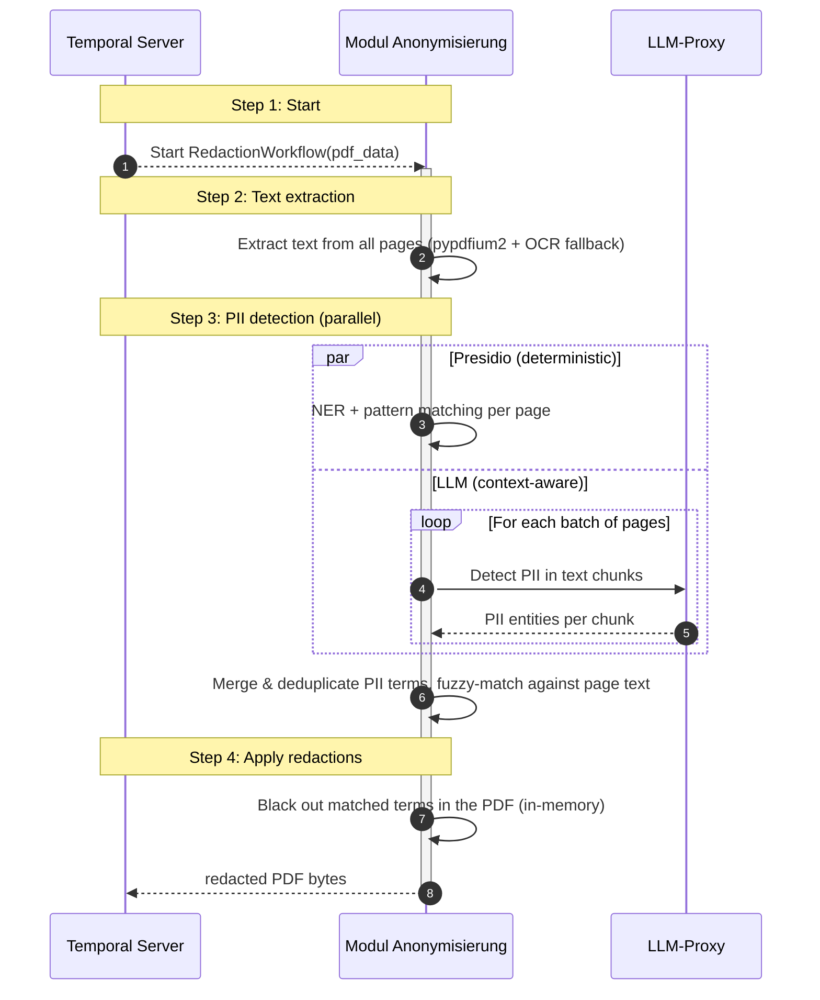

# Modul Anonymisierung (Module Anonymisation)

*A Temporal-orchestrated pipeline that automatically redacts personally identifiable information (PII) from PDF documents. Given raw PDF bytes, the pipeline extracts the text, detects PII using both a deterministic engine (Presidio/spaCy) and an LLM, and returns redacted PDF bytes with all sensitive data blacked out.*

> **Domain context:** This module was developed for German planning and approval procedures (_Planfeststellungsverfahren_). It processes project documents (e.g. objections and expert reports) and redacts personal data such as names, e-mail addresses and phone numbers before documents are shared or published.

## Core Features

- **Dual detection strategy:** Combines Presidio (deterministic NER and pattern matching) with LLM-based PII extraction for high recall.
- **Presidio baseline:** Uses the spaCy `de_core_news_lg` model for German NER, detecting names, e-mail addresses and phone numbers by default (the entity set is configurable).
- **LLM PII extraction:** Sends batches of pages to the shared LLM service for context-aware detection of PII that pattern matchers miss. A second LLM pass filters the Presidio candidates down to true PII.
- **Fuzzy matching:** Detected PII terms are matched against the page text using a Levenshtein similarity threshold to absorb OCR artefacts and formatting differences.
- **OCR fallback:** Scanned pages without an extractable text layer are processed with `ocrmypdf` (Tesseract, German language model).
- **Kill switch:** LLM detection can be disabled entirely, degrading cleanly to a Presidio-only baseline.
- **Bytes in, bytes out:** The workflow receives PDF bytes and returns the redacted PDF bytes directly.
- **Durable orchestration:** Each document is processed as an independent Temporal workflow with automatic retries; large payloads are offloaded to S3.

## Architecture

### Overview

The module is built on **Temporal** with a clear separation between workflows (orchestration) and activities (I/O and CPU-bound work). A single worker handles the workflow and all non-LLM activities; LLM calls are dispatched to the shared **LLM-Proxy** via the shared `llm_invoke` Temporal activity. Payloads larger than the Temporal size limit are stored in S3 transparently.

### Workflow Overview



### Temporal Workflows

- **RedactionWorkflow:** The main single-file orchestrator. Receives raw PDF bytes, runs the extraction → detection → redaction pipeline and returns the redacted PDF bytes. It is registered under the shared `anonymisierung` task queue and workflow ID defined by the Temporal shared library.

### Pipeline per Document

1. **Text extraction** — pypdfium2 reads the embedded text; scanned pages without a text layer are run through `ocrmypdf` (Tesseract) to produce an OCR text layer.
2. **Presidio detection** — spaCy NER plus Presidio pattern recognizers produce deterministic PII candidates per page.
3. **LLM PII extraction** — Page batches are sent to the LLM for context-aware detection; a second LLM pass filters the Presidio candidates.
4. **Merge & fuzzy matching** — Results are merged and deduplicated, then matched against the page text via Levenshtein similarity.
5. **Redaction** — Matched terms are blacked out in the PDF.

### Components

- **Activities (`src/activities`):** `extract_texts`, `detect_pii_presidio` and `apply_redactions` — the I/O and CPU-bound steps run on the worker thread pool.
- **Services (`src/services`):** `pdf_extractor` (text extraction + OCR), `presidio_detector` (Presidio/spaCy engine wrapper), `pii_matcher` (fuzzy matching) and `redactor` (PDF annotation/redaction).
- **Prompts (`src/prompts`):** System and user prompt builders for LLM extraction and filtering.
- **Config (`src/config.py`):** Stable algorithm parameters (batch sizes, thresholds, Presidio tuning).

### Dependencies

| Module / Service | Purpose |
|------------------|---------|
| **Temporal** | Durable workflow orchestration, scheduling and retries. |
| **LLM-Proxy** | Unified LLM gateway, reached through the shared `llm_invoke` Temporal activity. |
| **Verteilte Objektspeicherung** (S3) | Large-payload storage for Temporal inputs/outputs above the size limit. |
| **OpenTelemetry-kompatibler Telemetriedienst** | Receives traces and metrics emitted by the worker. |

### Data Models

The Pydantic schemas in `src/models/schemas.py` describe the activity I/O. The workflow itself takes `bytes` and returns `bytes`; the final `apply_redactions` activity reports the redaction statistics:

| Field | Type | Description |
|-------|------|-------------|
| `redacted_pdf` | bytes | Redacted PDF content (returned by the workflow). |
| `pages_processed` | int | Total number of pages processed. |
| `matches_found` | int | Total number of PII matches that were redacted. |
| `error_pages` | list[int] | Page numbers where PII detection failed. |

## Project Structure

```
├── main.py                          # Temporal worker entry point
├── Dockerfile                       # Multi-stage build (OCR + PDF dependencies)
├── k8s/                             # Kubernetes deployment manifests (kustomize)
├── tests/                           # Pytest suite (unit + workflow tests)
└── src/
    ├── config.py                    # Internal algorithm defaults (batch sizes, thresholds)
    ├── env.py                       # Environment settings (Pydantic Settings)
    ├── activities/
    │   └── redaction_activities.py  # Text extraction, Presidio detection, redaction
    ├── models/
    │   └── schemas.py               # Pydantic activity I/O models
    ├── prompts/
    │   └── pii_extraction.py        # LLM prompt builders (extraction + filtering)
    ├── services/
    │   ├── pdf_extractor.py         # Text extraction (pypdfium2 + OCR)
    │   ├── pii_matcher.py           # Fuzzy matching (Levenshtein)
    │   ├── presidio_detector.py     # Presidio NER engine wrapper
    │   └── redactor.py              # PDF annotation / redaction
    ├── utils/                       # Helpers (chunking, PII response parsing)
    └── workflows/
        └── redaction_workflow.py    # RedactionWorkflow (main orchestrator)
```

## Getting Started

### Prerequisites

- `uv` package manager
- Python `>=3.13, <3.14`
- Tesseract OCR with the German language pack (`tesseract-ocr`, `tesseract-ocr-deu`) and Ghostscript for the OCR fallback — already provided by the Dockerfile
- Shared platform services from the [root README](../../README.md#dependencies) when running locally (Temporal, S3/MinIO and the LLM service)

### Environment Variables

| Variable | Description | Default | Required |
|----------|-------------|---------|----------|
| `LLM_MODEL` | LLM model identifier (routed via LLM-Proxy) | — | yes |
| `LLM_ENABLED` | Kill switch: `false` = Presidio-only (no LLM calls) | `true` | no |
| `LLM_TEMPERATURE` | Sampling temperature for LLM PII detection | `0.0` | no |
| `LLM_TOP_P` | Nucleus-sampling parameter | `1.0` | no |
| `LLM_MAX_PROMPT_SIZE` | Maximum prompt size (characters) before chunking | `300000` | no |
| `LLM_PAGES_PER_CALL` | Number of pages bundled into one LLM call | `3` | no |
| `TEMPORAL_HOST` | Temporal server address | — | yes |
| `TEMPORAL_JOB_SERVICE_URL` | URL of the workflow management service | — | yes |
| `TEMPORAL_MAX_CONCURRENT_ACTIVITIES` | Max concurrent non-LLM activities per worker | `2` | no |
| `TEMPORAL_THREAD_MAX_WORKERS` | Thread-pool size for synchronous activities | `4` | no |
| `TEMPORAL_S3_BUCKET_NAME` | S3 bucket for large-payload storage | — | yes |
| `TEMPORAL_S3_ENDPOINT_URL` | S3 endpoint URL | — | yes |
| `TEMPORAL_S3_ACCESS_KEY_ID` | S3 access key | — | yes |
| `TEMPORAL_S3_SECRET_ACCESS_KEY` | S3 secret key | — | yes |
| `TEMPORAL_S3_REGION` | S3 region | — | yes |
| `OCR_JOBS` | Number of parallel Tesseract processes for `ocrmypdf` | `2` | no |
| `OTEL_SERVICE_NAME` | OpenTelemetry service name | `anonymisierung` | no |
| `OTEL_ENDPOINT` | OpenTelemetry collector endpoint | — | yes |

The worker task queue is fixed by the shared Temporal workflow contract.

### Running the Module / Service

#### In Development

1. **Create an environment file** and adjust it for your setup:

   ```bash
   cp .env.local .env
   ```

2. **Install dependencies and start the worker:**

   ```bash
   uv sync --package anonymisierung
   uv run main.py
   ```

3. **Monitor** the worker via the Temporal UI at [http://localhost:8233](http://localhost:8233).

#### In Production

The module runs as a Temporal worker container (see the `Dockerfile` and `k8s/` manifests). Configuration is supplied entirely through environment variables; on startup the worker connects to Temporal and polls the `anonymisierung` task queue automatically.

## Testing

```bash
# Run all tests (heavy ML-model tests are skipped by default)
uv run pytest

# Run a specific test file
uv run pytest tests/test_redaction_workflow.py

# Include the slow tests that load spaCy / ML models
uv run pytest -m slow
```

## Troubleshooting

<details>
<summary>LLM detection is disabled — only pattern matching runs</summary>

Set `LLM_ENABLED=true` in your `.env` to enable LLM-based PII detection alongside Presidio. When it is `false`, only the deterministic Presidio baseline is used.

</details>

<details>
<summary>Poor redaction quality on scanned documents</summary>

For scanned pages the result depends on the Tesseract German language model. Ensure `tesseract-ocr` and `tesseract-ocr-deu` (and Ghostscript) are installed — these are handled by the Dockerfile.

</details>

<details>
<summary>Temporal "Complete result exceeds size limit" error</summary>

Large payloads must be stored via S3. Ensure the `TEMPORAL_S3_*` variables are correctly configured and that the S3/MinIO endpoint is reachable.

</details>

<details>
<summary>Workflow inputs/outputs appear as binary in the Temporal UI</summary>

Large payloads are stored in S3 and shown encoded. Start the Temporal Codec Service, then in the Temporal UI click the codec (3D-glasses) icon, select "Use my browser setting" and point it at the codec endpoint to decode payloads.

</details>
