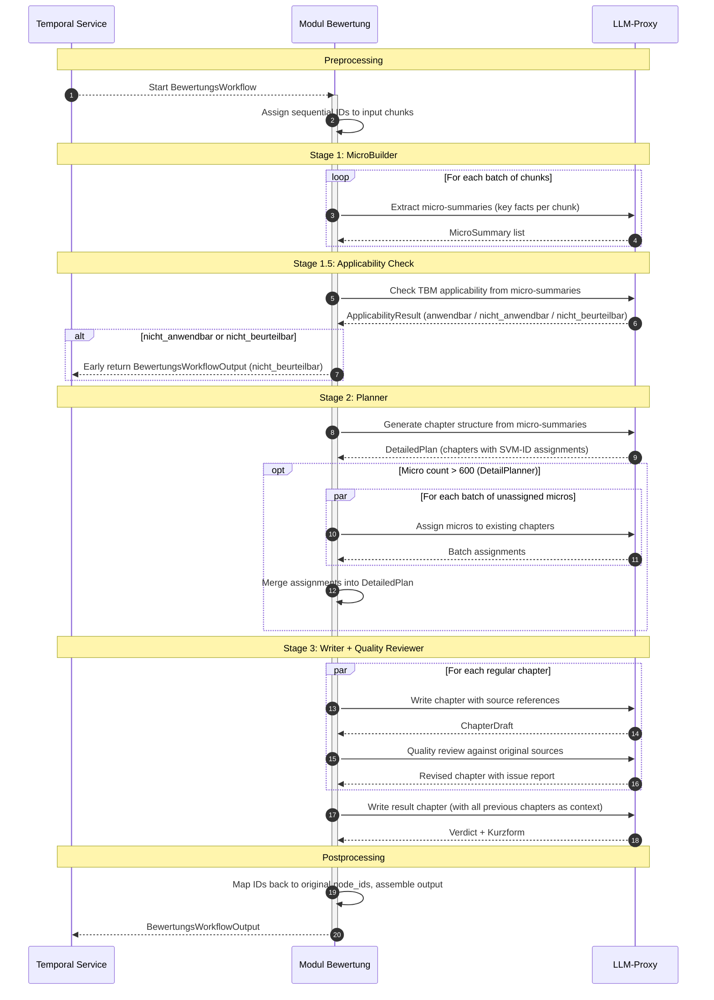

# Modul Bewertung (Module Assessment)

A Temporal-orchestrated pipeline for the legal assessment of norms. Given a legal norm requirement (_Tatbestandsmerkmal_ (_TBM_)) and relevant document chunks, the pipeline produces a structured, source-referenced legal assessment with a verdict (_erfüllt_, _nicht erfüllt_, or _nicht beurteilbar_).

> **Domain Context:** This module was developed for German planning and approval procedures (_Planfeststellungsverfahren_). It evaluates whether individual conditions of material-law norms are met, based on extracted content from project documents. The pipeline is norm-agnostic and can assess any if-then legal statement backed by textual evidence.

## Core Features

- **Four-Stage Pipeline:** MicroBuilder → Applicability Check → Planner → Writer + Quality Reviewer
- **MicroBuilder:** Extracts concise fact summaries from document chunks in configurable batches to make planning possible
- **Applicability Check:** Pre-screens whether the legal norm requirements (_Tatbestandsmerkmale_) are applicable to the project based on extracted facts. Non-applicable or indeterminate cases short-circuit the pipeline with an early return
- **Planner:** Generates a structured chapter outline via a single LLM call with Chain-of-Verification. For large micro sets (>600), a two-phase approach is used: the Planner samples a subset to create a coarse plan, then a DetailPlanner batch-assigns remaining micros to the existing chapters
- **Writer + Quality Reviewer:** Writes source-referenced chapters and verifies them against original sources, correcting hallucinations and invalid references
- **Verdict Derivation:** Produces a final verdict per norm statement with a short-form summary (_Kurzform_)
- **Temporal Workflow Orchestration:** Durable execution with automatic retries and S3 large-payload storage

## Architecture

### Overview

Built on **Temporal** with clear separation between workflows (orchestration) and activities (I/O). All LLM calls are routed through the shared **LLM-Proxy** via shared Temporal activities. Large payloads are stored in S3 to avoid Temporal size limits.

### Workflow Overview



### Temporal Workflows

| Workflow                | Description                                                                                                                                                   |
| ----------------------- | ------------------------------------------------------------------------------------------------------------------------------------------------------------- |
| `BewertungsWorkflow`    | Main orchestrator. Preprocesses input chunks (ID assignment), dispatches child workflows sequentially, and assembles the final output with source references. |
| `MicroBuilderWorkflow`  | Batch-extracts concise fact summaries from document chunks. Processes batches in parallel with graceful fallback on parse errors.                             |
| `ApplicabilityWorkflow` | Pre-checks whether the _Tatbestandsmerkmal_ is applicable based on micro-summaries. Non-applicable or indeterminate results cause an early return, skipping Planner and Writer. |
| `PlannerWorkflow`       | Generates a structured chapter plan (3–12 chapters) from micro-summaries. For large sets (>600 micros), samples a subset and delegates remaining assignments to the DetailPlanner. Retries automatically on validation failures. |
| `DetailPlannerWorkflow` | Batch-assigns remaining micro-summaries to the chapter structure created by the Planner. Processes batches in parallel.                                       |
| `WriterWorkflow`        | Writes all chapters in parallel, then writes the result chapter with full context. Each chapter undergoes quality review before finalization.                 |

### Dependencies

| Service         | Purpose                                             | Required |
| --------------- | --------------------------------------------------- | -------- |
| **Temporal** | Workflow orchestration and scheduling               | Yes      |
| **LLM-Proxy**                                       | Unified LLM API gateway                         | Yes      |
| **Verteilte Objektspeicherung** (S3) | Large payload storage for Temporal (>2 MB payloads) | Yes      |

### Data Models

The workflow returns a `BewertungsWorkflowOutput` with the assessment result, structured chapters, and source references.

| Field       | Type                                                  | Description                                                                      |
| ----------- | ----------------------------------------------------- | -------------------------------------------------------------------------------- |
| `id`        | string (UUID)                                         | Unique assessment result ID                                                      |
| `satz_id`   | string                                                | Input statement ID                                                               |
| `norm`      | string                                                | Norm reference (e.g. `§ 44 BNatSchG`)                                            |
| `satz_text` | string                                                | The evaluated legal norm requirement                                              |
| `result`    | `erfuellt` \| `nicht_erfuellt` \| `nicht_beurteilbar` | Verdict                                                                          |
| `kurzform`  | string \| null                                        | Short-form summary in judicial style                                             |
| `kapitel`   | array of KapitelOutput                                | Structured chapters with title, markdown, and optional per-chapter summary       |
| `full_text` | string                                                | Complete Markdown text of the assessment                                         |
| `sources`   | dict[string, Quelle]                                  | SVM-ID → source reference (document_id, node_id, title, chunk_ids, page_numbers) |

## Project Structure

```
├── main.py                 # Temporal worker entry point
├── .env.local              # Local environment variable defaults
├── test-data/              # Example input/output JSON files
├── tests/                  # Unit tests
└── src/
    ├── config.py           # Internal behavior defaults (batch sizes, retry policies)
    ├── env.py              # Environment settings (Pydantic Settings)
    ├── activities/         # Temporal activities (currently empty — LLM calls via shared activities)
    ├── models/             # Pydantic domain models and workflow I/O types
    ├── prompts/            # LLM prompt templates (system, micro_builder, planner, detail_planner, applicability, writer, quality_reviewer)
    ├── utils/              # JSON parsing and plan validation utilities
    └── workflows/          # Temporal workflows (main_workflow, micro_builder, applicability, planner, detail_planner, writer, quality_reviewer)
```

## Getting Started

### Prerequisites

- `uv` package manager
- Shared platform services from the [root README](../../README.md#dependencies) when running locally

### Environment Variables

1. **Create an environment file:**

   ```bash
   cp .env.local .env
   ```

2. **Edit `.env`** with your environment-specific values.

| Variable | Description | Default | Required |
|----------|-------------|---------|----------|
| `LITELLM_MODEL` | LLM model identifier (routed via LLM-Proxy) | — | yes |
| `TEMPORAL_HOST` | Temporal server address | — | yes |
| `TEMPORAL_S3_BUCKET_NAME` | S3 bucket for large payload storage | — | yes |
| `TEMPORAL_S3_ENDPOINT_URL` | S3 endpoint URL | — | yes |
| `TEMPORAL_S3_ACCESS_KEY_ID` | S3 access key | — | yes |
| `TEMPORAL_S3_SECRET_ACCESS_KEY` | S3 secret key | — | yes |
| `TEMPORAL_S3_REGION` | S3 region | — | yes |
| `OTEL_SERVICE_NAME` | OpenTelemetry service name | — | yes |
| `OTEL_ENDPOINT` | OpenTelemetry collector endpoint | — | yes |
| `TEMPORAL_JOB_SERVICE_URL` | URL of the Dienst Workflowmanagement for workflow status reporting | — | yes |

The worker task queue is fixed by the shared Temporal workflow contract.

### Running the Module

#### In Development

1. **Install dependencies** (from repo root):

   ```bash
   uv sync --all-packages
   ```

2. **Start the Temporal worker** (from `05-modulcluster/modul-bewertung`):

   ```bash
   uv run main.py
   ```

3. **Monitor workflow execution** via the Temporal UI at [http://localhost:8233](http://localhost:8233) - inspect workflow executions, child workflows, and activity retries.

#### In Production

Configure via environment variables. The worker connects to Temporal and polls the `bewertung` task queue automatically.

## Troubleshooting

<details>
<summary>Planner Validation Failures</summary>

The Planner retries automatically (up to 20 attempts) when LLM output fails Pydantic validation. Check Temporal UI for retry history. If persistent, the model may not be following the expected JSON schema — inspect the prompt in `src/prompts/planner.py`.

</details>

<details>
<summary>Temporal "Complete result exceeds size limit" Error</summary>

Large payloads (>2 MB) must be stored via S3. Ensure `TEMPORAL_S3_*` variables are correctly configured and VersityGW/S3 is reachable.

</details>

<details>
<summary>Codec Server for Payload Inspection</summary>

If workflow inputs/outputs appear as binary in the Temporal UI, start the codec server and configure the UI: click the 3D glasses icon → select "Use my browser setting" → enter `http://localhost:8000`.

</details>
