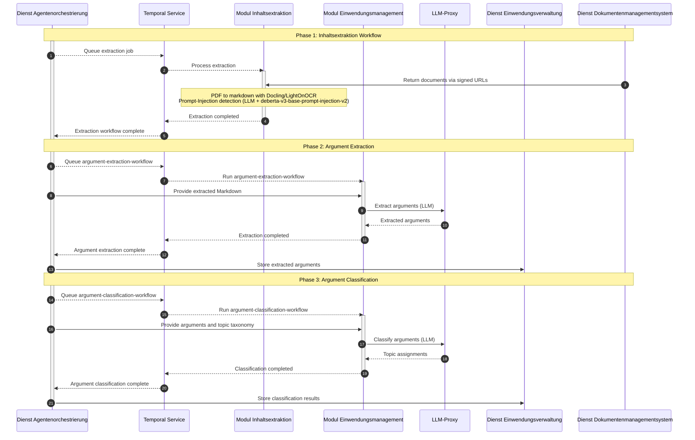

# Modul Einwendungsmanagement (Module Objection Management)

A Temporal-orchestrated pipeline that processes citizen objections (_Einwendungen_) submitted during German planning and approval procedures (_Planfeststellungsverfahren_). It extracts individual arguments from preprocessed objection documents and classifies each against a project-specific topic taxonomy to support downstream review.

## Core Features

- **Argument Extraction:** Splits objection submissions into individual arguments via LLM
- **Argument Classification:** Maps each argument to one or more topics from a configurable taxonomy
- **Batch Orchestration:** Batch workflows iterate over many documents with bounded parallelism
- **Temporal Workflow Orchestration:** Durable execution with automatic retries and S3 large-payload storage

## Architecture

### Overview

The **Dienst Agentenorchestrierung** triggers the workflow via Temporal and coordinates the end-to-end process. First, **Modul Inhaltsextraktion** converts the source objection documents (images and text) into Markdown and runs prompt-injection detection. The Markdown is then handed to this module, which extracts individual arguments which the **Dienst Agentenorchestrierung** stores in the **Dienst Einwendungsverwaltung**. Finally, each argument is classified against the project-specific topic taxonomy and the classification results are stored back in **Dienst Einwendungsverwaltung** as well. LLM calls run through the shared **LLM-Proxy** via shared Temporal activities, and large payloads (e.g. extracted texts, argument batches) are stored in S3 to stay under Temporal payload limits.

### Workflow Overview



### Temporal Workflows

| Workflow | Description |
|----------|-------------|
| `ArgumentExtractionWorkflow` | Entry point: splits the processed objection documents into batches and runs `ArgumentExtractionSingleBatchWorkflow` for each batch as a child workflow. |
| `ArgumentExtractionSingleBatchWorkflow` | Extracts and grounds the individual arguments of one batch of documents (LLM). |
| `ArgumentClassificationWorkflow` | Entry point: splits the extracted arguments into batches and runs `ArgumentClassificationSingleBatchWorkflow` for each batch as a child workflow. |
| `ArgumentClassificationSingleBatchWorkflow` | Classifies one batch of arguments against the provided topic taxonomy (LLM). |

### Dependencies

| Module / Service | Purpose |
|------------------|---------|
| **Dienst Agentenorchestrierung** | Workflow entry point (triggered by frontend) |
| **Temporal** | Workflow orchestration and scheduling |
| **LLM-Proxy** | Unified LLM API gateway (shared Temporal activity) |
| **Modul Inhaltsextraktion** | Preprocessed text extraction data |
| **Dienst Einwendungsverwaltung** | Stores extracted arguments and classification results |
| **S3 / VersityGW** | Large payload storage for Temporal (>2 MB payloads) |

## Project Structure

```
├── main.py                 # Temporal worker entry point
├── src/
│   ├── activities/         # Temporal activities (argument extraction I/O)
│   ├── config/             # config.py (internal tuning) and env.py (Pydantic Settings)
│   ├── prompts/            # LLM prompt templates
│   ├── schemas/            # Pydantic domain models and workflow I/O types
│   └── workflows/          # Temporal workflows
└── tests/
```

## Getting Started

### Prerequisites

- `uv` package manager
- Shared platform services from the [root README](../../README.md#dependencies) when running locally

### Environment Variables

| Variable | Description | Default | Required |
|----------|-------------|---------|----------|
| `LITELLM_MODEL_NAME` | LLM model identifier; selects the shared LLM worker queue | — | yes |
| `TEMPORAL_HOST` | Temporal server address | — | yes |
| `TEMPORAL_JOB_SERVICE_URL` | Base URL of the Temporal job service for workflow status tracking | — | yes |
| `TEMPORAL_S3_BUCKET_NAME` | S3 bucket for large payload storage | — | yes |
| `TEMPORAL_S3_ENDPOINT_URL` | S3 endpoint URL | — | yes |
| `TEMPORAL_S3_ACCESS_KEY_ID` | S3 access key | — | yes |
| `TEMPORAL_S3_SECRET_ACCESS_KEY` | S3 secret key | — | yes |
| `TEMPORAL_S3_REGION` | S3 region | — | yes |
| `OTEL_SERVICE_NAME` | OpenTelemetry service name | — | yes |
| `OTEL_ENDPOINT` | OpenTelemetry collector endpoint | — | yes |

### Running the Module / Service

#### In Development

1. **Create an environment file:**

   ```bash
   cp .env.local .env
   ```

2. **Edit `.env`** with your environment-specific values.

3. **Start platform services** (from repo root):

   ```bash
   docker compose up -d
   ```

4. **Start the Temporal worker:**

   ```bash
   uv sync --package einwendungsmanagement
   uv run main.py
   ```

5. **Monitor** via Temporal UI at [http://localhost:8233](http://localhost:8233).

#### In Production

Configure via environment variables. The worker connects to Temporal and polls the `einwendungsmanagement` task queue automatically.

## Additional Notes

### Monitoring

- **Temporal UI:** [http://localhost:8233](http://localhost:8233) — Workflow executions, activity retries
- **OpenTelemetry:** Traces and metrics via configured OTEL collector
