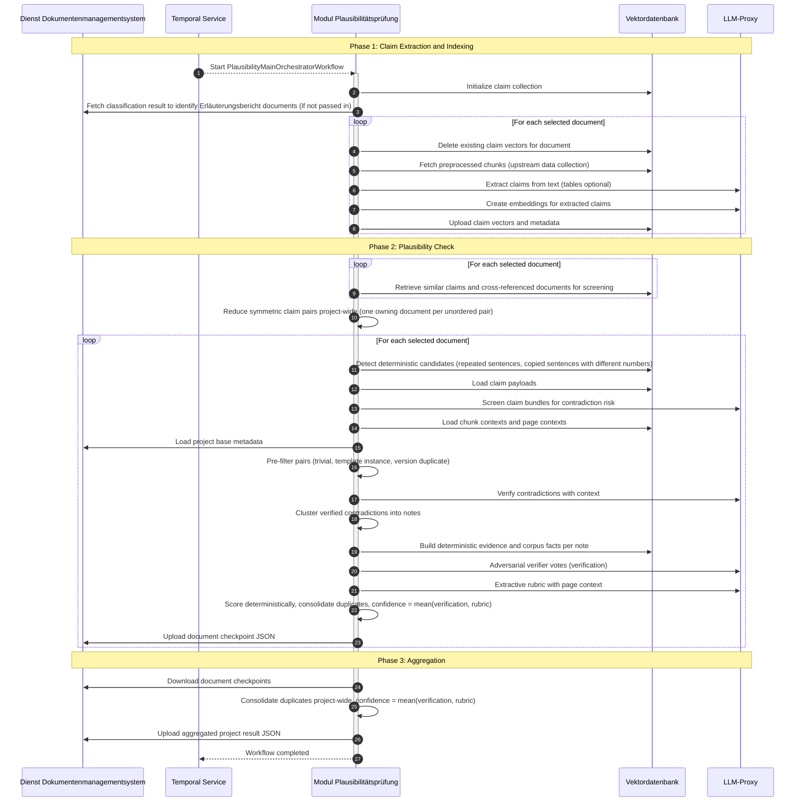

# Modul Plausibilitätsprüfung (Module Plausibility Check)

This module performs the **plausibility check** ("Plausibilitätsprüfung") of large legal planning applications.
It extracts structured factual claims from preprocessed document chunks, compares semantically related
statements and identifies likely contradictions across a project.

## Core Features

- **Three-Phase Pipeline**: Claim extraction → plausibility check → result aggregation
- **Claim Extraction**: Extracts structured claims from text chunks; table chunks only with `QDRANT_BUILDER.EXTRACT_TABLES` (off by default, large tables are split by rows). Filters unsupported / short chunks automatically
- **Semantic Candidate Retrieval**: Embeds claims in Qdrant and retrieves similar claims via vector search across three pools (Erläuterungsbericht documents, neighbours in the same document, the whole project). Supports incremental reprocessing per document
- **Multi-Stage Contradiction Detection**: Risk screening (0–100 score, configurable threshold) → deterministic pre-filter → context-aware verification → clustering → note-level confidence scoring. Candidate retrieval runs for all documents first, so every unordered claim pair is screened and checked exactly once per project run, no matter which documents its claims live in
- **Two Independent Confidence Layers**: verification (deterministic evidence + adversarial LLM verifier) and rubric (extractive rubric with page context, scored deterministically). Delivered as one `confidenceScore` (mean of both scores, 0–100, comparable across projects), duplicates consolidated without an LLM
- **DMS Checkpoint Outputs**: Uploads per-document and aggregated project-level result JSON files to the DMS; the aggregated file carries the project-wide confidence

## Architecture

### Overview

Executed asynchronously in Temporal. Depends on preprocessed data from **Modul Inhaltsextraktion** (chunked documents and summaries in Qdrant). Builds a claim index, runs plausibility checks and uploads contradiction results back to the DMS.

### Workflow Overview



### Dependencies

| Service                                   | Purpose                                                                  |
| ----------------------------------------- | ------------------------------------------------------------------------ |
| **Modul Inhaltsextraktion**               | Chunked document content, summaries, and Qdrant data collections         |
| **Modul formale Vollständigkeitsprüfung** | Optional classification output to identify Erläuterungsbericht documents |
| **Dienst Dokumentenmanagementsystem**     | Classification file, project base metadata, and checkpoint storage       |
| **Temporal**                              | Asynchronous workflow orchestration                                      |
| **LLM-Proxy**                             | OpenAI-compatible gateway for all LLM/embedding calls                    |

## Output Schema

Writes one JSON file per document and one aggregated file. Both share the same structure: A `contradictions` array.

> Output keys use camelCase (Pydantic alias serialization).

### Contradiction Object

| Field         | Type                   | Description                                                       |
| ------------- | ---------------------- | ----------------------------------------------------------------- |
| `id`              | string (UUID)          | Unique identifier                                                 |
| `title`           | string \| null         | Short summary (title of the strongest verified edge)              |
| `description`     | string                 | Detailed explanation, composed deterministically                  |
| `rating`          | integer \| null        | Legacy: strongest context-checker rating (kept for compatibility) |
| `confidenceScore` | number \| null         | **Confidence 0–100 for the sensitivity slider**: plain mean of `scoreA` and `scoreB` (`scoreA` alone if the rubric could not judge); an absolute property of the note, comparable across projects |
| `scoreA`          | number \| null         | Verification score (deterministic evidence ± adversarial verifier votes) |
| `scoreB`          | number \| null         | Rubric score (rubric with page context, deterministic pairwise scoring) |
| `evidence`        | array of string        | Audit trail: deterministic signals, verifier votes, rubric fields |
| `mergedCount`     | integer                | Number of clustered notes consolidated into this entry            |
| `conflict`        | array of ConflictLocation | Conflicting statements from the rubric (`gegenstand`, `merkmal`, `wert`) |
| `status`          | `"OPEN"` \| `"RESOLVED"` \| `"IGNORED"` | Always `"OPEN"` when produced; the other values are set downstream |
| `occurrences`     | array of Occurrence    | Document locations evidencing the contradiction                   |

### Occurrence Object

| Field            | Type            | Description                                       |
| ---------------- | --------------- | ------------------------------------------------- |
| `documentId`     | string (UUID)   | Source document ID in the DMS                     |
| `documentName`   | string \| null  | Human-readable document title                     |
| `contentExcerpt` | string          | Text excerpt illustrating the contradiction       |
| `contradiction`  | string \| null  | Attribute and value at this location, from the rubric |
| `pageNumber`     | integer \| null | Page number, if available                         |

<details>
<summary> Domain-specific example (based on German planning applications (Planfeststellungsverfahren))</summary>

```json
{
  "contradictions": [
    {
      "id": "3fa85f64-5717-4562-b3fc-2c963f66afa6",
      "title": "Widersprüchliche Flächenangaben zwischen Erläuterungsbericht und Bebauungsplan",
      "description": "Der Erläuterungsbericht gibt die Gesamtfläche des Plangebiets durchgehend mit 4,5 ha an, während der Bebauungsplan sowohl im Fließtext als auch in der Flächenbilanz 3,8 ha für dasselbe Plangebiet ausweist. Die Abweichung tritt in zwei unabhängigen Plandokumenten auf und lässt sich nicht durch unterschiedliche Abgrenzungen oder Planungsphasen erklären.",
      "rating": 85,
      "confidenceScore": 88.4,
      "scoreA": 86.0,
      "scoreB": 95.0,
      "evidence": [
        "Prüfung/Evidenz: score_det=70; same_id_conflict, id_shared, numeric_conflict_same_id; anker_fehlt=0.00",
        "Prüfung/Verifier[basis]: echt (kein) — Beide Stellen nennen das Plangebiet mit 4,5 ha bzw. 3,8 ha.",
        "Rubrik/Bewertung: 95 — Spitzenstufe"
      ],
      "mergedCount": 1,
      "conflict": [
        { "gegenstand": "Plangebiet", "merkmal": "Gesamtfläche", "wert": "4,5 ha" },
        { "gegenstand": "Plangebiet", "merkmal": "Gesamtfläche", "wert": "3,8 ha" }
      ],
      "status": "OPEN",
      "occurrences": [
        {
          "documentId": "00000000-0000-0000-0000-000000000001",
          "documentName": "Erläuterungsbericht 2024",
          "contentExcerpt": "Die Gesamtfläche des Plangebiets beträgt 4,5 ha und umfasst die Flurstücke 112 und 113.",
          "contradiction": "Gesamtfläche: 4,5 ha",
          "pageNumber": 12
        },
        {
          "documentId": "00000000-0000-0000-0000-000000000002",
          "documentName": "Bebauungsplan Nr. 47 — Textliche Festsetzungen",
          "contentExcerpt": "Das Plangebiet umfasst eine Fläche von 3,8 ha (Flurstücke 112 und 113 der Gemarkung Musterstadt).",
          "contradiction": "Gesamtfläche: 3,8 ha",
          "pageNumber": 3
        },
        {
          "documentId": "00000000-0000-0000-0000-000000000002",
          "documentName": "Bebauungsplan Nr. 47 — Textliche Festsetzungen",
          "contentExcerpt": "Flächenbilanz: Gesamtplangebiet 3,80 ha, davon Wohnbaufläche 2,10 ha, Verkehrsfläche 0,45 ha, Grünfläche 1,25 ha.",
          "contradiction": null,
          "pageNumber": 8
        }
      ]
    }
  ]
}
```

</details>

### Confidence Pipeline (behind the context checker)

```
Screening hits
  └─ Vorfilter (0 LLM)              activities/prefilter.py — trivial pairs (text identity only),
                                    template instances (identifiers from the whole page), version
                                    duplicates (same TOC section)
  └─ Context Checker
  └─ Clustering                     activities/clustering.py — connected components, never truncated
  └─ Notes                          activities/notes.py — Fundstellen, anchoring, evidence, page contexts
       ├─ Verification              activities/evidence.py (0 LLM) + note_verifier.py
       │                            (3 adversarial votes, veto pass on majority, fact guard, caps)
       └─ Rubric                    activities/rubric.py (1 extractive call, page context) +
                                    scoring.py (gate, pairwise deterministic score, self-consistency)
  └─ Konfidenz                      activities/confidence.py — mean of verification and rubric score
  └─ Zusammenführen (0 LLM)         activities/consolidation.py — duplicate groups (same evidence or same
                                    conflict), title/description/occurrences composed deterministically
```

Evidence captured at extraction time (`config.EXTRACTION`, requires a re-extraction per project):
page-level instance identifiers and object ids on every claim (`instance_identifiers`, `object_ids`), a
`superseded` flag for claims from outdated editions (references only, never check claims), and detection
of glyph-shifted text from PDF extraction (`activities/mojibake.py`); such chunks are skipped, not repaired.
Legacy claims without these fields fall back to page fetching at check time.
Candidate sources next to the screener (`config.CANDIDATES`, `activities/candidates.py`): a
deterministic repetition detector (same sentence, different numbers, exactly two occurrences, no differing
object identifier), the copied-sentence test on KNN neighbours above the cosine window, and cross-reference
resolution ("Unterlage 14.1") with window-free screening inside the referenced document. Detector and
overflow hits skip the LLM screener and go straight to the context checker.

All thresholds live in `src/config/config.py` (`PREFILTER`, `NOTE_VERIFIER`, `RUBRIC`, `CONSOLIDATION`, `CANDIDATES`, `EXTRACTION`).

## Project Structure

```
├── main.py                     # Temporal worker entry point
├── src/
│   ├── activities/             # Temporal activities (I/O operations; LLM calls are routed to the shared llm-client)
│   ├── config/                 # Configuration and environment variables
│   ├── dms/                    # DMS client and schemas
│   ├── qdrant/                 # Qdrant client and schemas
│   └── workflows/              # Temporal workflows (orchestration logic, incl. LLM/embedding invocations)
└── tests/                      # Unit and workflow tests
```

## Getting Started

### Prerequisites

- `uv` package manager
- Shared platform services from the [root README](../../README.md#dependencies) when running locally

### Environment Variables

Defaults for local development are in `.env.local`; put secrets and overrides in `.env`. Configure LiteLLM model names (`LITELLM_MODEL`, `LITELLM_EMBEDDING_MODEL`), Qdrant, DMS, Temporal, S3 payload storage (`TEMPORAL_S3_*`), and OpenTelemetry settings. The LiteLLM proxy connection (base URL, master key) and LLM rate limiting are handled by the shared llm-client workers.

Loaded from environment / `.env` by `src/config/env.py`. The `LITELLM_`, `QDRANT_`, and `TEMPORAL_` groups use pydantic-settings nested delimiter `_`. Set `SKIP_DOTENV` to read the environment only.

| Variable                        | Description                                             | Default                        | Required |
| ------------------------------- | ------------------------------------------------------- | ------------------------------ | -------- |
| `LITELLM_MODEL`                 | Chat model name (routed via the shared llm-client)      | `self-hosted/gpt-oss-120b`     | yes      |
| `LITELLM_EMBEDDING_MODEL`       | Embedding model name (routed via the shared llm-client) | `self-hosted/bge-m3`            | yes      |
| `QDRANT_CLUSTER_ENDPOINT`       | Qdrant cluster HTTP endpoint                            | `http://localhost:6333`        | yes      |
| `QDRANT_VECTOR_SIZE`            | Dense vector dimension                                  | `1024`                         | no       |
| `DMS_BASE_URL`                  | Document Management Service URL                         | `http://localhost:18001/api/dms/v1` | yes      |
| `TEMPORAL_HOST`                 | Temporal frontend address                               | `localhost:7233`               | yes      |
| `TEMPORAL_S3_BUCKET_NAME`       | S3 bucket for large Temporal payloads                   | `temporal-payloads`            | yes      |
| `TEMPORAL_S3_ENDPOINT_URL`      | S3/VersityGW endpoint                                       | `http://localhost:9000`        | yes      |
| `TEMPORAL_S3_ACCESS_KEY_ID`     | S3 access key                                           | generated root `.env` | yes      |
| `TEMPORAL_S3_SECRET_ACCESS_KEY` | S3 secret key                                           | generated root `.env` | yes      |
| `TEMPORAL_S3_REGION`            | S3 region                                               | `eu-west-1`                    | yes      |
| `OTEL_SERVICE_NAME`             | OpenTelemetry service name                              | `plausibilitaet_pruefung`      | yes      |
| `OTEL_ENDPOINT`                 | OpenTelemetry collector gRPC endpoint                   | `http://localhost:4317`        | yes      |
| `QDRANT_CLAIM_COLLECTION_NAME`  | Qdrant collection for the claim index                   | `plausibility`                 | no       |
| `QDRANT_DATA_COLLECTION_NAME`   | Qdrant collection with the upstream chunks              | `data`                         | no       |

The worker task queue is fixed by the shared Temporal workflow contract.

### Running the Module

#### In Development

1. **Setup Python Environment** (run from the repository root):

   ```bash
   uv venv --python 3.13
   uv sync --package plausibilitaet-pruefung
   ```

2. **Start Platform Services** (from repo root):

   ```bash
   docker compose up -d
   ```

   Alternatively, point environment variables to an existing deployment.

3. **Start the Temporal Worker**:

   ```bash
   uv run main.py
   ```

   This starts a single worker on the `plausibilitaet-pruefung` task queue. LLM and embedding invocations are dispatched as shared `llm_invoke`/`embedding_invoke` activities and handled by the central llm-client workers (auto-routed via task queue derived from the configured model name).

#### Manual Workflow Trigger via Temporal UI

Task Queue: `plausibilitaet-pruefung`  
Workflow Type: `PlausibilityMainOrchestratorWorkflow`

```json
{
  "projectId": "00000000-0000-0000-0000-000000000000",
  "documentIds": ["00000000-0000-0000-0000-000000000001"],
  "erlaeuterungsberichtDocumentIds": [],
  "classificationFileId": "00000000-0000-0000-0000-000000000002"
}
```

`erlaeuterungsberichtDocumentIds` and `classificationFileId` are optional. If `erlaeuterungsberichtDocumentIds` is empty, the Erläuterungsbericht documents are read from the classification file. If `documentIds` is empty, the result contains an empty contradictions list.

#### In Production

Start Temporal workers and ensure DMS, Qdrant, LiteLLM, and the upstream extraction pipeline are available. Trigger workflows via backend orchestration or Temporal UI.

## Testing

```bash
# Run all tests of this module (from the module directory)
uv run pytest

# Run a specific test file
uv run pytest tests/test_scoring.py
```

## Monitoring

- **Temporal Web UI**: Workflow execution, activity retries, child workflow progress
- **DMS Outputs**: Per-document files (`plausibility_{document_id}_{run_id}.json`) and aggregated file (`aggregated_plausibility_results_{run_id}.json`)
- **Qdrant**: Verify `plausibility` collection is populated and upstream `data` collection has chunk payloads
- **OpenTelemetry / Logs**: LLM failures, upload errors, missing upstream metadata

## Troubleshooting

<details>
<summary>Claim Extraction Yields No Claims</summary>

Verify that the upstream Qdrant `data` collection contains extracted chunks for the target project. This module does not perform OCR or content extraction itself.

</details>

<details>
<summary>No Erläuterungsbericht Documents Detected</summary>

Check whether `classificationFileId` points to a valid classification JSON in the DMS. The workflow still runs without it but retrieval is less specialized.

</details>

<details>
<summary>Qdrant Errors or Empty Retrieval Results</summary>

Confirm that `QDRANT_CLUSTER_ENDPOINT` is correct and that the upstream extraction pipeline populated the expected data collections.

</details>

<details>
<summary>LLM Rate Limits or Slow Runs</summary>

Review model quotas and LiteLLM routing. Rate limiting and concurrency are governed by the shared llm-client workers, not by this module.

</details>

<details>
<summary>Missing Final Results in DMS</summary>

Inspect failed upload or aggregation activities in Temporal. Document checkpoints are uploaded first, followed by the aggregated JSON.

</details>

<details>
<summary>Inconsistent Results Between Runs</summary>

LLM outputs are non-deterministic — results may vary between runs. Output quality is significantly affected by model choice.

</details>
