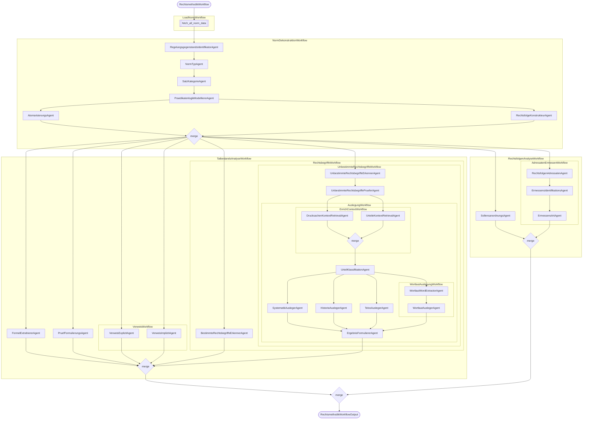

# Modul Rechtsmethodik (Module Legal Methodology)

The module performs a systematic deconstruction and analysis of German statutory norms. It implements a Temporal-orchestrated pipeline that operates at the sentence level, decomposing each sentence into key legal constituents — legal conditions (Tatbestandsmerkmale), legal consequences (Rechtsfolgen), and references (Verweise) — using a network of over 25 specialized LLM agents.

## Core Features

- **Norm Load Workflow:** Fetches norm data from the **Dienst Gesetze- und Normendatenbank** and returns it as workflow input for the norm deconstruction.
- **Norm Deconstruction Workflow (Normdekonstruktion):** Identifies the regulatory subject matter at norm level (Regelungsgegenstand), classifies norm types at sentence level (Normtyp), categorizes sentence structures (Satzkategorie), identifies legal conditions and consequences, and atomizes the legal conditions (atomare Tatbestandsmerkmale).
- **Analysis of Legal Conditions (Tatbestandsanalyse):** Constructs examination questions (Prüffragen) and examination instances (Prüfgegenstände), models predicate logic (Formelextraktion), identifies references, defined and undefined legal terms (bestimmte und unbestimmte Rechtsbegriffe), and performs interpretation (Auslegung) of undefined legal terms.
- **Legal Consequences Analysis (Rechtsfolgenanalyse):** Analyzes legal consequences with regard to normative directives (Sollensanordnungen), addressees (Rechtsfolgenadressat), and discretion (Ermessen).
- **Legal Definitions Extraction (Legaldefinitionen):** Standalone workflow that extracts legal definitions from a given list of paragraphs. Not part of the main pipeline - it operates independently as a bulk extraction service.

## Architecture

### Overview

The module runs as a Temporal worker that registers and executes a hierarchy of workflows and activities. The top-level `RechtsmethodikWorkflow` orchestrates the full analysis pipeline: it first loads the target norm from the **Dienst Gesetze- und Normendatenbank**, runs norm deconstruction, then executes legal conditions analysis and legal consequences analysis in parallel, and finally merges the results.

Agents are implemented as Temporal workflows that call LLM invocation activities with structured prompt templates and Pydantic output models. Large payloads are offloaded to an S3-compatible object store to stay within Temporal message size limits. The module emits OpenTelemetry traces for observability.

### Workflow Overview



### Temporal Workflows

`RechtsmethodikWorkflow` - Top-level orchestrator. Loads the target norm, dispatches deconstruction, runs legal conditions and legal consequences analysis in parallel, and merges results.

<details>
<summary><strong>LoadNormWorkflow</strong> - Fetches norm data from the <strong>Dienst Gesetze- und Normendatenbank</strong> and returns it as structured workflow input.</summary>

| Function | Description |
|---|---|
| `fetch_all_norm_data` | Retrieves the full norm data from the **Dienst Gesetze- und Normendatenbank**. |

</details>

<details>
<summary><strong>NormDekonstruktionWorkflow</strong> - Identifies the regulatory subject matter, classifies norm type, categorizes sentence structure, extracts legal conditions and consequences, atomizes legal conditions, and reconstructs standalone legal consequence sentences.</summary>

| Agent | Description |
|---|---|
| `RegelungsgegenstandsIdentifikatorAgent` | Analyzes the legal paragraph to determine and describe its regulatory subject matter. |
| `NormTypAgent` | Classifies individual sentences as either procedural law (verfahrensrechtlich) or substantive law (materiell-rechtlich). |
| `SatzKategorieAgent` | Categorizes each sentence by its legal-methodological function ("wenn-dann", "abwägungsdirektive", "begriffserklärung", or "sonstiges"). |
| `PraedikatenlogikModelliererAgent` | Decomposes sentences into their constituent parts by extracting legal conditions and legal consequences. |
| `AtomarisierungsAgent` | Breaks down complex legal conditions into atomic, individually testable yes/no conditions formulated as "Wenn" sentences. |
| `RechtsfolgeKonstrukteurAgent` | Reconstructs a syntactically complete, standalone legal consequence sentence from extracted fragments. |

</details>

<details>
<summary><strong>TatbestandsAnalyseWorkflow</strong> - Derives predicate logic formulas, constructs examination questions, identifies legal terms and statutory references. Triggers interpretation workflows for undefined terms.</summary>

| Agent | Description |
|---|---|
| `FormelExtrahiererAgent` | Derives a predicate logic formula expressing the logical relationships (AND, OR, NOT) between atomic legal conditions that lead to the legal consequence. |
| `PruefFormulierungsAgent` | Transforms each atomic legal condition into a yes/no examination question and a corresponding examination instance. |

<details>
<summary><strong>VerweisWorkflow</strong> - Identifies explicit and implicit statutory references within atomic legal conditions and consequences.</summary>

| Agent | Description |
|---|---|
| `VerweisExplizitAgent` | Extracts explicit legal references (specific paragraphs, articles, regulations) and structures them in a standardized format. |
| `VerweisImplizitAgent` | Identifies implicit references to legal domains or regulatory complexes that lack specific paragraph citations. |

</details>

<details>
<summary><strong>RechtsbegriffeWorkflow</strong> - Identifies defined legal terms and dispatches interpretation for undefined legal terms.</summary>

| Agent | Description |
|---|---|
| `BestimmteRechtsbegriffeErkennerAgent` | Checks whether a sentence contains terms from a provided list of defined legal terms. |

<details>
<summary><strong>UnbestimmteRechtsbegriffeWorkflow</strong> - Identifies, validates, and interprets undefined legal terms via the four-method Auslegung pipeline.</summary>

| Agent | Description |
|---|---|
| `UnbestimmteRechtsbegriffeErkennerAgent` | Identifies undefined legal terms that lack a clear fixed meaning and require case-by-case interpretation. |
| `UnbestimmteRechtsbegriffePrueferAgent` | Validates candidates by cross-checking against defined legal terms. |

<details>
<summary><strong>AuslegungWorkflow</strong> - Applies Wortlaut, Systematik, Telos, and Historie interpretation in parallel, enriched by retrieval of parliamentary documents and court rulings.</summary>

<details>
<summary><strong>EnrichContextWorkflow</strong> - Retrieves legislative history and case law to enrich the interpretation context.</summary>

| Agent | Description |
|---|---|
| `DrucksachenKontextRetrievalAgent` | Selects relevant text chunks from parliamentary documents containing substantive interpretive content about the undefined legal term. |
| `UrteileKontextRetrievalAgent` | Identifies relevant court ruling fragments that define or concretize the undefined legal term. |

</details>

<details>
<summary><strong>WortlautAuslegungWorkflow</strong> - Performs literal/grammatical interpretation by extracting lemmas and analyzing lexical meanings.</summary>

| Agent | Description |
|---|---|
| `WortlautWordExtractorAgent` | Extracts dictionary-relevant lemmas (base forms of nouns, verbs, adjectives, adverbs) from the undefined legal term. |
| `WortlautAuslegerAgent` | Performs literal interpretation by analyzing dictionary entries and synthesizing grammatical relationships. |

</details>

| Agent | Description |
|---|---|
| `UrteilKlassifikationAgent` | Classifies retrieved court ruling chunks by assigning them to the relevant interpretation methods (literal, systematic, historical, teleological). |
| `SystematikAuslegerAgent` | Performs systematic interpretation by analyzing the term's position within the normative context and supplementing with case law. |
| `TelosAuslegerAgent` | Performs teleological interpretation by reconstructing the purpose (ratio legis) and analyzing court rulings. |
| `HistorieAuslegerAgent` | Performs historical interpretation by analyzing legislative materials and court rulings to reconstruct the legislator's original intent. |
| `ErgebnisFormuliererAgent` | Synthesizes results of all four interpretation methods into a coherent overall interpretation and working definition. |

</details>

</details>

</details>

</details>

<details>
<summary><strong>RechtsfolgenAnalyseWorkflow</strong> - Classifies normative directives, determines whether the consequence addresses authorities or private parties, and classifies discretionary powers.</summary>

| Agent | Description |
|---|---|
| `SollensanordnungsAgent` | Classifies the legal consequence into one of four normative modalities: command (Gebot), prohibition (Verbot), permission (Erlaubnis), or exemption (Freistellung). |

<details>
<summary><strong>AdressatenErmessenWorkflow</strong> - Determines whether the legal consequence grants authority discretion or constitutes a bound decision.</summary>

| Agent | Description |
|---|---|
| `RechtsfolgenAdressatenAgent` | Determines whether the legal consequence contains an authority's power to act or not. |
| `ErmessensIdentifikationsAgent` | Determines whether the legal consequence grants discretionary power (Ermessensspielraum) or constitutes a bound decision (gebundene Entscheidung). |
| `ErmessensArtAgent` | Classifies discretion as whether to act (Entschließungsermessen), how to act (Auswahlermessen), or both. |

</details>

</details>

<details>
<summary><strong>LegalDefinitionenWorkflow</strong> - Extracts legal definitions from a given list of paragraphs. Operates independently from the RechtsmethodikWorkflow as a bulk extraction pipeline.</summary>

| Agent | Description |
|---|---|
| `LegalDefinitionenExtrahiererAgent` | Extracts defined legal terms and their definitions from a text chunk. Uses a detailed extraction prompt for dedicated definitions paragraphs (Begriffsbestimmungen) and a conservative pattern-matching prompt for general paragraphs. |

</details>

### Dependencies

| Service | Purpose | Required |
|---|---|---|
| **Temporal** | Workflow orchestration and task queue management | Yes |
| **Verteilte Objektspeicherung** (S3) | Offloaded payload storage for large workflow data | Yes |
| **Dienst Gesetze- und Normendatenbank** | Norm and document retrieval by statutory reference | Yes |
| **Dienst Gesetzesbegründungsdatenbank** | Vector retrieval of legislative history documents | Yes |
| **Dienst juristische Datenbank** | Vector retrieval of court rulings | Yes |
| **LLM-Proxy** / **LLM-Client-Library** | Unified access to multiple LLM backends | Yes |
| **OpenTelemetry-kompatibler Telemetriedienst** | Distributed trace and metric ingestion | Optional |

### API Endpoints

| Endpoint | Method | Description |
|---|---|---|
| `https://en.wiktionary.org/api/rest_v1/page/definition/{word}` | GET | Fetches word meanings from Wiktionary via the Wikimedia-API. Used by the `WortlautWordExtractorAgent` for literal interpretation of undefined legal terms. Controlled by the `WIKTIONARY_ENABLED` environment variable. |

## Project Structure

```
├── main.py                     # Temporal worker entry point
├── conftest.py                 # Shared pytest fixtures
├── pyproject.toml              # Project metadata and dependencies
├── Dockerfile                  # Container image definition
├── Dockerfile.dockerignore     # Docker build ignore rules
├── .env.local                  # Environment variable template
├── README.md                   # This file
├── tests/                      # Unit tests
└── src/
    ├── env.py                  # Environment variable configuration (pydantic-settings)
    ├── activities/             # Temporal activity implementations
    ├── log/                    # Logging configuration
    └── workflows/              # Temporal workflow definitions
```

## Getting Started

### Prerequisites

- Python `>=3.13, <3.14`
- `uv` package manager
- Docker and Docker Compose
- Access to all required services (see [Dependencies](#dependencies))

### Environment Variables

Loaded from `.env.local` by `src/env.py`. The `TEMPORAL_*`, `LAW_DATABASE_*`, and `MODELS_*` groups use pydantic-settings nested delimiter `_`.

| Variable | Description | Default | Required |
|----------|-------------|---------|----------|
| `TEMPORAL_HOST` | Temporal frontend address | `temporal-frontend.temporal.svc.cluster.local:7233` *(deployment-set)* | yes |
| `TEMPORAL_S3_BUCKET_NAME` | S3 bucket for large Temporal payloads | `temporal-payloads` | yes |
| `TEMPORAL_S3_ENDPOINT_URL` | S3/MinIO endpoint | `https://s3.<your-domain>` *(deployment-set)* | yes |
| `TEMPORAL_S3_ACCESS_KEY_ID` | S3 access key | from `temporal-s3-secrets` *(deployment-set)* | yes |
| `TEMPORAL_S3_SECRET_ACCESS_KEY` | S3 secret key | from `temporal-s3-secrets` *(deployment-set)* | yes |
| `TEMPORAL_S3_REGION` | S3 region | `my-store` *(deployment-set)* | yes |
| `OTEL_SERVICE_NAME` | OpenTelemetry service name | `rechtsmethodik` | yes |
| `OTEL_ENDPOINT` | OpenTelemetry collector endpoint | `otel-gateway.observability.svc.cluster.local:4317` *(deployment-set)* | yes |
| `WIKTIONARY_ENABLED` | Enable external Wiktionary dictionary lookups | `true` *(deployment-set)* | yes |
| `MODELS_LARGE_LLM` | Large LLM model name (LiteLLM route) | `Qwen/Qwen3-235B-A22B-Instruct-2507` (from `.env.local`) | yes |
| `MODELS_MEDIUM_LLM` | Medium LLM model name (LiteLLM route) | `self-hosted/gpt-oss-120b` (from `.env.local`) | yes |
| `MODELS_SMALL_LLM` | Small LLM model name (LiteLLM route) | `gemma-4-26b-a4b-it-maas` (from `.env.local`) | yes |
| `LAW_DATABASE_DOCUMENTS_URL` | Documents endpoint | `http://localhost:18020/documents/` | yes |
| `LAW_DATABASE_NORMS_SEARCH_URL` | Norms search endpoint | `http://localhost:18020/norms/search` | yes |
| `LAW_DATABASE_ABSATZ_JURABK_URL` | Paragraph-by-JURABK endpoint | `http://localhost:18020/absatz/{jurabk}` | yes |
| `LAW_DATABASE_DOCUMENTS_SEARCH_TERM_URL` | Documents search-term endpoint | `http://localhost:18020/documents/search/{search_term}` | yes |
| `LAW_DATABASE_DOCUMENTS_JURABK_URL` | Documents-by-JURABK endpoint | `http://localhost:18020/documents/{jurabk}` | yes |
| `LAW_DATABASE_LEGALDEFINITIONEN_JURABK_URL` | Legal-definitions-by-JURABK endpoint | `http://localhost:18020/legaldefinitionen/{jurabk}` | yes |
| `LAW_DATABASE_TECHNISCHE_NORMEN_DOKUMENT_URL` | Technische-Normen-by-Dokument endpoint | `http://localhost:18020/technische-normen/{dokument}` | yes |
| `LAW_DATABASE_QUERY_TOP_K_DR_URL` | Dienst Gesetzesbegründungsdatenbank query endpoint | `http://localhost:18021/query_top_k` | yes |
| `LAW_DATABASE_QUERY_K_RESULTS_UT_URL` | Dienst Juristische Datenbank top-k endpoint | `http://localhost:18022/query_k_results` | yes |
| `LAW_DATABASE_QUERY_CHUNKS_UT_URL` | Dienst Juristische Datenbank chunks endpoint | `http://localhost:18022/chunks` | yes |
| `TEMPORAL_JOB_SERVICE_URL` | URL of the Dienst Workflowmanagement for workflow status reporting | `http://localhost:18011` | yes |

### Running the Module

#### In Development

1. **Install dependencies** (from repo root):

   ```bash
   uv sync --all-packages
   ```

2. **Start the Temporal worker** (from `05-modulcluster/modul-rechtsmethodik`):

   ```bash
   uv run main.py
   ```

3. **Monitor workflow execution** via the Temporal UI at [http://localhost:8233](http://localhost:8233) - inspect workflow executions, child workflows, and activity retries.

#### In Production

Configure via environment variables. The worker connects to Temporal and polls the `rechtsmethodik` task queue automatically.

## Troubleshooting

**Workflows stall without making progress** - Check the Temporal Web UI for stuck activities. Common causes are unreachable downstream services (databases, LLM client). Inspect activity failure details in the Temporal UI for the exact error and service endpoint involved.
