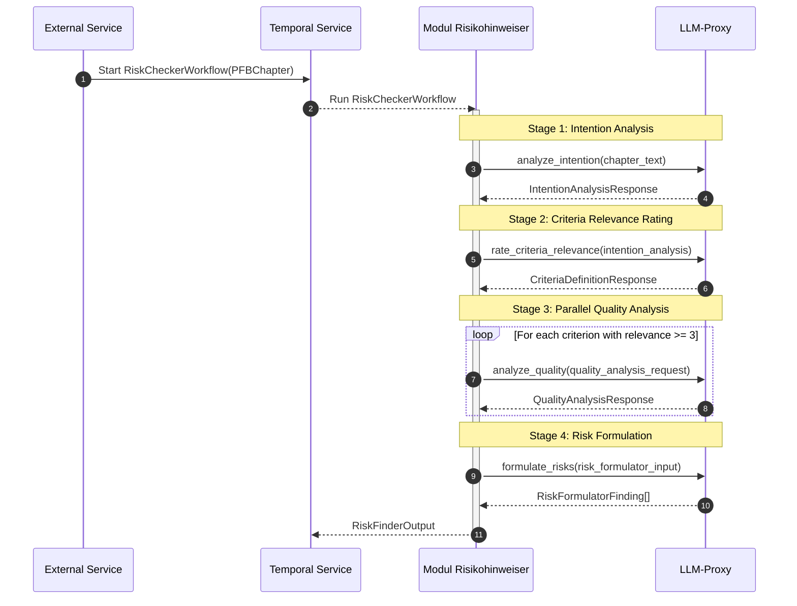

# Modul Risikohinweiser (Module Risk Indicator)

The *Modul Risikohinweiser* analyzes chapters of a *Planfeststellungsbeschluss* (Planning Approval Decision) to identify **risks, weaknesses, and errors**. For each chapter, it runs a four-stage LLM pipeline (Intention → Criteria Relevance → Quality Analysis → Risk Formulation) that returns concrete risk findings with quote, description, implications, recommendation, and severity rating.

## Core Features

- **Four-Stage LLM Pipeline**: Intention analysis → criteria relevance rating → parallel quality analysis → risk formulation
- **Intention Analysis**: Classifies chapter purpose, main part (Entscheidung/Begründung/Rechtsbehelfsbelehrung), subpart role, structure, and dependencies
- **Criteria Relevance Rating**: Evaluates nine quality criteria (Bestimmtheit, Normverankerung, Juristische Präzision, Substanz, Tatsachenfundierung, Argumentationssystematik, Argumentationsstringenz, Abwägungssorgfalt, Würdigungstiefe) on a 1–5 relevance scale per chapter
- **Parallel Quality Analysis**: Runs quality checks for all criteria with relevance ≥ 3 concurrently via `asyncio.gather`
- **Risk Formulation**: Synthesizes quality defects into actionable risk findings with severity (1–10), implications, and recommendations
- **Structured Output**: Returns machine-readable `RiskFinderOutput` with risk findings linked to chapter IDs

## Architecture

### Overview

The *Modul Risikohinweiser* is a Temporal worker that registers a single workflow (`RiskCheckerWorkflow`) on the `risikohinweiser` task queue. It takes a `PFBChapter` as input and produces a `RiskFinderOutput` via the four-stage pipeline. All LLM calls are routed through the shared **LLM-Proxy**, and large payloads are offloaded to **VersityGW (S3)** via the shared `temporal` workspace package.

### Workflow Overview



### Quality Criteria

The nine quality criteria evaluated by the pipeline:

| Criterion | Description |
|-----------|-------------|
| `BESTIMMTHEIT` | Certainty of regulations — clarity of addressees, triggers, and legal consequences |
| `NORM_VERANKERUNG` | Normative anchoring — presence of recognizable statutory references |
| `JUR_PRAEZISION` | Precision of legal formulations — avoidance of ambiguous terms |
| `PRAEGNANZ_SUBSTANZ` | Conciseness and substance — presence of case-specific argumentation vs. generic placeholders |
| `FUNDIERUNG` | Factual foundation — traceability of assumptions or prognoses to expert reports |
| `ARG_SYSTEMATIK` | Argumentation structure — logical flow and separation of issues |
| `ARG_STRINGENZ` | Argumentation consistency — absence of internal contradictions |
| `ABWAEGUNGSSORGFALT` | Balancing diligence — completeness and balance of interest weighing |
| `WUERDIGUNGSTIEFE` | Depth of assessment — substantive engagement with objections and statements |

### Severity Scale

Risk severity is rated on a scale of **1 (low) to 10 (very high)**:

| Range | Meaning |
|-------|---------|
| 1–3 | Low risk, formal observations |
| 4–6 | Medium risk, substantive deficiencies with moderate challenge potential |
| 7–10 | High risk, serious deficiencies with high challenge potential |

### Dependencies

| Service | Purpose |
|---------|---------|
| **Temporal** | Asynchronous workflow orchestration |
| **VersityGW / S3-compatible storage** | Large-payload storage for Temporal |
| **LLM-Proxy** / shared LLM gateway | Unified model access for LLM calls |

## Output Schema

The JSON examples below use the field names emitted by the workflow schema.

### RiskFinderOutput

```json
{
  "risks": [
    {
      "risk_id": "3fa85f64-5717-4562-b3fc-2c963f66afa6",
      "chapter_id": "a1b2c3d4-5717-4562-b3fc-2c963f66afa6",
      "quote": "Die Vorhabenträgerin hat geeignete Schutzvorkehrungen vorzusehen, falls im Einzelfall die Immissionsrichtwerte nicht eingehalten werden können.",
      "description": "Unbestimmter Auslöser ('falls im Einzelfall') ohne klar definierte Bedingung oder Schwellenwert.",
      "implications": "Die Unbestimmtheit der Regelung könnte im Rahmen eines Rechtsbehelfs als Bestimmtheitsmangel geltend gemacht werden.",
      "recommendation": "Konkrete Auslösebedingungen oder Schwellenwerte definieren, bei deren Überschreitung Schutzvorkehrungen zu treffen sind.",
      "severity": 6
    }
  ]
}
```

### RiskFinding Object

| Field | Type | Description |
|-------|------|-------------|
| `risk_id` | string (UUID) | Unique identifier for the risk finding |
| `chapter_id` | string (UUID) | ID of the chapter the finding refers to |
| `quote` | string | Exact text excerpt illustrating the risk |
| `description` | string | Description of the identified risk |
| `implications` | string | Potential implications of the risk |
| `recommendation` | string | Recommended actions to mitigate the risk |
| `severity` | integer (1–10) | Severity rating |

## Project Structure

```
modul-risikohinweiser/
├── main.py                          # Temporal worker entry point
├── pyproject.toml
├── .env.example
├── Dockerfile
├── src/
│   ├── config/
│   │   ├── env.py                   # Pydantic-Settings (environment variables)
│   │   └── config.py                # Internal workflow defaults
│   ├── schemas/
│   │   └── workflow.py              # All Pydantic models (PFBChapter, IntentionAnalysisResponse,
│   │                                  CriteriaDefinitionResponse, QualityCheckItem, etc.)
│   ├── prompts/
│   │   ├── intention_analysis.py     # Stage 1: Intention analysis prompts
│   │   ├── quality_criteria_formulator.py  # Stage 2: Criteria relevance prompts
│   │   ├── quality_checker.py        # Stage 3: Quality analysis prompts
│   │   └── risk_formulator.py        # Stage 4: Risk formulation prompts
│   └── workflows/
│       └── risk_checker.py           # RiskCheckerWorkflow + four workflow functions
└── tests/
    ├── conftest.py                   # Test fixtures
    ├── test_schemas_workflow.py      # Schema validation tests
    ├── test_workflow_functions.py    # Workflow function tests
    └── test_risk_checker_workflow.py # Workflow orchestration tests
```

## Getting Started

### Prerequisites

- Python `>=3.13, <3.14`
- `uv` package manager
- Docker & Docker Compose
- Access to platform services (Temporal, VersityGW, LLM-Proxy) from the monorepo root

### Environment Variables

Loaded from environment / `.env` by `src/config/env.py`. The `LITELLM_*` and `TEMPORAL_*` groups use pydantic-settings nested delimiter `_`. See `.env.example` for a template.

For local development, provide the values through `.env`. In deployed environments, these values are normally supplied by the runtime configuration.

| Variable | Description | Default | Required |
|----------|-------------|---------|----------|
| `LITELLM_BASE_URL` | LLM-Proxy base URL | — | yes |
| `LITELLM_MASTER_KEY` | LLM-Proxy API key (secret) | — | yes |
| `LITELLM_MODEL` | Chat model identifier routed via LiteLLM | `self-hosted/gpt-oss-120b` | yes |
| `TEMPORAL_HOST` | Temporal frontend address | `localhost:7233` | yes |
| `TEMPORAL_LLM_MAX_PER_SECOND` | Token-bucket cap on LLM activities per second | `3` | yes |
| `TEMPORAL_S3_BUCKET_NAME` | S3 bucket for large Temporal payloads | `temporal-payloads` | yes |
| `TEMPORAL_S3_ENDPOINT_URL` | S3/VersityGW endpoint | `http://localhost:9000` | yes |
| `TEMPORAL_S3_ACCESS_KEY_ID` | S3 access key | generated root `.env` | yes |
| `TEMPORAL_S3_SECRET_ACCESS_KEY` | S3 secret key | generated root `.env` | yes |
| `TEMPORAL_S3_REGION` | S3 region | `eu-west-1` | yes |
| `OTEL_SERVICE_NAME` | OpenTelemetry service name | `risikohinweiser` | yes |
| `OTEL_ENDPOINT` | OpenTelemetry collector gRPC endpoint | `http://localhost:4317` | yes |

### Running the Module

#### In Development

1. **Setup Python Environment**:
   ```bash
   uv venv --python 3.13
   uv sync --package risikohinweiser
   ```

2. **Start Platform Services** (from monorepo root):
   ```bash
   docker compose up -d
   ```

3. **Start the Temporal Worker**:
    ```bash
    uv run main.py
    ```
    This starts a single worker on the `risikohinweiser` task queue. LLM invocations are dispatched as shared `llm_invoke` activities and handled by the central llm-client workers.

4. **Start the LLM-Client Worker** (in a separate terminal):
    ```bash
    cd 04-shared-services/llm/llm-client
    uv run python -m llm_client.worker
    ```
    This starts the worker that handles LLM activity execution on provider-specific queues.

#### Manual Workflow Trigger via Temporal UI

Task Queue: `risikohinweiser`  
Workflow Type: `RiskCheckerWorkflow`

```json
{
  "id": "00000000-0000-0000-0000-000000000001",
  "title": "6. Immissionsschutz",
  "text": "6.1 Die Bestimmungen der Allgemeinen Verwaltungsvorschrift zum Schutz gegen Baulärm..."
}
```

#### In Production

Start Temporal workers and ensure Temporal, VersityGW, LLM-Proxy, and the DMS are available. Trigger workflows via backend orchestration or Temporal UI.

## Monitoring

- **Temporal Web UI**: Workflow execution, activity retries, child workflow progress
- **OpenTelemetry / Logs**: LLM failures, workflow errors, missing input data
- **S3 Payload Storage**: Large payload offloading for Temporal (handled transparently by the shared `temporal` workspace package)

## Troubleshooting

<details>
<summary>Worker Not Picking Up Jobs</summary>

Ensure the worker is registered on the correct task queue (`risikohinweiser`) and that Temporal Server is reachable at the configured URL. Restart the worker after code changes.

</details>

<details>
<summary>LLM API Rate Limits (429 Errors)</summary>

Check your LLM provider quotas and LLM-Proxy configuration. Rate limiting is governed by the shared llm-client workers, not by this module.

</details>

<details>
<summary>Empty Risk Findings</summary>

Verify that the input chapter contains sufficient text for analysis. Very short chapters or chapters with no quality defects (all criteria rated ≥ 3 with ratings ≥ 3 in quality analysis) will return empty results.

</details>

<details>
<summary>Unexpectedly High or Low Severity Ratings</summary>

LLM outputs are non-deterministic — severity ratings may vary between runs. Review the `quality_defects` input to the risk formulation stage to understand which quality issues contributed to the rating.

</details>

> **Note:** LLM outputs are inherently non-deterministic. Results may vary slightly between runs on identical inputs.
