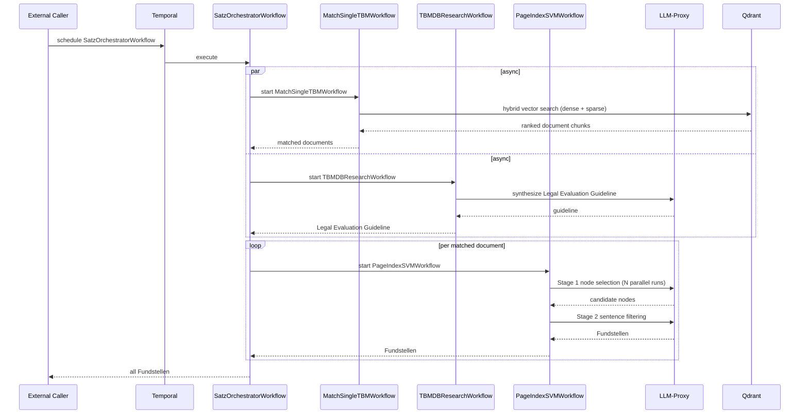

# Modul Suche und Zuordnung (Module Search and Assignment)

A Temporal worker service that matches legal norm requirements (_Tatbestandsmerkmale_ (_TBMs_)) to relevant documents. For each norm sentence (_Satz_), it runs vector-based document retrieval, synthesizes a research report from **Dienst Gesetzesbegründungsdatenbank** and **Dienst juristische Datenbank**, and uses a two-stage LLM pipeline to identify the precise page sections that satisfy each TBM.

## Core Features

- **TBM Matching** — Hybrid dense + sparse vector retrieval against Qdrant using Prüffragen queries against original content, pre-generated summaries, and pre-generated hypothetical questions, fused via reciprocal rank fusion. An additional rule-based approach supplements retrieval for documents selected for specific norms.
- **DB-backed Research** — Queries law databases (**Dienst Gesetzesbegründungsdatenbank**, **Dienst juristische Datenbank**) concurrently and synthesizes a _Legal Evaluation Guideline_ via LLM to guide matching.
- **PageIndex SVM** — Two-stage LLM pipeline (node selection + sentence-level filtering) that returns the exact sections (Fundstellen) within a matched document that cover the TBM.
- **Satz Orchestration** — Per-_Satz_ coordinator that runs TBM matching and DB research asynchronously, then fans out PageIndex SVM children for every matched document.
- **Large-payload S3 Offload** — Temporal payloads exceeding the gRPC size limit are automatically offloaded to VersityGW via the shared `temporal` workspace package.

## Architecture

### Overview

The service is a Temporal worker that registers a task queue (`modul-suche-und-zuordnung`) and processes four workflow types. It has no inbound HTTP API, all execution is triggered by other services via the Temporal SDK. Large payloads are transparently offloaded to **VersityGW (S3)** by the shared `temporal` workspace package so gRPC size limits are never hit. All LLM calls are proxied through the shared **LLM-Proxy**, and all vector searches go through **Vektordatenbank**.

### Workflow Overview



### Components

- **`main.py`** — Worker entrypoint. Registers all workflows and activities against the `modul-suche-und-zuordnung` Temporal task queue.
- **`SatzOrchestratorWorkflow`** — Per-_Satz_ coordinator. Runs `TBMDBResearch` and `MatchSingleTBM` asynchronously, then fans out `PageIndexSVM` children for each matched document (concurrency-limited).
- **`MatchSingleTBMWorkflow`** — Retrieves relevant document chunks for a single TBM using hybrid Qdrant search (dense + sparse vectors) against original content, summaries, and hypothetical questions, and applies reciprocal rank fusion together with a rule-based lookup fallback.
- **`TBMDBResearchWorkflow`** — Queries the **Dienst Gesetzesbegründungsdatenbank** and **Dienst juristische Datenbank** in parallel, then calls an LLM to synthesize a _Legal Evaluation Guideline_ for the TBM.
- **`PageIndexSVMWorkflow`** — Two-stage pipeline: Stage 1 selects candidate document nodes via multi-query LLM consensus; Stage 2 filters at the sentence level within selected nodes.
- **`src/tbm_matching/`** — Retrieval helpers: query building, Qdrant dense/sparse search, RRF fusion, and document-level ranking.
- **`src/pageindex_svm/`** — LLM prompts and sentence utility functions for the PageIndex SVM pipeline.
- **`src/tbm_db_research/`** — **Dienst Gesetzesbegründungsdatenbank** and **Dienst juristische Datenbank** formatting and LLM synthesis prompt construction.
- **`src/config/config.py`** — Static algorithm tunables (model names, batch sizes, top-k values, consensus thresholds).
- **`src/config/env.py`** — Runtime settings loaded from environment variables via pydantic-settings.

### Dependencies

| Service                                          | Role                                                        |
| ------------------------------------------------ | ----------------------------------------------------------- |
| **Temporal** (port 7233)                         | Workflow orchestration engine                               |
| **VersityGW / S3** (port 9000)                       | Large-payload storage for Temporal                          |
| **Vektordatenbank** (port 6333)                  | Vector database for chunk retrieval                         |
| **LLM-Proxy**                                    | Unified gateway for all LLM calls (SVM, synthesis)          |
| **Dienst formale Vollständigkeitsprüfung** (FCS) | Used by `PageIndexSVMWorkflow`                              |
| **Dienst Gesetzesbegründungsdatenbank**          | Law commentary database queried by `TBMDBResearchWorkflow`  |
| **Dienst juristische Datenbank**                 | Court judgments database queried by `TBMDBResearchWorkflow` |

## Getting Started

### Prerequisites

- Python `>=3.13, <3.14`
- `uv` package manager
- Docker & Docker Compose
- The platform services below, started from the monorepo root `docker-compose.yaml`:
  - **Temporal** + Temporal UI
  - **VersityGW** with a `temporal-payloads` bucket
  - **Vektordatenbank**
- A reachable OpenAI-compatible LiteLLM endpoint. Process Compose starts the local `llm-client` workers; this module does not hold LiteLLM credentials.

### Environment Variables

Loaded from the environment or `.env.local` by `src/config/env.py`. The `FCS_`, `QDRANT_`, `LAW_DATABASE_`, `LLM_`, and `TEMPORAL_` groups use pydantic-settings nested delimiter `_`.

| Variable                         | Description                                                      | Default                                                                                                                              | Required |
| -------------------------------- | ---------------------------------------------------------------- | ------------------------------------------------------------------------------------------------------------------------------------ | -------- |
| `TEMPORAL_HOST`                  | Temporal frontend address                                        | `temporal-frontend.temporal.svc.cluster.local:7233` _(deployment-set; `localhost:7233` locally)_                                     | yes      |
| `TEMPORAL_S3_BUCKET_NAME`        | S3 bucket for large Temporal payloads                            | `temporal-payloads`                                                                                                                  | yes      |
| `TEMPORAL_S3_ENDPOINT_URL`       | S3/VersityGW endpoint                                                | `https://s3.<your-domain>` _(deployment-set; `http://localhost:9000` locally)_                                                       | yes      |
| `TEMPORAL_S3_ACCESS_KEY_ID`      | S3 access key                                                    | generated root `.env` _(local)_ / from `temporal-s3-secrets` _(deployment-set)_                                                               | yes      |
| `TEMPORAL_S3_SECRET_ACCESS_KEY`  | S3 secret key                                                    | generated root `.env` _(local)_ / from `temporal-s3-secrets` _(deployment-set)_                                                               | yes      |
| `TEMPORAL_S3_REGION`             | S3 region                                                        | `my-store` _(deployment-set; `eu-west-1` locally)_                                                                                   | yes      |
| `QDRANT_HOST`                    | Qdrant host                                                      | `qdrant.testing-database.svc.cluster.local` _(deployment-set; `localhost` locally)_                                                  | yes      |
| `QDRANT_PORT`                    | Qdrant port                                                      | `6333`                                                                                                                               | yes      |
| `QDRANT_COLLECTION`              | Qdrant collection name                                           | `data` _(deployment-set)_ / `minimal_test_Qwen0.6B_bm25_hybrid` _(local)_                                                            | yes      |
| `LLM_EMBEDDING_MODEL`            | Embedding model name (routed via LiteLLM)                        | `self-hosted/BAAI/bge-m3` _(deployment-set)_                                                                                         | yes      |
| `LLM_PAGEINDEX_SVM_MODEL_STAGE1` | LLM model for PageIndex SVM stage 1 (node selection)             | `self-hosted/gpt-oss-120b` _(deployment-set)_                                                                                        | yes      |
| `LLM_PAGEINDEX_SVM_MODEL_STAGE2` | LLM model for PageIndex SVM stage 2 (sentence filtering)         | `self-hosted/gpt-oss-120b` _(deployment-set)_                                                                                        | yes      |
| `LLM_DB_RESEARCH_MODEL`          | LLM model for TBM DB-research synthesis                          | `self-hosted/gpt-oss-120b` _(deployment-set)_                                                                                        | yes      |
| `FCS_BASE_URL`                   | Dienst formale Vollständigkeitsprüfung URL                       | `http://fcs-module-test.backend-module.svc.cluster.local/api/fcs/v1` _(deployment-set; `http://localhost:18002/api/fcs/v1` locally)_ | yes      |
| `FCS_TIMEOUT`                    | Dienst formale Vollständigkeitsprüfung request timeout (seconds) | `60`                                                                                                                                 | yes      |
| `LAW_DATABASE_DKE_BASE_URL`      | Dienst Gesetzesbegründungsdatenbank base URL                     | `http://localhost:18021`                                                                                                             | yes      |
| `LAW_DATABASE_UT_BASE_URL`       | Dienst juristische Datenbank base URL                            | `http://localhost:18022`                                                                                                             | yes      |
| `OTEL_SERVICE_NAME`              | OpenTelemetry service name                                       | `suche-und-zuordnung` _(deployment-set)_ / `modul-suche-und-zuordnung` _(local)_                                                     | yes      |
| `OTEL_ENDPOINT`                  | OpenTelemetry collector gRPC endpoint                            | `otel-gateway.observability.svc.cluster.local:4317` _(deployment-set; `http://localhost:4317` locally)_                              | yes      |

### Running the Module / Service

#### In Development

Follow the monorepo root [First Local Start](../../README.md#first-local-start). Docker Compose starts the local stateful services. Process Compose starts this worker with the local Qdrant, FCS, law-data, and `llm-client` services. Only the configured LiteLLM endpoint and the Docling port-forward leave the local stack.

Verify the worker in the [Temporal UI](http://localhost:8233). The task queue `modul-suche-und-zuordnung` should have an active poller.

#### In Production

1. **Build and push the Docker image** via the CI/CD pipeline. The `Dockerfile` uses a multi-stage build. The CI/CD pipeline requires a `<REGISTRY_AUTH_TOKEN>` secret set in the pipeline environment for accessing the private Python registry.

2. **Deploy to Kubernetes** using Kustomize from the `k8s/` directory:

   ```bash
   # Staging
   kubectl apply -k k8s/overlays/staging

   # Production
   kubectl apply -k k8s/overlays/production
   ```

   The deployment runs 2 replicas with resource limits of `2 CPU / 2 GiB RAM`. Secrets are injected via `ExternalSecrets` (`k8s/base/externalsecrets.yaml`).

3. **Verify** the worker has registered by checking the Temporal UI in the respective environment. The task queue `modul-suche-und-zuordnung` must show active pollers.

## Monitoring

- **Temporal UI** — Primary tool for inspecting workflow execution history, activity retries, and failures. Available at the environment-specific Temporal endpoint.
- **OpenTelemetry** — The worker is instrumented with OTEL tracing. Set `OTEL_ENDPOINT` to a gRPC collector endpoint (e.g. an OTLP-compatible backend) to enable distributed traces. The service name reported is `OTEL_SERVICE_NAME` (default: `modul-suche-und-zuordnung`).

## Troubleshooting

- **Worker does not appear in Temporal UI** — Check that `TEMPORAL_HOST` is reachable from inside the container (`host.docker.internal:7233` for local Docker setups) and that the task queue name matches exactly.
- **LLM calls fail** — LLM credentials are managed by the `llm-client` workers, not this module. Verify those workers are running and that the configured `LLM_*` model names route correctly through LLM-Proxy.
- **Qdrant connection errors** — Check that the root Docker Compose stack is healthy, then verify `QDRANT_HOST`, `QDRANT_PORT`, and `QDRANT_COLLECTION`.
- **S3 / VersityGW `NoSuchBucket` errors** — Start the root Docker Compose stack; VersityGW creates the `temporal-payloads` bucket during startup.
- **Temporal payload too large** — This is handled automatically by the S3 offload mechanism. If you see unexpected serialization errors, verify that the VersityGW endpoint and credentials are correct.
