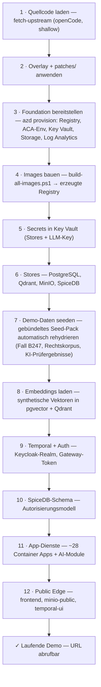

# SPARK Workflow — Azure-Deployment (Delta-Overlay)

Minimales, eigenständiges Overlay, um **SPARK Workflow** — das KI-gestützte Planungs-
und Genehmigungssystem aus openCode — als **kostenoptimierte Demo auf Azure Container
Apps** bereitzustellen. Dieses Repository enthält **ausschließlich das Delta**:
Patches, Azure-Infrastruktur, Deployment-Skripte und Demo-Daten. Der Quellcode der
rund 30 Dienste wird **nicht mitgeführt**, sondern bei Bedarf aus openCode *geladen*
(nur lesend — es wird niemals nach openCode zurückgeschrieben).

> Upstream: [BMDS / Planungs- und Genehmigungsbeschleunigung / SPARK Workflow](https://gitlab.opencode.de/bmds/planungs-und-genehmigungsbeschleunigung/spark-workflow)
> — weiterverbreitet unter der [EUPL v1.2](./LICENSE); die Änderungen liegen in
> [`patches/`](patches/) und [`overlay/`](overlay/).

## Aufbau

| Pfad | Inhalt |
|------|--------|
| [`scripts/fetch-upstream.ps1`](scripts/fetch-upstream.ps1) / `.sh` | openCode-Quellcode laden, Overlay + Patches anwenden |
| [`patches/`](patches/) | die einzigen Änderungen am Upstream-Quellcode |
| [`overlay/`](overlay/) | neue Azure-Dateien für den Upstream-Baum (z. B. `Dockerfile.azure`) |
| [`infra/`](infra/) | Bicep — Foundation + Templates je Komponente |
| [`scripts/azure/`](scripts/azure/) | Deployment-Orchestrierung (`deploy-all.ps1`) + Seeding |
| [`scripts/seed/`](scripts/seed/) | Generatoren für synthetische Demo-Daten |
| [`demo-data/`](demo-data/) | der Beispielfall B247 |
| [`build/images.json`](build/images.json) | Manifest für den Image-Build |
| [`.github/workflows/`](.github/workflows/) | mirror, build-and-publish (→ GHCR), deploy-to-azure |
| [`docs/azure-demo.md`](docs/azure-demo.md) | Betriebshandbuch |

## Voraussetzungen

Für das Deployment (`azd up`) müssen folgende Werkzeuge lokal installiert und im
`PATH` verfügbar sein. Die gesamte Orchestrierung läuft über PowerShell-Skripte —
auch unter Linux/macOS wird daher `pwsh` benötigt.

| Werkzeug | Version | Wofür |
|----------|---------|-------|
| [Azure Developer CLI (`azd`)](https://github.com/Azure/azure-dev) | aktuell | steuert `azd up` — Provisionierung (`infra/main.bicep`) und die Deploy-Hooks |
| [Azure CLI (`az`)](https://github.com/Azure/azure-cli) | aktuell | Key Vault, ARM-Deployments und REST-Aufrufe in allen Deploy-Skripten |
| [PowerShell (`pwsh`)](https://github.com/PowerShell/PowerShell) | 7.0+ | Ausführungsumgebung sämtlicher Orchestrierungs-Skripte (`scripts/**/*.ps1`) |
| [Git](https://git-scm.com/downloads) | aktuell | `fetch-upstream` klont den openCode-Quellcode (shallow) |
| [Python](https://www.python.org/downloads/) | 3.13 | erzeugt `infra/app-env.json` neu und führt die Seeding-Skripte aus (`.venv` im Repo-Wurzelverzeichnis) |
| [Docker](https://docs.docker.com/get-docker/) | aktuell | **für den Selbst-Build der Images** — ohne Zugriff auf eine vorgefüllte Registry baut `build-all-images.ps1` alle ~30 Images (inkl. Frontend-SPA) aus dem Quellcode in die eigene Registry |

Außerdem erforderlich:

- eine **Azure-Subscription** mit Berechtigung zum Anlegen von Ressourcen (Container
  Apps, Key Vault, Storage, Log Analytics) sowie eine angemeldete Sitzung
  (`azd auth login`, bei Bedarf zusätzlich `az login`);
- ein **OpenAI- oder Azure-OpenAI-Schlüssel** für `SPARK_LLM_API_KEY` — die
  Token-Kosten werden separat abgerechnet.

## Schnellstart

> **Ein Befehl, vollständig aus dem Quellcode — inklusive Demo-Daten.** `azd up` lädt den
> openCode-Quellcode (preprovision-Hook), provisioniert die Foundation, **baut die ~30 Images aus
> dem Quellcode in die neu angelegte Registry** (nur wenn sie dort fehlen) und rollt den App-Tier
> aus. Die **Demo-Daten sind im Repo gebündelt** ([`demo-data/seed-pack.tar.gz`](demo-data/seed-pack.tar.gz))
> und werden dabei **automatisch** eingespielt — kein externer Download, kein Seed-Schritt, keine
> `.env`. Fall **B247** samt Rechtskorpus und KI-Prüfergebnissen ist danach sofort sichtbar.
>
> **Voraussetzung für den Selbst-Build:** lokal laufendes **Docker** (BuildKit). Der Erstlauf dauert
> wegen des Image-Builds ~30–40 Min. Wer eine vorgefertigte Registry nutzt, setzt `SPARK_IMAGE_REGISTRY`
> — dann entfällt der Build.

```bash
# Anmelden, azd-Umgebung anlegen, LLM konfigurieren.
azd auth login
azd env new spark-demo
azd env set SPARK_LLM_BASE_URL "https://<ressource>.openai.azure.com/openai/v1/"
azd env set SPARK_TEXT_MODEL   "<ihr-chat-deployment>"
$env:SPARK_LLM_API_KEY = "<openai-oder-azure-openai-schlüssel>"   # bash: export SPARK_LLM_API_KEY=...

# Alles aus dem Quellcode aufbauen: Quellcode → Foundation → Images bauen → App-Tier → Seed.
azd up
```

Der Lauf ist **idempotent**: Bricht er ab (z. B. Netzwerk oder Docker-Build), einfach `azd provision`
erneut ausführen — bereits gebaute Images und bestehende Ressourcen werden übersprungen. Wer die
Images lieber getrennt baut, kann Schritt für Schritt vorgehen (siehe [`docs/azure-demo.md`](docs/azure-demo.md)).

Das vollständige Betriebshandbuch (Seeding, Zugriff, Pause/Resume, Kosten, Sicherheit) steht
in [`docs/azure-demo.md`](docs/azure-demo.md).

## Ablauf: von der Quelle zur laufenden Demo (E2E)

Von der Quelle bis zur laufenden Demo durchläuft die Anwendung zwei Phasen — das Vorbereiten
(Quellcode, Registry, Images) und das Ausrollen des App-Tiers:



Alle zwölf Schritte laufen in **einem `azd up`**: die Hooks in [`azure.yaml`](azure.yaml) führen
`fetch-upstream` (preprovision) und `deploy-all.ps1` (postprovision) aus; letzteres baut fehlende
Images selbst und spielt das gebündelte Seed-Pack ein. Die zwei Phasen sind nur die logische Gliederung:

- **Phase A · Vorbereiten:** Quellcode von openCode laden, `patches/` anwenden, Foundation samt
  Registry provisionieren und die Images aus dem Quellcode in diese Registry bauen (Schritte 1–4).
- **Phase B · App-Tier ausrollen:** Secrets erzeugen, Stores hochfahren, Demo-Daten und Embeddings
  seeden, Temporal/Auth/SpiceDB einrichten, App-Dienste und Public-Edge veröffentlichen (Schritte 5–12).

## Kosten & Pausieren

Die Demo läuft auf **Azure Container Apps (Consumption)** plus Container Registry, Key Vault, Storage
und Log Analytics. Der frisch ausgerollte Stand umfasst **37 Container Apps mit zusammen 19 vCPU /
38 GiB**, die alle auf **min. = max. 1 Replik** stehen (kein Scale-to-Zero) — die dauerhaft
allozierte Compute ist damit der mit Abstand größte Kostentreiber. **Wird die Demo nicht gebraucht,
lässt sie sich auf ~0 € Compute pausieren.**

| Zustand | Compute (ACA) | Übrige Dienste | Grobe Größenordnung* |
|---------|---------------|----------------|----------------------|
| **Laufend** (37 Apps min-1, 19 vCPU / 38 GiB, Demo-Idle 24/7) | ~300–500 €/Monat | ACR ~4 € + Storage/KV/Log Analytics | **~320–540 €/Monat** |
| **Pausiert** (alle Apps auf 0 skaliert) | ~0 € | ACR Basic ~4 € + Snapshot-Share/KV/LA (gering) | **~10–15 €/Monat** |
| **Gelöscht** (`az group delete`) | 0 € | 0 € | **0 €** |

\* **Schätzung** auf Basis der tatsächlich ausgerollten Allokation (19 vCPU / 38 GiB, alle min-1) und
der veröffentlichten ACA-Consumption-Sätze (vCPU/Memory je Sekunde, abzüglich der monatlichen
Gratis-Kontingente von 180 000 vCPU-s / 360 000 GiB-s / 2 Mio. Anfragen). Live-Einzelpreise
(EUR, North Europe, Retail-API): ACA-Anfragen **0,351 €/Mio.**, ACR Basic **0,146 €/Tag**,
Log-Analytics-Ingestion **2,42 €/GB**, Azure Files Std-LRS **0,053 €/GB·Monat**, Key Vault
**0,026 €/10 000 Operationen**. Unter echter Last steigen die Compute-Kosten (Active-Sätze); die
tatsächlichen Zahlen liefern der [Azure Pricing Calculator](https://azure.microsoft.com/pricing/calculator/)
und Azure Cost Management. **LLM-Token** (OpenAI / Azure OpenAI) werden vom jeweiligen Anbieter
**separat** abgerechnet.

### Pausieren / Fortsetzen (Snapshot-basiert)

Die vier Stores (PostgreSQL, Qdrant, MinIO, SpiceDB) laufen auf **ephemerem** Speicher — beim
Skalieren auf 0 gingen ihre Daten verloren. Deshalb sichert das Pause-Skript den Zustand **vorher** in
die dauerhafte `snapshots`-Azure-Files-Freigabe und stellt ihn beim Fortsetzen wieder her:

```bash
# Pausieren: Stores snapshotten, dann ALLE Apps auf min-Replicas 0 (Compute ~0 €).
pwsh ./scripts/azure/pause-demo.ps1  -ResourceGroup <rg>

# Fortsetzen: Stores starten, aus dem Snapshot rehydrieren, Temporal/Auth + App-Tier hochfahren.
pwsh ./scripts/azure/resume-demo.ps1 -ResourceGroup <rg>
```

`pause-demo.ps1` schreibt die vorherige Skalierung nach `scripts/azure/.demo-scale-state.json`, sodass
`resume-demo.ps1` sie exakt wiederherstellt (fehlt die Datei, wird min-1 angenommen). Endgültiger
Abbau ohne Wiederkehr: `az group delete -n <rg>`.

## Demo-Szenario

Das Deployment wird mit einem vollständigen, in sich geschlossenen **synthetischen
Fall** vorbefüllt, damit die Demo sofort durchgängig funktioniert: ein fiktives
Planfeststellungsverfahren für eine Bundesfernstraße — **„Bundesstraße B 247,
Ortsumgehung Musterhausen"** (Vorgang `B247-DEMO2`).

Sämtliche Orts-, Personen-, Flur-, Akten- und Fristangaben sind **frei erfunden**
(*Musterhausen* = „Beispielort"); es liegen **keine echten personenbezogenen Daten**
vor — die Demo ist überall unbedenklich einsetzbar. Struktur, Sprache und Rechtsbezüge
sind realen Planfeststellungsbeschlüssen für Bundesfernstraßen nachgebildet; die
zitierten Normtexte (z. B. § 44 BNatSchG, 16. BImSchV, § 41 BImSchG) sind wortgetreu
der amtlichen Fassung entnommen. Quelle:
[`demo-data/bundesstrasse-b247-ou-musterhausen/`](demo-data/bundesstrasse-b247-ou-musterhausen/).

**Der Fall in Kürze:** eine rund 6,8 km lange Ortsumgehung mit den für ein solches
Vorhaben typischen Konfliktfeldern — Verkehrslärm (16. BImSchV), Artenschutz
(§ 44 BNatSchG), Gewässer (WHG), eine FFH-/Natura-2000-Vorprüfung und Landwirtschaft.
Er umfasst **7 Planunterlagen**: Inhaltsverzeichnis, Erläuterungsbericht,
Planfeststellungsbeschluss, schalltechnische Untersuchung, Artenschutzbeitrag (saP),
Grunderwerbsverzeichnis und UVP-Bericht (Zusammenfassung). Zusammen mit dem
vorbefüllten Rechtskorpus (Normtexte sowie synthetische Embeddings für
Gesetzesbegründungen und Rechtsprechung) durchläuft er die gesamte Pipeline:
Dokumentenextraktion, formale und materielle Vollständigkeitsprüfung, Normen-Zuordnung
und quellenbelegte Fundstellen.

### Was die Demo zeigt

**1 · Verfahrensübersicht** — der Vorgang, seine 7 Antragsunterlagen und das Team.


**2 · Formale Vollständigkeitsprüfung** — die KI gleicht das Inhaltsverzeichnis mit den
hochgeladenen Unterlagen ab, prüft, welche Unterlagen der Verfahrenstyp benötigt, weist
auf Plausibilitätsprobleme hin und klassifiziert jede Unterlage nach Typ und Thema.


**3 · Materielle Vollständigkeitsprüfung** — die Unterlagen werden gegen **39
Rechtsthemen** geprüft (Artenschutz, Immissionsschutz, Natura 2000, Gewässer,
Entschädigung, …), jeweils mit den einschlägigen Rechtsgrundlagen.


**4 · Detailansicht mit belegten Fundstellen** — für ein Thema wie *Artenschutzrecht*
verknüpft die KI den Artenschutzbeitrag mit den einschlägigen **BNatSchG**-Normen und
zeigt die tragenden Textpassagen (*Fundstellen*). Jede KI-Ausgabe bleibt auf eine
Quelle zurückführbar — der Mensch behält die Kontrolle.


## Synchronisierung mit openCode

`scripts/fetch-upstream` klont openCode flach (shallow) an einem festen Tag, kopiert den
Quellcode in das Wurzelverzeichnis des Repositorys — **ohne dabei Delta-Dateien zu
überschreiben** —, legt die Overlay-Dateien darüber und wendet `patches/` an. Über
`-Ref` lässt sich auf ein neueres Upstream-Release wechseln; passt ein Patch nicht mehr,
bricht `patches/apply-patches` mit einer klaren Meldung ab, damit die Änderung
abgeglichen werden kann. Es ist dieselbe einseitige, nur-lesende Beziehung, die auch der
Workflow `mirror-upstream` nutzt.

## Lizenz

Es gelten zwei Lizenzen:

- Der Upstream-Quellcode von **SPARK Workflow** (aus openCode geladen) und die Änderungen
  daran in [`patches/`](patches/) stehen unter der **[EUPL-1.2](./LICENSE)** (die Liste
  der Änderungen enthält [`patches/README.md`](patches/README.md)).
- Alle übrigen Bestandteile dieses Repositorys — [`infra/`](infra/), [`scripts/`](scripts/),
  [`overlay/`](overlay/), [`.github/`](.github/), [`build/`](build/),
  [`azure.yaml`](azure.yaml), [`docs/`](docs/) und [`demo-data/`](demo-data/) — stehen
  unter der **[MIT-Lizenz](./LICENSE-MIT)**.

| Pfad | Lizenz |
|------|--------|
| `patches/` (Änderungen am Upstream) | EUPL-1.2 |
| `infra/` · `scripts/` · `overlay/` · `.github/` · `build/` · `azure.yaml` · `docs/` · `demo-data/` | MIT |
