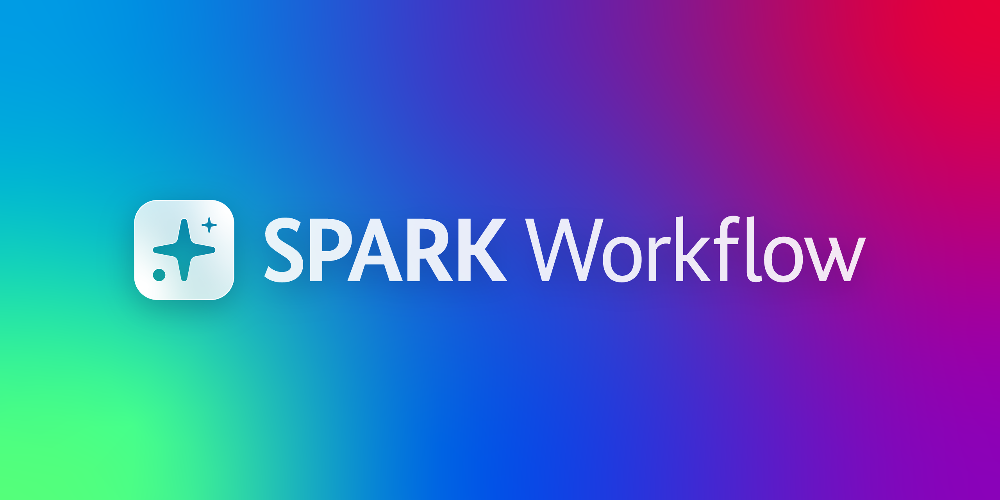

# SPARK Workflow 

Welcome to the repository of the application **SPARK Workflow**!

A detailed description of the project **SPARK Workflow** and the features of **SPARK Workflow** can be found on [openCode](https://opencode.de/de/software/spark-workflow-10117). Additional information for public authorities can be found on the [website](https://bmds.bund.de/themen/kuenstliche-intelligenz/ki-in-der-verwaltung/spark) of the BMDS.

For step-by-step guidance on using the application, see the [user manual (DE)](./docs/handbuch/). If you are interested in operating the solution, [the technical product data sheet (DE)](./docs/SPARK_Workflow_Technischer_Produktsteckbrief_v0-3-0.pdf) is a good starting point. An overview of all documentation in this repository is available in the [documentation index](./docs/README.md).

**SPARK Workflow** was released as open source in consecutive releases.

> [!WARNING]
> Please note the security notice below.

## What it is, what it isn't

**SPARK Workflow is ...**

* an operational assistance tool for complex administrative planning and permitting procedures. It helps public authorities handle large volumes of application materials, prepare information for review, and support key steps of the procedure.

* based on initial concepts from the use cases of approval procedures for federal highways or hydrogen pipelines (Planfeststellungsverfahren für Bundesfernstraßen oder im Bereich des Wasserstoffkernnetzes). Due to its configurability and modular architecture, it can be adapted to other use cases.

* built to reduce administrative workload while keeping humans in control and accountable. Every AI output has to be actively accepted, edited, or discarded.

* distinctive in embedding AI directly into the authority's established, legally grounded working process. Results are shown in a user interface designed together with the officials who use it.

**SPARK Workflow is not ...**

* an autonomous system. It supports decision-making but does not decide on its own, and no output takes effect without human review.

* infallible. AI is probabilistic and makes mistakes, just as people do. Which is why human oversight is part of every step.

## Architecture
SPARK Workflow is implemented as a containerized service architecture and is natively designed to run on any Kubernetes-compatible infrastructure. See the [system architecture (GER)](./docs/system-architecture) for more information.

The TypeScript backend runs as one application, `spark-backend`, assembled from separate feature packages. The AI modules run as separate Python services that the backend starts through Temporal workflows. The [backend README](./02-backend/apps/spark-backend/README.md) explains how it is built and how to configure and run it.

## Upgrading from Earlier Versions

> [!IMPORTANT]
> SPARK Workflow 0.3.0 cannot be installed as an upgrade of an earlier version.

Version 0.3.0 introduces changes to the data structure that are not compatible with earlier versions of SPARK Workflow. Procedure data from earlier versions (0.2.x and older) therefore cannot be migrated.

If you operate an earlier version, set up SPARK Workflow 0.3.0 as a new installation. Back up any data you still need before switching, as it will not be available in the new installation. For the required steps, see "Upgrading from 0.2.x" in the [release notes](./RELEASE_NOTES.md).

## Getting Started

### Prerequisites

- Docker with Docker Compose
- [Bun 1.4.0](https://bun.sh/docs/installation)
- [uv](https://docs.astral.sh/uv/getting-started/installation/)
- [Process Compose v1.76.1](https://github.com/F1bonacc1/process-compose/releases/tag/v1.76.1)
  (or a later release explicitly verified to contain the readiness-restart fix from upstream #403
  and the readiness-health assignment fix from upstream #414)
- Node.js 24
- [pnpm 10.30.2](https://pnpm.io/installation)
- An OpenAI-compatible LLM provider, for example LiteLLM

### Dependencies

The local development stack provides the shared platform services used by the modules:

- Temporal for workflow execution and the workflow UI
- VersityGW/S3 for document and object storage
- Qdrant for vector storage
- PostgreSQL-backed application databases
- Keycloak and SpiceDB for local authentication and authorization
- UNO/LibreOffice for document export and Office-file conversion

The local setup starts shared infrastructure with Docker Compose and runs the application services, workers, and frontend on the host with Process Compose.

### External AI Services

The local stack does not start an LLM provider. During secret generation, provide an OpenAI-compatible base URL, API key, chat model, embedding model, and vision model.

Document parsing uses [Docling Serve](https://github.com/docling-project/docling-serve). Process Compose runs its CPU image as a local container on `localhost:5001` and waits for its health endpoint before starting the extraction workers. The image is several gigabytes, so pull it once before the first start:

```bash
docker pull quay.io/docling-project/docling-serve-cpu:v1.14.3
```

To use another Docling Serve instance, set `DOCLING_COMMAND` in the root `.env` to a command that makes it reachable on `localhost:5001`.

### First Local Start

Generate the private root `.env` file first. The script prompts for the local login user and external LiteLLM settings. You can export those variables before running the command to skip their prompts. Every local infrastructure secret is generated fresh. The login user is created automatically in the local Keycloak when the infrastructure starts. The script refuses to overwrite an existing `.env`.

Existing `.env` files remain supported during the OIDC naming migration. Rename
`KEYCLOAK_BOOTSTRAP_ADMIN_PASSWORD` to `OIDC_BOOTSTRAP_ADMIN_PASSWORD` and
`LOCAL_KEYCLOAK_CLIENT_SECRET` to `LOCAL_OIDC_CLIENT_SECRET` while preserving their
values. Compose and Process Compose accept the legacy names until the bridge is
removed; a nonempty OIDC value takes precedence when both names exist. This key
rename does not require regenerating credentials or deleting Docker volumes.

```bash
uv run poe create-secrets
```

If you regenerate `.env`, stop the local infrastructure and remove its volumes first. The local stateful dependencies persist the generated credentials.

```bash
docker compose --env-file .env down --volumes --remove-orphans
rm .env
uv run poe create-secrets
```

Install the pinned TypeScript backend workspace and frontend dependencies:

```bash
pnpm install --frozen-lockfile
cd 01-frontend/frontend
pnpm install --frozen-lockfile
cd ../..
```

Start shared infrastructure:

```bash
docker compose --env-file .env up --wait
```

VersityGW uses the `S3_ACCESS_KEY_ID` and `S3_SECRET_ACCESS_KEY` generated by
`create-secrets`. It creates `dms-local`, `quarantine-bucket`, and
`temporal-payloads` in its `versitygw_data` volume before serving S3 on port 9000.
The local region is `eu-west-1`, and browser uploads use the configured CORS policy allowing all origins.

Start application services and the frontend:

```bash
uv run poe process-compose
```

Verify `process-compose version` reports at least the vetted v1.76.1 release before starting.
Releases through v1.75.2 can stop a process after a fatal readiness probe without launching the
configured replacement, while v1.76.0 does not persist successful readiness health for dependent
processes. The quickstart restarts readiness-supervised long-lived processes after probe-driven
shutdown while deliberate process and whole-project stops remain terminal; one-shot cleanup
jobs run once. Those long-lived entries intentionally wait 21 seconds before replacement after a
20-second force-stop deadline, so an expired prior-generation timer cannot kill the replacement.

Process Compose loads the root `.env` by default. Keep it limited to shared local secrets, external LiteLLM settings, and the fixed local Docling address. Components retain tracked `.env.local` defaults for direct startup; `process-compose.yaml` overrides the shared and cutover-specific values for the composed stack.

Each SPARK Workflow backend process runs the same aggregate Elysia route graph and initializes the shared
schema before readiness. Process Compose keeps the former service ports for local acceptance:
Vite sends each owner-specific `/api/...` prefix to its corresponding SPARK Workflow backend process, while
unmatched aggregate routes use port 18000. The selected Temporal workers still run only in their
configured pools. Law-data services and module-cluster workers stay Python.

The law database (gesetze-normen) is seeded with `scripts/data/gesetze-normen-seed.sql.gz` when Postgres initializes a fresh volume. The plausibility checks rely on this data.

### Open the Application

Open the frontend at:

```text
http://localhost:3000/app/
```

You are redirected to the local Keycloak login. Sign in with the email and password you chose during `uv run poe create-secrets`.

Useful local endpoints:

- Frontend: `http://localhost:3000/app/`
- Keycloak admin console: `http://localhost:9090`
- Temporal UI: `http://localhost:8233`
- S3 API: `http://localhost:9000`
- Qdrant API: `http://localhost:6333`
- Process Compose API: `http://localhost:8080`

### Verify the Local Stack

Uploads must supply a known content length or use S3 multipart upload, because
VersityGW rejects ordinary HTTP chunked PUTs without a declared size. DMS and
both Temporal codecs keep optional SDK checksum trailers disabled with
`WHEN_REQUIRED`.

Exercise the application through the frontend:

1. Open `http://localhost:3000/app/`, sign in, and create a Verfahren.
2. Upload a ZIP file in the `Unterlagen` area, open the Verfahren, and select `Formale Vollständigkeitsprüfung`.
3. Click `KI-Analyse starten`. Wait until the FVP workflow and its current children complete and the uploaded documents have assignments in the frontend. This verifies document extraction, result insertion, Qdrant indexing, document-type matching, table-of-contents matching, and plausibility checks.
4. Open `Materielle Vollständigkeitsprüfung` and choose a topic with at least one `Unterlage`. Select `Rechtsgrundlage`, open an available norm, and click the purple `KI starten` button. The check passes when the UI shows the running state and the corresponding Suche-und-Zuordnung workflow completes in Temporal.
5. Open `Behörden- und Öffentlichkeitsbeteiligung` and upload an objections ZIP. The check passes when the Beteiligungseingänge and their extracted arguments appear in the frontend.
6. Open `Redaktion Planfeststellungsbeschluss`, select the `Beschluss` panel, and click `Exportieren`. The PDF preview must load and `Als .pdf herunterladen` must return a valid PDF.

Use the owner-specific frontend paths for these checks. Do not replace them with direct Resource or generic node calls.

List running workflows and inspect one execution from the terminal:

```bash
docker compose exec -T temporal-init temporal workflow list \
  --address temporal:7233 \
  --query 'ExecutionStatus = "Running"'
docker compose exec -T temporal-init temporal workflow describe \
  --address temporal:7233 \
  --workflow-id <workflow-id>
```

Inspect the corresponding worker without leaving Process Compose:

```bash
process-compose process logs <worker-name> --tail 200
```

### Backend images

The TypeScript backend produces the `spark-backend` image with
`02-backend/apps/Dockerfile`. Each app's `dist` directory is the complete build
context. The image build does not install application dependencies.

```bash
docker build \
  -f 02-backend/apps/Dockerfile \
  -t spark/spark-backend \
  02-backend/apps/spark-backend/dist
```

Python services in `04-shared-services` and `05-modulcluster` retain their own Dockerfiles.

The frontend, TypeScript backend, and Python service Dockerfiles accept
`--build-arg BASE_IMAGE=<image>` to override their final base image.
Multi-stage Dockerfiles also accept `--build-arg BASE_IMAGE_DEV=<image>` for
the builder image or, in the TypeScript backend, the image that provides Bun.
Omitting these arguments uses the tags and digests declared in each Dockerfile.

## Security Notice
> [!WARNING]
>This project provides a full-stack application for AI-assisted planning and approval workflows, including frontend, AI processing modules, and supporting backend services. It is designed to integrate into an existing platform infrastructure and to leverage the services and security controls already established within that platform. It does not include a self-contained, production-ready security configuration.
>
>The application is developed and maintained with security in mind. A production deployment depends on platform infrastructure components outside the scope of this repository. The operator is responsible for providing, configuring, and hardening these components in accordance with applicable policies and the risk profile of the target environment. This includes, among others:
>- **Identity & Authorization**: Integration with an OIDC- and OAuth 2.0-compliant identity and authorization service and IAM. Roles and permissions are defined within the application and may require adaptation to internal requirements.
>- **Service Communication**: Deployment within an mTLS-capable service mesh. TLS certificate lifecycle management at the platform level.
>- **Secrets & Key Management**: All secrets, credentials, and cryptographic keys must be managed via a dedicated platform-level solution.
>- **Data Storage**: The deployment uses PostgreSQL and S3-compatible object storage; the Docling processing stack also uses Redis. Infrastructure-level encryption of all storage backends is assumed. Additional encryption at the application or field level must be implemented as required by the operator's crypto concept.
>- **Observability**: The application exposes Prometheus-compatible metrics and supports OpenTelemetry-compatible telemetry. The application provides an audit log covering user actions and AI operations. Central aggregation, forwarding, and evaluation of logs must be provided by the operator's observability platform.
>
>Beyond infrastructure components, the operator is solely responsible for the secure and orderly operation of the deployment. This includes, among others:
>- **Access Control & Administration**: Restricting access to internal services, administrative interfaces, and management endpoints to authorized personnel and systems only. Applying the principle of least privilege throughout.
>- **Network Security**: Enforcing IP allowlisting, network segmentation, and firewall rules appropriate to the target environment. Configuring security-relevant HTTP response headers (e.g. Content-Security-Policy, Strict-Transport-Security, X-Frame-Options) at the edge.
>- **Resource & Capacity Management**: Ensuring that storage volumes, databases, log targets, and message queues do not exhaust available capacity. Implementing appropriate retention policies, log rotation, and alerting.
>- **Monitoring & Incident Response**: The application's built-in audit log provides a record of user and AI activity but does not replace centralized log aggregation and analysis. Operating monitoring, alerting, and centralized log evaluation for all relevant system components. Establishing and maintaining incident response and escalation processes is the responsibility of the operator.
>- **Patch & Vulnerability Management**: Keeping all platform components, base images, and dependencies up to date. Tracking relevant security advisories and applying patches in a timely manner.
>- **Backup & Recovery**: Implementing and regularly testing backup and disaster recovery procedures for all stateful components.
>
>Default values, example configurations, and supporting scripts are provided for development, testing, and integration purposes only and must not be used in production without review and adaptation. A dedicated security review of the full deployment is required before use in any non-development environment. Secure operation is the sole responsibility of the respective operator.

## Troubleshooting

<details>
<summary>A TypeScript API exits immediately with a TypeBox parse error</summary>

Each app under `02-backend/apps` parses a required `src/env.ts` contract with no parser defaults. Process Compose must set every required key. Do not add fallbacks in the parser. Compare the failing process in `process-compose.yaml` with that app's environment table in its README.

</details>

<details>
<summary>PostgreSQL won't start / application services are crashing</summary>

This is most likely because the `.env` file with secrets hasn't been created yet. Create it by running:

```bash
uv run poe create-secrets
```

To regenerate `.env`, follow the stop, volume removal, and regeneration sequence in [First Local Start](#first-local-start).

</details>

<details>
<summary>Why does Temporal store large intermediate states externally in S3
and pass only references to the workflows?</summary>

In SPARK Workflow, Temporal stores its data in Postgres. Postgres can work with large amounts of data, but it's not recommended. Because of that, we made the deliberate design decision to enforce a 2MB limit on inputs and outputs in Temporal.

Note: The AI-assisted steps in SPARK Workflow are not a low-latency solution. Workflows can run over several hours. In this context, the latency produced by the coupling of the Temporal Workflows and S3 is negligible.

</details>

<details>
<summary>The state-management of the local setup is fragile due to poor decoupling of configuration and persistent state.</summary>

The Docker setup is intended as a low-barrier entry point for getting started with SPARK Workflow. Its goal is to make testing SPARK Workflow as easy as possible. It is explicitly not production ready and not designed for a long-term setup. To deploy SPARK Workflow in a production environment, use the [Helm charts](/helm/charts/README.md).
</details>

<details>
<summary>The source code does not allow legal norms to be generated or updated independently from primary sources.</summary>

The [Laws and Norms Database service](04-shared-services/db-services/gesetze-normen-db-service) makes it possible to retrieve and update legal norms from public federal and state law databases using parsers. Further information can be found in the [README](04-shared-services/db-services/gesetze-normen-db-service/README.md).

For the first local setup, a database seed for the Gesetze- und Normendatenbank (Law and Norm Database) has been provided. This was done to decrease the barrier to entry for the open-source community. This is **not a production-ready configuration**. Please note the security notice above for more information.

</details>

## License

This project is licensed under the EUPL-1.2.

It also includes third-party components under other open source licenses.
See [THIRD_PARTY_LICENSES.md](./THIRD_PARTY_LICENSES/THIRD_PARTY_LICENSES.md) for details.
