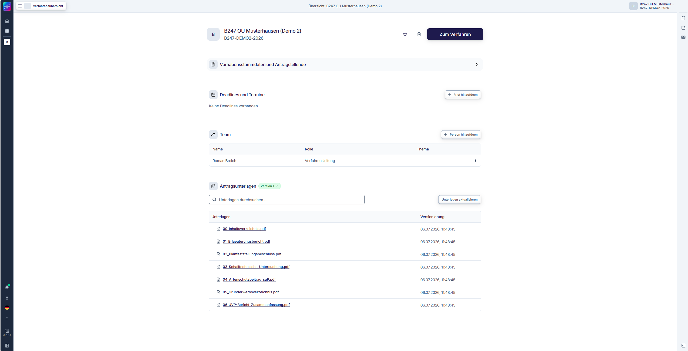
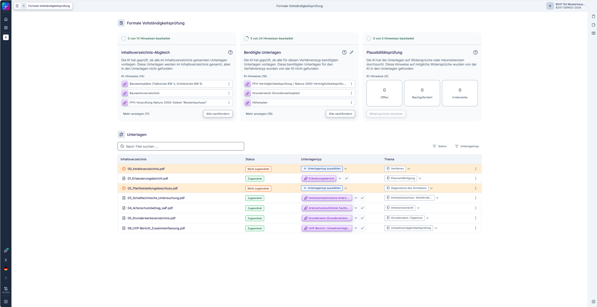
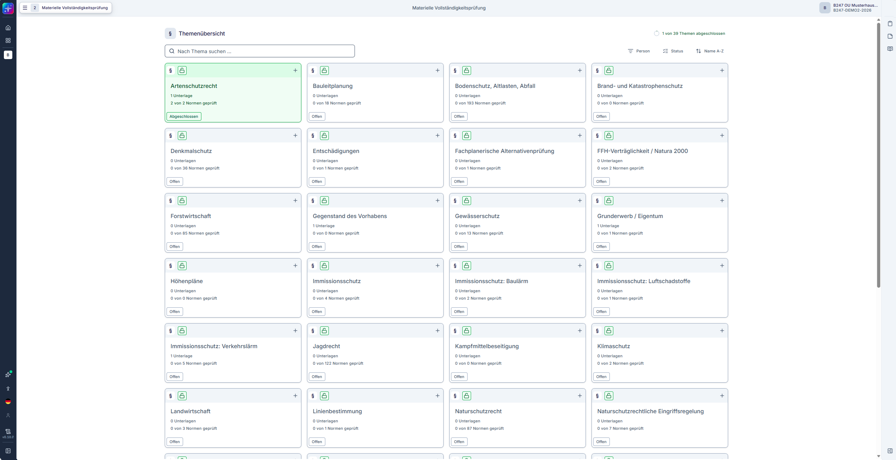
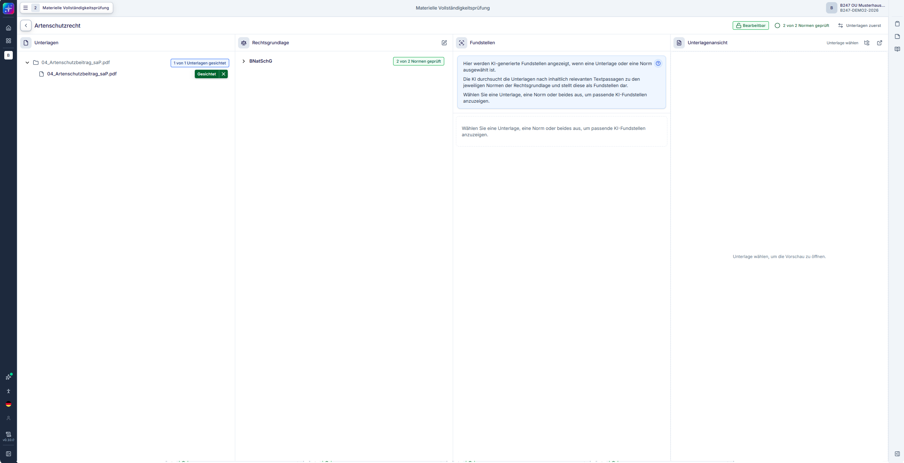

# SPARK Workflow — Azure-Deployment (Delta-Overlay)

Minimales, eigenständiges Overlay, um **SPARK Workflow** — das KI-gestützte Planungs-
und Genehmigungssystem aus openCode — als **kostenoptimierte Demo auf Azure Container
Apps** bereitzustellen. Dieses Repository enthält **ausschließlich das Delta**:
Patches, Azure-Infrastruktur, Deployment-Skripte und Demo-Daten. Der Quellcode der
rund 30 Dienste wird **nicht mitgeführt**, sondern bei Bedarf aus openCode *geladen*
(nur lesend — es wird niemals nach openCode zurückgeschrieben).

> Upstream: [BMDS / Planungs- und Genehmigungsbeschleunigung / SPARK Workflow](https://gitlab.opencode.de/bmds/planungs-und-genehmigungsbeschleunigung/spark-workflow)
> — weiterverbreitet unter der [EUPL v1.2](./LICENSE); die Änderungen liegen in
> [`patches/`](patches/) und [`overlay/`](overlay/).

## Aufbau

| Pfad | Inhalt |
|------|--------|
| [`scripts/fetch-upstream.ps1`](scripts/fetch-upstream.ps1) / `.sh` | openCode-Quellcode laden, Overlay + Patches anwenden |
| [`patches/`](patches/) | die einzigen Änderungen am Upstream-Quellcode |
| [`overlay/`](overlay/) | neue Azure-Dateien für den Upstream-Baum (z. B. `Dockerfile.azure`) |
| [`infra/`](infra/) | Bicep — Foundation + Templates je Komponente |
| [`scripts/azure/`](scripts/azure/) | Deployment-Orchestrierung (`deploy-all.ps1`) + Seeding |
| [`scripts/seed/`](scripts/seed/) | Generatoren für synthetische Demo-Daten |
| [`demo-data/`](demo-data/) | der Beispielfall B247 |
| [`build/images.json`](build/images.json) | Manifest für den Image-Build |
| [`.github/workflows/`](.github/workflows/) | mirror, build-and-publish (→ GHCR), deploy-to-azure |
| [`docs/azure-demo.md`](docs/azure-demo.md) | Betriebshandbuch |

## Schnellstart

```bash
# 1. openCode-Quellcode laden + Overlay & Patches in dieses Repo anwenden.
pwsh ./scripts/fetch-upstream.ps1          # oder: ./scripts/fetch-upstream.sh

# 2. In die eigene Azure-Subscription deployen.
azd auth login
$env:SPARK_LLM_API_KEY = "<openai-oder-azure-openai-schlüssel>"   # bash: export SPARK_LLM_API_KEY=...
azd env set SPARK_LLM_BASE_URL "https://<ressource>.openai.azure.com/openai/v1/"
azd env set SPARK_TEXT_MODEL   "<ihr-chat-deployment>"
azd up
```

Der Ein-Klick-Workflow **deploy-to-azure** und die Image-Pipeline **build-and-publish**
führen `fetch-upstream` automatisch aus. Das vollständige Betriebshandbuch (Seeding,
Zugriff, Pause/Resume, Kosten, Sicherheit) steht in
[`docs/azure-demo.md`](docs/azure-demo.md).

## Demo-Szenario

Das Deployment wird mit einem vollständigen, in sich geschlossenen **synthetischen
Fall** vorbefüllt, damit die Demo sofort durchgängig funktioniert: ein fiktives
Planfeststellungsverfahren für eine Bundesfernstraße — **„Bundesstraße B 247,
Ortsumgehung Musterhausen"** (Vorgang `B247-DEMO2`).

Sämtliche Orts-, Personen-, Flur-, Akten- und Fristangaben sind **frei erfunden**
(*Musterhausen* = „Beispielort"); es liegen **keine echten personenbezogenen Daten**
vor — die Demo ist überall unbedenklich einsetzbar. Struktur, Sprache und Rechtsbezüge
sind realen Planfeststellungsbeschlüssen für Bundesfernstraßen nachgebildet; die
zitierten Normtexte (z. B. § 44 BNatSchG, 16. BImSchV, § 41 BImSchG) sind wortgetreu
der amtlichen Fassung entnommen. Quelle:
[`demo-data/bundesstrasse-b247-ou-musterhausen/`](demo-data/bundesstrasse-b247-ou-musterhausen/).

**Der Fall in Kürze:** eine rund 6,8 km lange Ortsumgehung mit den für ein solches
Vorhaben typischen Konfliktfeldern — Verkehrslärm (16. BImSchV), Artenschutz
(§ 44 BNatSchG), Gewässer (WHG), eine FFH-/Natura-2000-Vorprüfung und Landwirtschaft.
Er umfasst **7 Planunterlagen**: Inhaltsverzeichnis, Erläuterungsbericht,
Planfeststellungsbeschluss, schalltechnische Untersuchung, Artenschutzbeitrag (saP),
Grunderwerbsverzeichnis und UVP-Bericht (Zusammenfassung). Zusammen mit dem
vorbefüllten Rechtskorpus (Normtexte sowie synthetische Embeddings für
Gesetzesbegründungen und Rechtsprechung) durchläuft er die gesamte Pipeline:
Dokumentenextraktion, formale und materielle Vollständigkeitsprüfung, Normen-Zuordnung
und quellenbelegte Fundstellen.

### Was die Demo zeigt

**1 · Verfahrensübersicht** — der Vorgang, seine 7 Antragsunterlagen und das Team.



**2 · Formale Vollständigkeitsprüfung** — die KI gleicht das Inhaltsverzeichnis mit den
hochgeladenen Unterlagen ab, prüft, welche Unterlagen der Verfahrenstyp benötigt, weist
auf Plausibilitätsprobleme hin und klassifiziert jede Unterlage nach Typ und Thema.



**3 · Materielle Vollständigkeitsprüfung** — die Unterlagen werden gegen **39
Rechtsthemen** geprüft (Artenschutz, Immissionsschutz, Natura 2000, Gewässer,
Entschädigung, …), jeweils mit den einschlägigen Rechtsgrundlagen.



**4 · Detailansicht mit belegten Fundstellen** — für ein Thema wie *Artenschutzrecht*
verknüpft die KI den Artenschutzbeitrag mit den einschlägigen **BNatSchG**-Normen und
zeigt die tragenden Textpassagen (*Fundstellen*). Jede KI-Ausgabe bleibt auf eine
Quelle zurückführbar — der Mensch behält die Kontrolle.



## Synchronisierung mit openCode

`scripts/fetch-upstream` klont openCode flach (shallow) an einem festen Tag, kopiert den
Quellcode in das Wurzelverzeichnis des Repositorys — **ohne dabei Delta-Dateien zu
überschreiben** —, legt die Overlay-Dateien darüber und wendet `patches/` an. Über
`-Ref` lässt sich auf ein neueres Upstream-Release wechseln; passt ein Patch nicht mehr,
bricht `patches/apply-patches` mit einer klaren Meldung ab, damit die Änderung
abgeglichen werden kann. Es ist dieselbe einseitige, nur-lesende Beziehung, die auch der
Workflow `mirror-upstream` nutzt.

## Lizenz

Es gelten zwei Lizenzen:

- Der Upstream-Quellcode von **SPARK Workflow** (aus openCode geladen) und die Änderungen
  daran in [`patches/`](patches/) stehen unter der **[EUPL-1.2](./LICENSE)** (die Liste
  der Änderungen enthält [`patches/README.md`](patches/README.md)).
- Alle übrigen Bestandteile dieses Repositorys — [`infra/`](infra/), [`scripts/`](scripts/),
  [`overlay/`](overlay/), [`.github/`](.github/), [`build/`](build/),
  [`azure.yaml`](azure.yaml), [`docs/`](docs/) und [`demo-data/`](demo-data/) — stehen
  unter der **[MIT-Lizenz](./LICENSE-MIT)**.

| Pfad | Lizenz |
|------|--------|
| `patches/` (Änderungen am Upstream) | EUPL-1.2 |
| `infra/` · `scripts/` · `overlay/` · `.github/` · `build/` · `azure.yaml` · `docs/` · `demo-data/` | MIT |

Private, nicht für den Produktivbetrieb bestimmte Demo; steht in keiner Verbindung zu den
Upstream-Autoren oder zu Microsoft und wird von diesen nicht unterstützt.

## Nicht enthalten

Der vollständige openCode-Quellcode sowie interne Analyse-/Review-Unterlagen. Dieses
Repository enthält ausschließlich das Deployment-Delta; das vollständige Quell- und
Overlay-Repository wird separat gepflegt.
