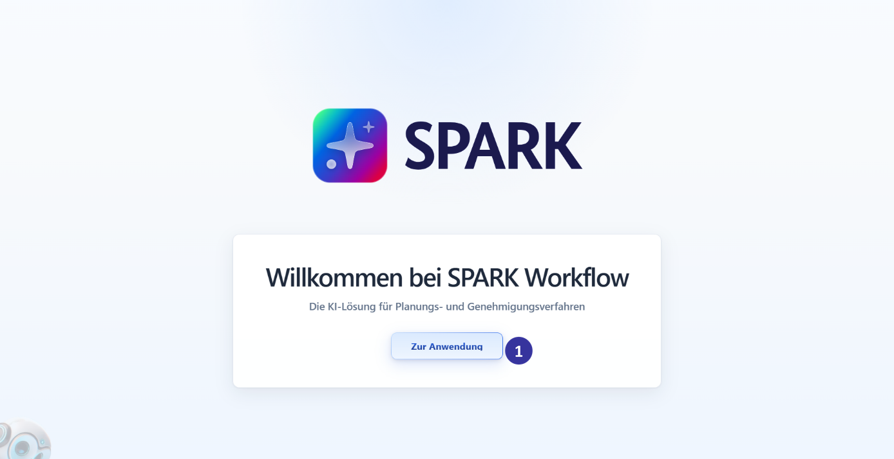
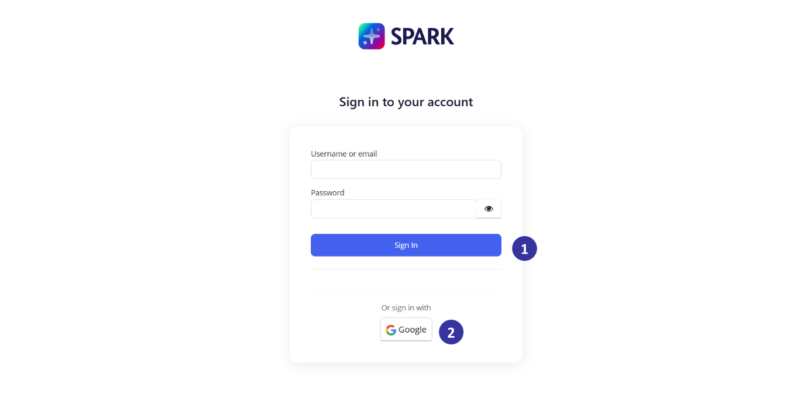
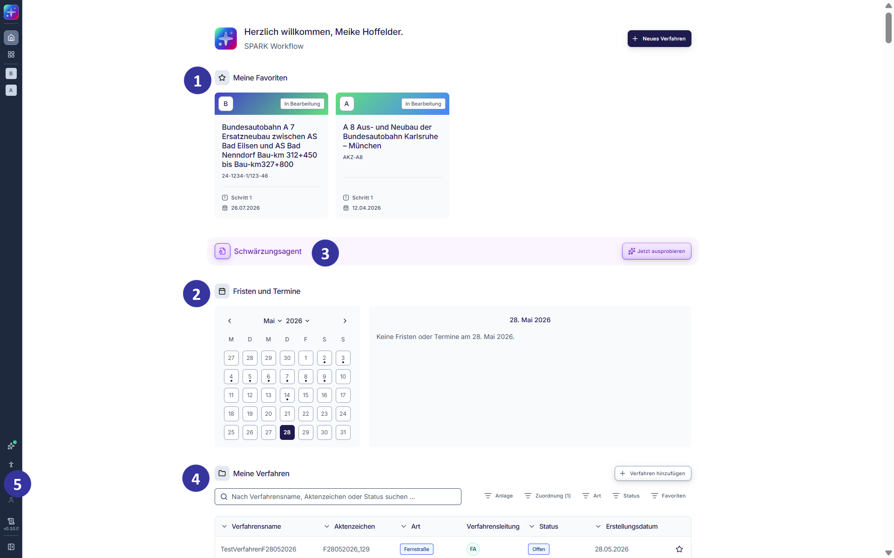
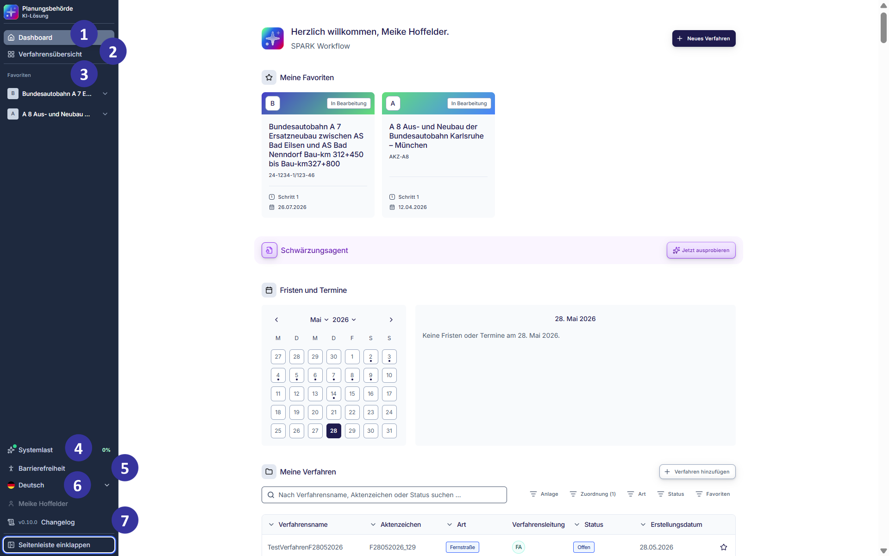
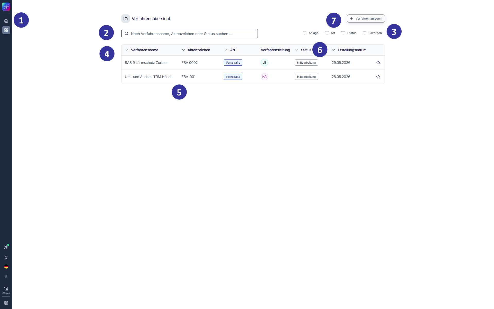

### 5.2 Schritt-für-Schritt-Anleitung [#kapitel-5-2]

#### 5.2.1 Anmeldung im System [!toc] [#kapitel-5-2-1]

*Abbildung 3: Verfahrensübersicht in der Hauptansicht (Entwicklungsstand: 29.05.2026)*

**Beschreibung**

Diese Ansicht erscheint, wenn SPARK Workflow geöffnet wird, Nutzende aber nicht im System angemeldet sind.

**Elementbeschreibungen**

① Button „Zur Anwendung“: öffnet die Anmeldungsmaske.

#### 5.2.2 Anmeldung im System: Anmeldungsmaske [!toc] [#kapitel-5-2-2]

*Abbildung 4: Verfahrensübersicht in der Hauptansicht (Entwicklungsstand: 29.05.2026)*

**Beschreibung**

Die Anmeldungsmaske ermöglicht die Anmeldung mit Nutzername und Passwort (z. B. über Keycloak) oder mittels eines zentralen Single Sign-On Systems. Ein Beispiel hierfür ist die Anmeldung mittels eines Google-Kontos (z. B. über Gmail oder Google Workspace).

**Elementbeschreibungen**

① Button „Sign In“: ermöglicht die Anmeldung über Nutzername oder E-Mail und Passwort. Nach Erstanmeldung muss ein neues Passwort vergeben werden.

② Button „Google“: ermöglicht die Anmeldung mit einem Google-Konto.

#### 5.2.3 Dashboard: Hauptansicht [!toc] [#kapitel-5-2-3]

*Abbildung 5: Dashboard in der Hauptansicht (Entwicklungsstand: 29.05.2026)*

**Beschreibung**

Das Dashboard ist die Startseite der Applikation und öffnet sich automatisch nach der erfolgreichen Anmeldung (dem Login). Nutzende sehen hier die als „Meine Favoriten“ markierten Verfahren sowie eine Gesamtliste aller ihnen zugeordneten Verfahren (s. Kapitel [5.2.3](#kapitel-5-2-3)). Über das Dashboard können Verfahren gesucht, geöffnet oder neu angelegt werden. Die linke Navigationsleiste bietet grundlegende Navigationsmöglichkeiten innerhalb der Applikation.

Hinweis zur IT-Sicherheit: Im Dashboard werden ausschließlich Verfahren angezeigt, für die dem jeweiligen Nutzenden gemäß Rollen- und Rechtekonzept eine entsprechende Rolle zugewiesen wurde. Dies dient der Sicherstellung eines rollenbasierten Zugriffs. Berechtigungen und Zuordnungen sind regelmäßig zu überprüfen und bei Bedarf zu aktualisieren. Insbesondere im Rahmen des Austritts sind nicht mehr erforderliche Zugriffsberechtigungen vollständig zurückzunehmen (s. Kapitel [4.3](#kapitel-4-3)).

**Elementbeschreibungen**

① Kachel „Meine Favoriten“: zeigt Verfahren an, die von Nutzenden über das Stern‑Icon in der Tabelle „Meine Verfahren“ als Favoriten markiert wurden. Per Klick auf eine Kachel öffnet sich die Einzelverfahrensübersicht des ausgewählten Verfahrens (s. Kapitel [5.2.11](#kapitel-5-2-11)).

② Kalender: zeigt den aktuellen Monat und die in den Verfahren angelegten Fristen und Termine an (s. Kapitel [5.2.12.3](#kapitel-5-2-12-3)).

③ KI-Werkzeug: öffnet den verfahrensunabhängig nutzbaren KI-Agenten zur Schwärzung von Unterlagen.

④ Tabelle „Meine Verfahren“: ermöglicht Suche, Filterung und Sortierung aller für den Nutzenden gemäß der Berechtigung sichtbaren Verfahren.

Suchfeld: durchsucht „Meine Verfahren“ dynamisch nach Verfahrensnamen, Aktenzeichen oder dem Status.

Spaltenkopf (z. B. „Aktenzeichen“): ändert die Sortierung zu auf- bzw. absteigend.

Button „+ Verfahren hinzufügen“: ermöglicht die Anlage eines neuen Verfahrens.

⑤ Ausklappen-Icon: öffnet die Navigationsleiste.

#### 5.2.4 Dashboard: ausgeklappte Navigationsleiste [!toc] [#kapitel-5-2-4]

*Abbildung 6: Dashboard mit ausgeklappter Navigationsleiste (Entwicklungsstand: 29.05.2026)*

**Beschreibung**

Die Navigationsleiste ermöglicht den zentralen Zugriff auf die Funktionen und Bereiche der Applikation und ist auch in den nachfolgenden Verfahrensschritten verfügbar. Sie unterstützt die Navigation zwischen verfahrensbezogenen Ansichten, systemweiten Übersichten sowie persönlichen und administrativen Funktionen.

Die Navigationsleiste kann über das Ausklappen‑Icon ein‑ oder ausgeklappt werden. In der ausgeklappten Ansicht werden alle Navigationspunkte mit ausgeschriebenen Bezeichnungen angezeigt. In der eingeklappten Ansicht (Standard-Einstellung) erscheinen die Navigationspunkte ausschließlich als Icons. In der eingeklappten Ansicht wird beim Überfahren eines Icons eine Kurzinfo (sogenannter Tooltip) mit der ausgeschriebenen Bezeichnung des jeweiligen Navigationspunkts angezeigt. Neben der Navigation stellt die Navigationsleiste auch den Zugriff auf favorisierte Verfahren, Systeminformationen, Sprachumschaltung, Profilinformationen sowie weitere unterstützende Funktionen bereit. Die Leiste kann jederzeit eingeklappt werden, um mehr Platz für die fachliche Arbeit im Hauptbereich der Applikation zu schaffen. Nutzenden mit der systemweiten Rolle „Administration“ zeigt die Navigationsleiste zusätzlich den Navigationspunkt „Administration“, der den Administrationsbereich öffnet (s. Kapitel [6.3](#kapitel-6-3)). Für alle übrigen Nutzenden entfällt dieser Navigationspunkt.

**Elementbeschreibungen**

① „Dashboard“-Navigationspunkt: öffnet das Dashboard der Applikation (s. Kapitel [5.2.3](#kapitel-5-2-3)). Das Dashboard dient als zentrale Startseite und bietet einen Überblick über die als Favoriten markierten Verfahren und weitere Informationen.

② „Verfahrensübersicht“-Navigationspunkt: öffnet die Verfahrensübersicht (s. Kapitel [5.2.5](#kapitel-5-2-5)). In der Verfahrensübersicht werden alle für die nutzende Person gemäß ihrer Berechtigung sichtbaren Verfahren angezeigt.

③ „Favoriten“-Bereich: zeigt die Liste der von der nutzenden Person als Favoriten markierten Verfahren an. Jedes als Favorit markierte Verfahren wird mit Verfahrensname und Aktenzeichen angezeigt.

④ „Systemlast“-Indikator: zeigt den aktuellen Auslastungszustand des Systems an.

⑤ „Barrierefreiheit“-Navigationspunkt: öffnet die Informationen zur Barrierefreiheit der Applikation.

⑥ Länderflaggen-Icon „Deutsch“: zeigt die aktuell ausgewählte Sprache der Benutzeroberfläche an. Über diesen Menüpunkt kann die Sprache der Benutzeroberfläche gewechselt werden.

⑦ „Changelog“-Navigationspunkt: öffnet das Changelog der KI-Lösung. Das Changelog stellt Informationen zu Änderungen und neuen Funktionen der jeweiligen Version bereit.

#### 5.2.5 Verfahrensübersicht: Hauptansicht [!toc] [#kapitel-5-2-5]

*Abbildung 7: Verfahrensübersicht in der Hauptansicht (Entwicklungsstand: 29.05.2026)*

**Beschreibung**

Diese Ansicht öffnet sich, wenn Nutzende in der Navigationsleiste auf das Verfahrensübersicht-Icon klicken. Dies ist sowohl bei eingeklappter als auch bei ausgeklappter Navigationsleiste möglich. Die Verfahrensübersicht zeigt alle Verfahren an, die für die Nutzenden gemäß ihrer Berechtigungen sichtbar sind.

**Elementbeschreibungen**

① Navigationsleiste: Nutzende wechseln über die Navigationsleiste die Bereiche (s. Kapitel [5.2.4](#kapitel-5-2-4)).

② Suchfeld: ermöglicht eine Volltextsuche nach dem Verfahrensnamen, dem Aktenzeichen oder dem Status. Die Suche erfolgt ohne Verwendung von Wildcards. Sie unterscheidet nicht zwischen Groß- und Kleinschreibung und findet Teilbegriffe innerhalb eines Textes. Die Ergebnisliste wird in Echtzeit aktualisiert.

③ Filter: filtert die Tabelle per Klick nach folgenden Kriterien:

„Art“: zeigt nur Verfahren der ausgewählten Art.

„Status“: zeigt nur Verfahren des ausgewählten Status.

„Favoriten“: zeigt nur Verfahren des ausgewählten Favoritenstatus.

Die Filteroptionen können per Klick aus- und abgewählt werden. Es können mehrere Filter gleichzeitig ausgewählt werden.

④ Tabelle als zentrale Übersicht über Verfahren mit Spalten „Verfahrensname“, „Aktenzeichen“, „Art“, „Verfahrensleitung“, „Status“ und „Erstellungsdatum“. Die Spalten können per Klick auf den Spaltenkopf auf- und absteigend sortiert werden.

⑤ Per Klick auf ein Verfahren öffnet sich die entsprechende Einzelverfahrensübersicht (s. Kapitel [5.2.11](#kapitel-5-2-11)).

⑥ „Status“: Der Status eines Verfahrens gibt den aktuellen Bearbeitungsstand eines Verfahrens wieder. Er hilft Nutzenden, den fachlichen Fortschritt eines Verfahrens auf einen Blick zu erkennen. Mögliche Status sind:

„In Erstellung“: Das Verfahren wurde angelegt, es wurden jedoch noch keine Unterlagen hochgeladen. Der Prüfprozess kann in diesem Status noch nicht gestartet werden.

„Offen“: Unterlagen wurden hochgeladen, der Prüfprozess wurde jedoch noch nicht gestartet.

„In Bearbeitung“: Das Verfahren wurde angelegt, es wurden Unterlagen hochgeladen und der Prüfprozess wurde gestartet. Mindestens ein Prüfschritt befindet sich in Bearbeitung.

Der aktuelle Status eines Verfahrens wird automatisch gesetzt und aktualisiert sich im Verlauf der Bearbeitung.

⑦ Button „+ Verfahren anlegen“: startet die Anlage eines neuen Verfahrens (s. Kapitel [5.2.6](#kapitel-5-2-6)).
