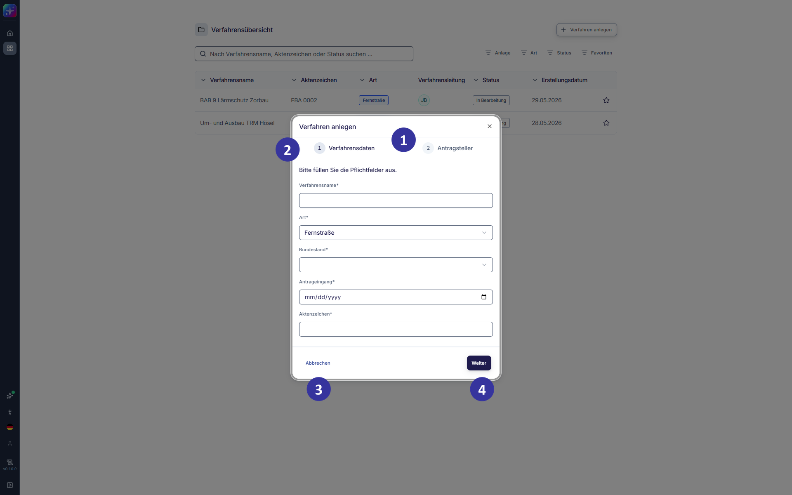
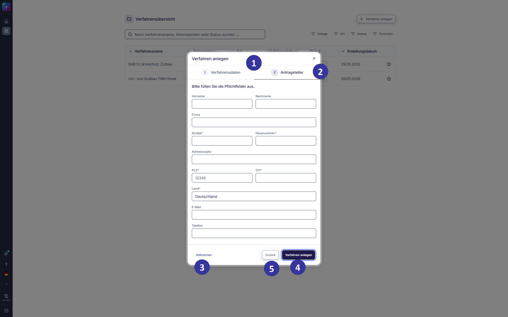
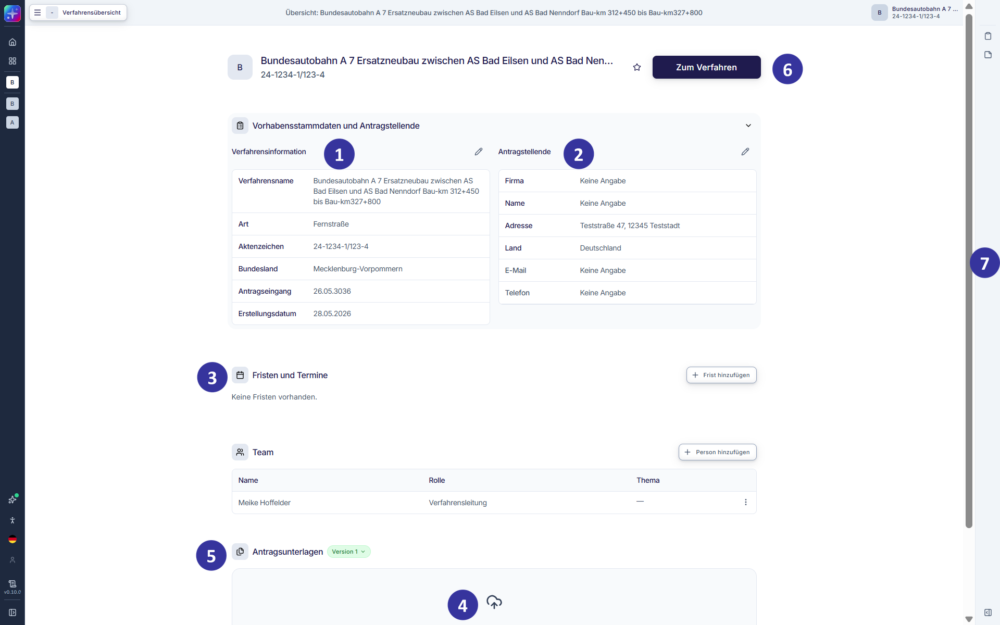
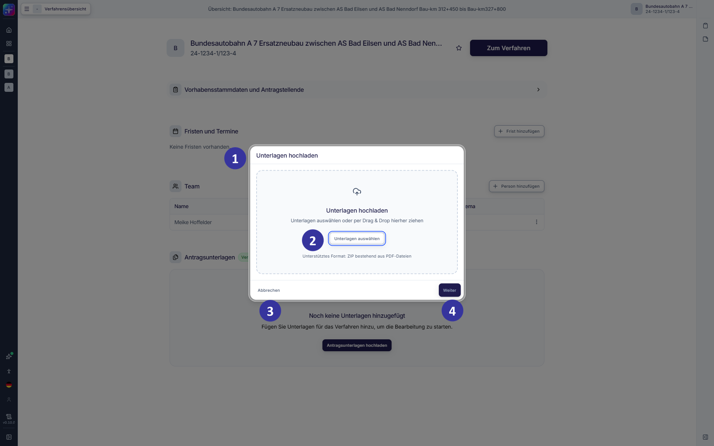
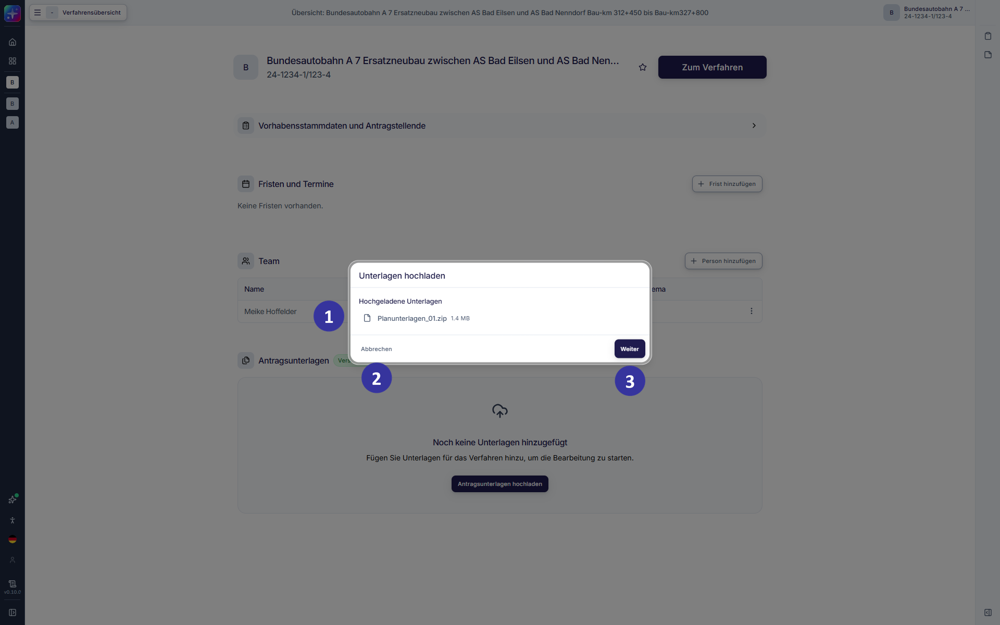

#### 5.2.6 Verfahren anlegen: erster Schritt – Verfahrensdaten [!toc] [#kapitel-5-2-6]

*Abbildung 8: Verfahren anlegen – erster Schritt – Verfahrensdaten (Entwicklungsstand: 29.05.2026)*

**Beschreibung**

Verfahren können über Konnektoren aus einer Behördenplattform (Antrags- und Beteiligungsportal) zu SPARK Workflow übertragen werden. Verfahren, die nicht über das Antrags- und Beteiligungsportal übertragen werden, können manuell angelegt werden. Perspektivisch können weitere Schnittstellen angebunden werden.

Das Dialogfenster „Verfahren anlegen“ öffnet sich, wenn Nutzende im Dashboard (s. Kapitel [5.2.3](#kapitel-5-2-3)) oder in der Verfahrensübersicht (s. Kapitel [5.2.5](#kapitel-5-2-5)) per Klick auf den Button „+ Verfahren hinzufügen“ manuell ein neues Verfahren anlegen. In diesem Schritt werden die grundlegenden Verfahrensdaten erfasst.

**Elementbeschreibungen**

① Fortschrittsleiste: zeigt an, in welchem Schritt der Verfahrensanlage sich Nutzende befinden.

② Eingabefelder für Verfahrensinformationen (Pflichtfelder mit Stern markiert): „Verfahrensname“, „Art“, „Bundesland“, „Antragseingang“ (Datum), „Aktenzeichen“.

Im Feld „Art“ stehen ausschließlich die aktiven Verfahrensarten zur Auswahl (s. Kapitel [6.3](#kapitel-6-3)).

Hinweis: Das Bundesland kann nach Erstellung eines Verfahrens und bis zur KI-Verarbeitung bei Start des Prüfprozesses geändert werden. Wird das Bundesland nach Start der KI-Verarbeitung geändert, hat dies keine Auswirkungen auf die Anwendung der Landesgesetze, d. h. es werden die Gesetze für das Bundesland verarbeitet, das beim Start des KI-Prüfprozesses ausgewählt war.

③ Button „Abbrechen“: beendet die Bearbeitung ohne Speicherung der vorgenommenen Änderungen und schließt das Dialogfenster.

④ Button „Weiter“: wechselt zum nächsten Schritt „Antragsteller“ (s. Kapitel [5.2.7](#kapitel-5-2-7)).

#### 5.2.7 Verfahren anlegen: zweiter Schritt – Antragsteller [!toc] [#kapitel-5-2-7]

*Abbildung 9: Verfahren anlegen – zweiter Schritt – Antragsteller (Entwicklungsstand: 29.05.2026)*

**Beschreibung**

Dieses Dialogfenster öffnet sich per Klick auf „Weiter“ im (vorangegangenen) Schritt „Verfahren anlegen – Verfahrensdaten“. In diesem Schritt werden die Daten der Antragstellenden erfasst.

**Elementbeschreibungen**

① Fortschrittsleiste: zeigt an, dass sich Nutzende nun im Schritt „Antragsteller“ befinden.

② Eingabefelder für Daten des Antragstellenden (Pflichtfelder mit Stern markiert): „Vorname“, „Nachname“, „Firma“, „Straße“, „Hausnummer“, „Adresszusatz“, „PLZ“, „Ort“, „Land“, „E-Mail“, „Telefon“.

③ Button „Abbrechen“: bricht den Vorgang ab und schließt das Dialogfenster, ohne vorgenommene Eintragungen zu speichern.

④ Button „Verfahren anlegen“: schließt die Verfahrensanlage ab und führt zur Einzelverfahrensübersicht (s. Kapitel [5.2.8](#kapitel-5-2-8)).

⑤ Button „Zurück“: navigiert zurück in den ersten Schritt „Verfahrensdaten“.

#### 5.2.8 Verfahren anlegen: Einzelverfahrensübersicht vor dem Hochladen der Unterlagen [!toc] [#kapitel-5-2-8]

*Abbildung 10: Einzelverfahrensübersicht in der Hauptansicht vor dem Hochladen der Unterlagen (Entwicklungsstand: 29.05.2026)*

**Beschreibung**

Diese Ansicht öffnet sich, nachdem ein neues Verfahren angelegt wurde. Die Einzelverfahrensübersicht stellt alle bisher erfassten Verfahrensdaten kompakt dar und bietet einen strukturierten Einstieg in die weiteren Bearbeitungsschritte. Über thematisch abgegrenzte Kacheln werden zentrale Informationen angezeigt, darunter die Verfahrensinformationen, die Daten der Antragstellenden sowie Fristen und Termine. Darüber hinaus können Nutzende an dieser Stelle Unterlagen hochladen, bevor der Prüfprozess gestartet wird.

**Elementbeschreibungen**

① Bereich „Vorhabensstammdaten und Antragstellende“: Der Bereich lässt sich per Klick auf das Expandieren-Icon aus- und einklappen. Der linke Bereich „Verfahrensinformation“ zeigt die im vorherigen Schritt eingetragenen grundlegenden Verfahrensdaten, wie „Verfahrensname“, „Art“, „Status“, „Aktenzeichen“ und Datum des Antragseingangs an. Diese Angaben können bei Bedarf über Auswahl des Stift-Icons angepasst werden (s. Kapitel [5.2.12.1](#kapitel-5-2-12-1)).

② Kachel „Antragstellende“: zeigt die im vorherigen Schritt eingetragenen Daten der Antragstellenden an. Diese Angaben können bei Bedarf über Auswahl des Stift-Icons angepasst werden (s. Kapitel [5.2.12.2](#kapitel-5-2-12-2)).

③ Kachel „Fristen und Termine“: bietet einen Überblick über relevante Fristen und Termine im Verfahren. Die Übersicht enthält zum Zeitpunkt der Verfahrensanlage noch keine Einträge. Fristen und Termine können per Klick auf den „+ Frist hinzufügen“-Button angelegt werden (s. Kapitel [5.2.12.3](#kapitel-5-2-12-3)).

④ Hinweis: informiert darüber, dass für den Start des Prüfprozesses das Hochladen von Unterlagen erforderlich ist. Per Klick auf „Antragsunterlagen hochladen“ gelangen Nutzende zum Dialogfenster.

⑤ Kachel „Antragsunterlagen“: zeigt nach dem Hochladen alle hochgeladenen Unterlagen an.

⑥ Button „Zum Verfahren“: öffnet den Prozessschritt der formalen Vollständigkeitsprüfung, um dort den Verarbeitungsprozess der Unterlagen durch die KI zu starten. Dies ist erst nach dem Hochladen von Unterlagen möglich.

⑦ Seitenleiste: In der rechten Seitenleiste stehen zusätzliche Funktionen zur Verfügung. Diese Funktionen ergänzen die Bearbeitung des Verfahrens und werden in den folgenden Kapiteln näher erläutert (s. Kapitel [6.2](#kapitel-6-2)).

#### 5.2.9 Antragsunterlagen hochladen: erster Schritt – Dateien auswählen [!toc] [#kapitel-5-2-9]

*Abbildung 11: Antragsunterlagen hochladen – erster Schritt – Dateien hinzufügen (Entwicklungsstand: 29.05.2026)*

**Beschreibung**

Dieses Dialogfenster öffnet sich per Klick auf „Antragsunterlagen hochladen“ in der Einzelverfahrensübersicht (s. Kapitel [5.2.8](#kapitel-5-2-8)). In diesem Schritt können die für das Verfahren relevanten Unterlagen hochgeladen werden. Der Prüfprozess kann nach dem Hochladen von mindestens einer Unterlage gestartet werden.

Hinweis zur IT-Sicherheit: Hochgeladene Einzeldateien in ZIP-Archiven werden u. a. durch KI-gestützte Funktionen verarbeitet. Daher ist beim Hochladen darauf zu achten, dass Dateien ausschließlich aus vertrauenswürdigen Quellen stammen und keine schädlichen Inhalte enthalten. Dies gilt insbesondere für im Dateitext verborgene oder eingebettete Anweisungen (Prompt Injektionen), die auf eine Beeinflussung der Verarbeitung abzielen können.

**Elementbeschreibungen**

① Dialogfenster „Unterlagen hochladen“: ermöglicht das Hochladen von Unterlagen.

② Button „Unterlagen auswählen“: öffnet den Dateiexplorer, um ein ZIP‑Archiv mit PDF-Dateien auszuwählen. Die maximale Größe des ZIP-Archives beträgt 10 GB.

Hinweis: PDF‑Dateien, deren Seiten vollständig oder teilweise gedreht oder gespiegelt sind, können nicht zuverlässig verarbeitet werden. Daher sollten nur korrekt ausgerichtete, nicht gespiegelte PDF‑Dateien verwendet werden.

③ Button „Abbrechen“: bricht den Vorgang ab und schließt das Dialogfenster.

④ Button „Weiter“: wird aktiv, sobald mindestens eine Unterlage zum Hochladen ausgewählt wurde. Klick auf „Weiter“ lädt die gewählte Datei hoch.

#### 5.2.10 Antragsunterlagen hochladen: zweiter Schritt – Dateien prüfen und hochladen [!toc] [#kapitel-5-2-10]

*Abbildung 12: Antragsunterlagen hochladen – zweiter Schritt – Dateien prüfen und hochladen (Entwicklungsstand: 29.05.2026)*

**Beschreibung**

In diesem Schritt werden die zuvor ausgewählten Unterlagen hochgeladen. Nach dem Hochladen stehen die Unterlagen in der Einzelverfahrensübersicht zur Ansicht und weiteren Prüfung bereit.

**Elementbeschreibungen**

① Hochgeladene Unterlagen: zeigt die Unterlagen an, die im vorherigen Schritt zum Hochladen ausgewählt wurden.

② Button „Abbrechen“: bricht den Vorgang ab und schließt das Dialogfenster. Bereits ausgewählte Unterlagen werden dabei nicht hochgeladen.

③ Button „Weiter“: startet das Hochladen der angezeigten Unterlagen. Das Dialogfenster zeigt eine Fortschrittsansicht, schließt sich nach Abschluss automatisch und führt zurück zur Einzelverfahrensübersicht.
