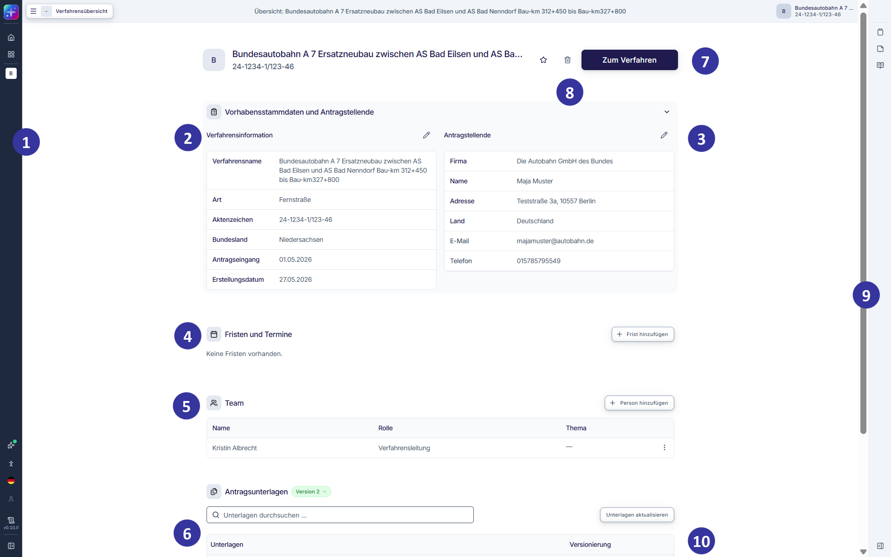
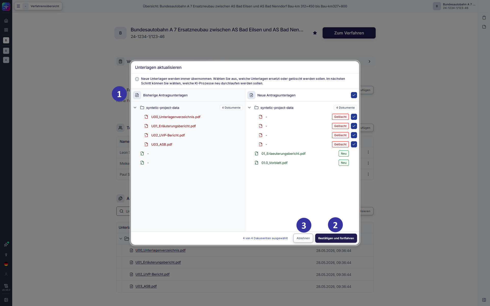
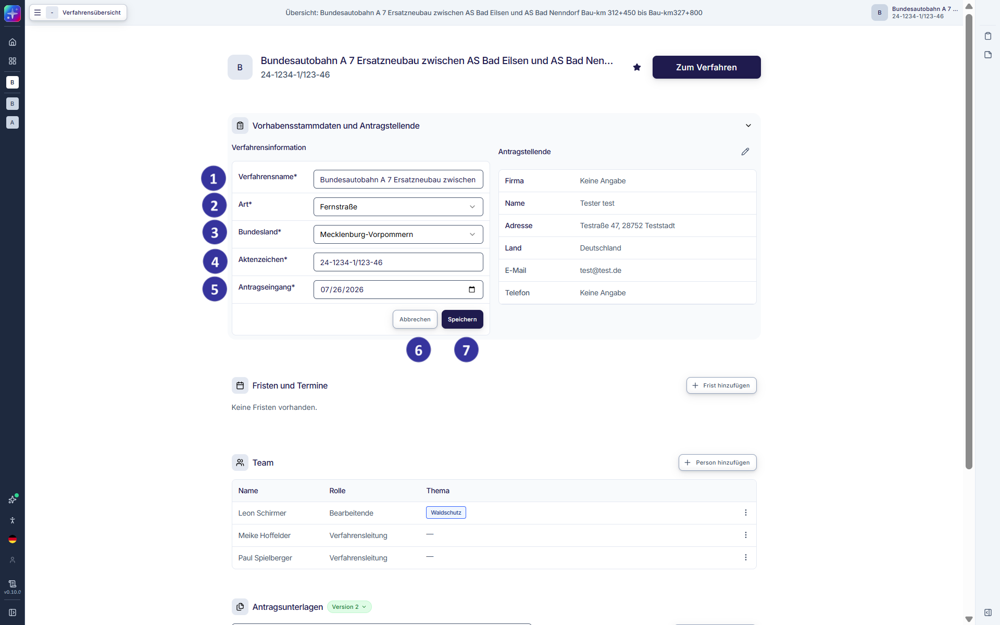
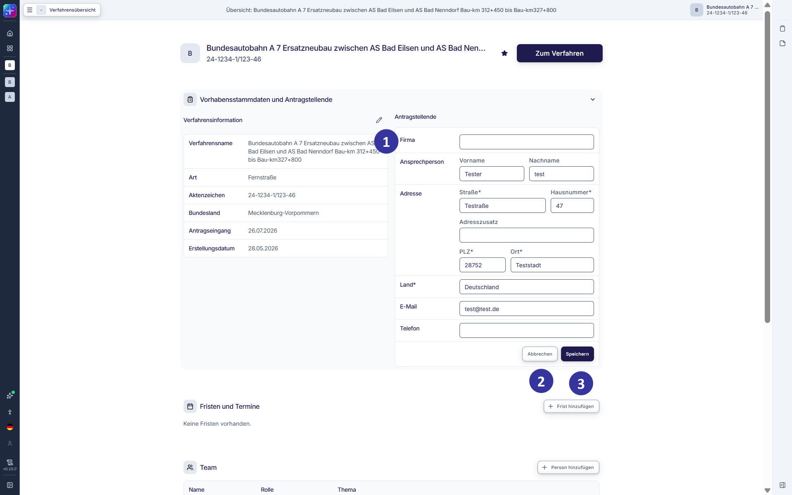
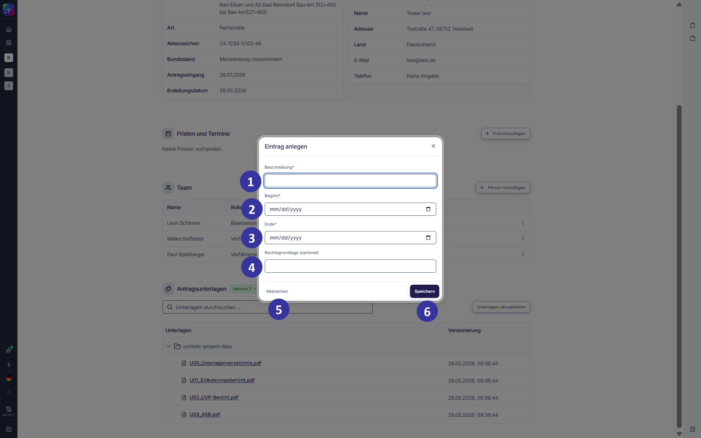
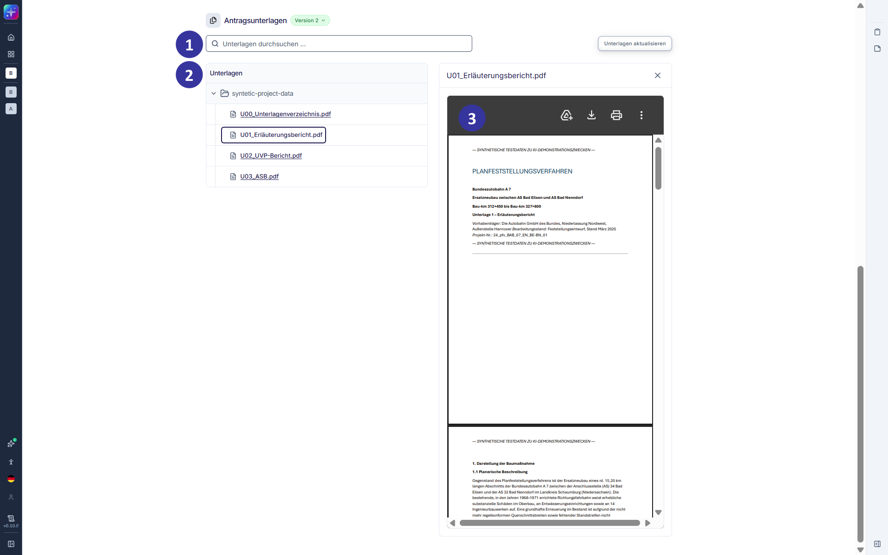

#### 5.2.11 Einzelverfahrensübersicht: Hauptansicht [!toc] [#kapitel-5-2-11]

*Abbildung 13: Einzelverfahrensübersicht in der Hauptansicht (Entwicklungsstand: 29.05.2026)*

**Beschreibung**

Diese Ansicht öffnet sich, wenn Nutzende im Dashboard (s. Kapitel [5.2.3](#kapitel-5-2-3)) per Klick ein Verfahren auswählen oder ein Verfahren aus der Tabelle der Verfahrensübersicht öffnen und Unterlagen hochgeladen wurden. Die Einzelverfahrensübersicht zeigt ein spezifisches Verfahren in einer übersichtlichen Darstellung. Sie stellt alle erfassten Angaben zum Verfahren strukturiert dar und bildet den Einstieg in die weiteren Bearbeitungsschritte.

**Elementbeschreibungen**

① Navigationsleiste: Über die Navigationsleiste können Nutzende zu systemweiten Bereichen wechseln (s. Kapitel [5.2.4](#kapitel-5-2-4)).

② Bereich „Vorhabensstammdaten und Antragstellende“: Der Bereich lässt sich per Klick auf das Expandieren-Icon aus- und einklappen. Der linke Bereich „Verfahrensinformation“ zeigt die im vorherigen Schritt eingetragenen grundlegenden Verfahrensdaten, wie „Verfahrensname“, „Art“, „Status“, „Aktenzeichen“ und Datum des Antragseingangs an. Diese Angaben können bei Bedarf über Auswahl des Stift-Icons angepasst werden (s. Kapitel [5.2.12.1](#kapitel-5-2-12-1)).

③ Bereich „Vorhabensstammdaten und Antragstellende“: Der Bereich lässt sich per Klick auf das Expandieren-Icon aus- und einklappen. Der rechte Bereich „Antragstellende“ zeigt die Daten der Antragstellenden an. Diese Angaben können bei Bedarf über Auswahl des Stift-Icons angepasst werden (s. Kapitel [5.2.12.2](#kapitel-5-2-12-2)).

④ Kachel „Fristen und Termine“: bietet einen Überblick über relevante Fristen und Termine im Verfahren. Die Übersicht enthält zum Zeitpunkt der Verfahrensanlage noch keine Einträge. Fristen und Termine können per Klick auf den „+ Frist hinzufügen“-Button angelegt werden (s. Kapitel [5.2.12.3](#kapitel-5-2-12-3)).

⑤ Kachel „Team“: zeigt die Namen der Personen des Verfahrensteams an. Zusätzlich werden die den Teammitgliedern verfahrensspezifisch zugeordneten Rollen und Themen angezeigt.

Die Rollen „Administration“ sowie „Verfahrensleitung“ sind berechtigt, Personen dem Verfahrensteam hinzuzufügen und ihre zugewiesene Rolle und Themen (s. Kapitel [4.3](#kapitel-4-3)) zu bearbeiten. Sie können Personen ebenfalls wieder aus dem Verfahrensteam entfernen.

⑥ Kachel „Antragsunterlagen“: zeigt nach dem Hochladen alle hochgeladenen Unterlagen an.

⑦ Button „Zum Verfahren“: öffnet den Prozessschritt der formalen Vollständigkeitsprüfung, um dort den Verarbeitungsprozess der Unterlagen durch die KI zu starten. Dies ist erst nach dem Hochladen von Unterlagen möglich.

⑧ Button „Löschen“: markiert das Verfahren als gelöscht. Diese Funktion steht nur berechtigten Nutzenden zur Verfügung (Administration).

⑨ Seitenleiste: In der rechten Seitenleiste stehen zusätzliche verfahrensbezogene Funktionen zur Verfügung. Diese Funktionen ergänzen die Bearbeitung des Verfahrens und werden in den folgenden Kapiteln näher erläutert (s. Kapitel [6.2](#kapitel-6-2)).

⑩ Button „Unterlagen aktualisieren“: bietet nach Erstupload von Unterlagen die Möglichkeit, die Unterlagen zu aktualisieren. Eine Aktualisierung erzeugt eine neue Version aller Unterlagen.

#### 5.2.12 Einzelverfahrensübersicht: Aktualisieren der Unterlagen [!toc] [#kapitel-5-2-12]

*Abbildung 14: Einzelverfahrensübersicht in der Hauptansicht (Entwicklungsstand: 08.10.2026)*

**Beschreibung**

Diese Ansicht öffnet sich, wenn in der Einzelverfahrensübersicht über den Button „Unterlagen aktualisieren“ Unterlagen aktualisiert werden. Wie auch beim Erstupload ist das Hochladen von PDF-Dateien in einem ZIP-Archiv möglich.

**Elementbeschreibungen**

① Vergleichsansicht: zeigt die aktuellen Unterlagen im Vergleich zu den vorherigen Unterlagen. Neue, gelöschte, umbenannte oder ersetzte Unterlagen werden entsprechend gekennzeichnet.

② Button „Bestätigen und fortfahren“: öffnet den nächsten Schritt, der bei Bedarf die erneute KI-Analyse der formalen Vollständigkeitsprüfung sowie der Plausibilitätsprüfung auf Basis der neuen Unterlagen ermöglicht.

③ Button „Ablehnen“: verwirft die Eingaben und schließt das Dialogfenster.

##### 5.2.12.1 Einzelverfahrensübersicht: Verfahrensinformationen bearbeiten [!toc] [#kapitel-5-2-12-1]

*Abbildung 15: Einzelverfahrensübersicht – Verfahrensinformationen bearbeiten (Entwicklungsstand: 29.05.2026)*

**Beschreibung**

Diese Bearbeitungsansicht öffnet sich aus der Verfahrensinformation-Kachel über den Bearbeiten-Button (Stift-Icon). Nutzende können hier Verfahrensinformationen erfassen und aktualisieren.

**Elementbeschreibungen**

① Eingabefeld „Verfahrensname“: Freitextfeld zur Bearbeitung des Verfahrensnamens

② Eingabefeld „Art“: Drop-down-Menü zur Auswahl der Verfahrensart. Zur Auswahl stehen die aktiven Verfahrensarten; ist die Verfahrensart des Verfahrens deaktiviert, bleibt sie mit dem Zusatz „(inaktiv)“ erhalten (s. Kapitel [6.3](#kapitel-6-3)).

③ Eingabefeld „Bundesland“: Drop-down-Menü zur Auswahl des Bundeslands

Hinweis: Das Bundesland kann nach Erstellung eines Verfahrens und bis zur KI-Verarbeitung bei Start des Prüfprozesses geändert werden. Wird das Bundesland nach Start der KI-Verarbeitung geändert, hat dies keine Auswirkungen auf die Anwendung der Landesgesetze, d. h. es werden die Gesetze für das Bundesland verarbeitet, das beim Start des KI-Prüfprozesses ausgewählt war.

④ Feld „Status“: zeigt den Status des Verfahrens. Dieser wird systemseitig vergeben und kann nicht editiert werden.

⑤ Eingabefeld „Aktenzeichen“: Freitextfeld für behördeninternes Aktenzeichen

⑥ Eingabefeld „Antragseingang“: Datumsauswahl des Antragseingangs

⑦ Button „Abbrechen“: verwirft die Eingaben und schließt die Bearbeitungsansicht.

⑧ Button „Speichern“: übernimmt die Eingaben und schließt die Bearbeitungsansicht.

##### 5.2.12.2 Einzelverfahrensübersicht: Antragstellende bearbeiten [!toc] [#kapitel-5-2-12-2]

*Abbildung 16: Einzelverfahrensübersicht – Antragstellende bearbeiten (Entwicklungsstand: 29.05.2026)*

**Beschreibung**

Diese Bearbeitungsansicht öffnet sich aus der Antragstellende-Kachel über das Bearbeiten-Icon. Nutzende können hier Daten der Antragstellenden erfassen und aktualisieren.

**Elementbeschreibungen**

① Bearbeitung der Antragstellendendaten: zeigt Textfelder zur Bearbeitung der Antragstellendendaten an.

② Button „Abbrechen“: verwirft die Eingaben und schließt die Bearbeitungsansicht.

③ Button „Speichern“: übernimmt die Eingaben und schließt die Bearbeitungsansicht.

##### 5.2.12.3 Einzelverfahrensübersicht: Fristen- und Terminanlage [!toc] [#kapitel-5-2-12-3]

*Abbildung 17: Einzelverfahrensübersicht – Fristen- und Terminanlage (Entwicklungsstand: 29.05.2026)*

**Beschreibung**

Dieses Dialogfenster öffnet sich in der Kachel „Fristen und Termine“ über das Hinzufügen-Icon. Nutzende können hier Fristen und Termine, z. B. für Wiedervorlagen, eingeben und festhalten.

**Elementbeschreibungen**

① Eingabefeld „Beschreibung“: Freitextfeld zur Eingabe einer kurzen Beschreibung (z. B. „Erörterungstermin“)

② Eingabefeld „Beginn“: Auswahl des Startdatums

③ Eingabefeld „Ende“: Auswahl des Enddatums

④ Eingabefeld „Rechtsgrundlage“: optionales Freitextfeld zur Eingabe der zugehörigen Rechtsgrundlage.

⑤ Button „Abbrechen“: verwirft die Eingaben und schließt das Dialogfenster.

⑥ Button „Speichern“: legt den Eintrag an und schließt das Dialogfenster.

##### 5.2.12.4 Einzelverfahrensübersicht: Unterlagen [!toc] [#kapitel-5-2-12-4]

*Abbildung 18: Einzelverfahrensübersicht – Unterlagen (Entwicklungsstand: 29.05.2026)*

**Beschreibung**

In der Liste der Unterlagen kann eine Vorschau der hochgeladenen Unterlagen eingesehen werden. Per Klick auf eine Unterlage öffnet sich im rechten Bildschirmbereich eine browser-spezifische PDF-Ansicht.

**Elementbeschreibungen**

① Suchfeld „Unterlagen durchsuchen“: ermöglicht eine Volltextsuche nach Unterlagennamen. Die Suche erfolgt ohne Wildcards, unterscheidet nicht zwischen Groß‑ und Kleinschreibung und findet auch Teilbegriffe. Die Ergebnisliste wird in Echtzeit aktualisiert.

② Bereich „Unterlagen“: zeigt den Antrag, die Planunterlagen und die ergänzenden Unterlagen in einer ausklappbaren Ordnerstruktur an. Die Ordner- und Unterlagennamen entsprechen den beim Hochladen bereitgestellten Bezeichnungen und können nicht bearbeitet werden.

③ Vorschaufenster: öffnet die ausgewählte Unterlage in einem eigenen Fenster. Die Darstellung erfolgt über die PDF‑Anzeige des verwendeten Browsers. Der verfügbare Funktionsumfang kann daher je nach Browser variieren.
