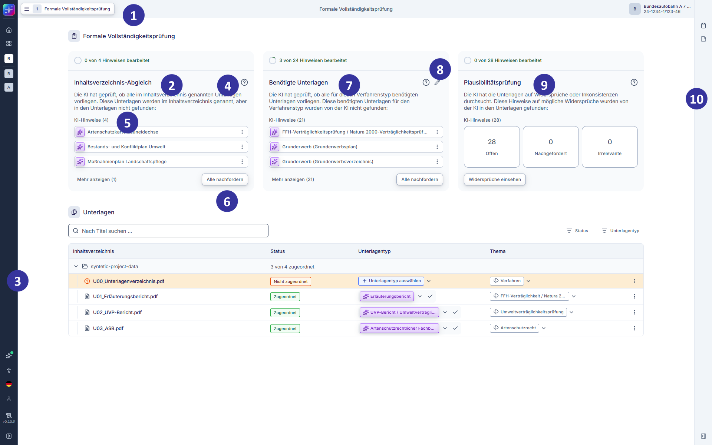
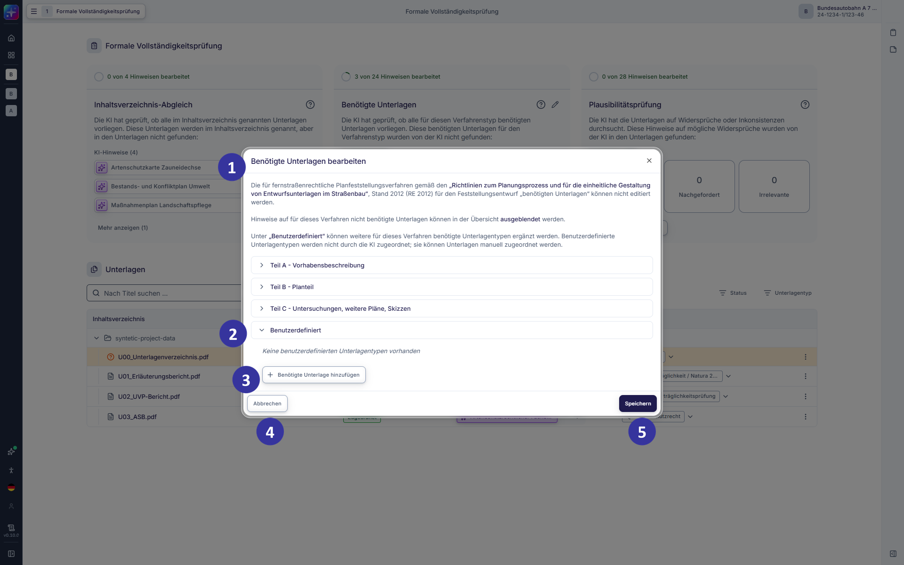
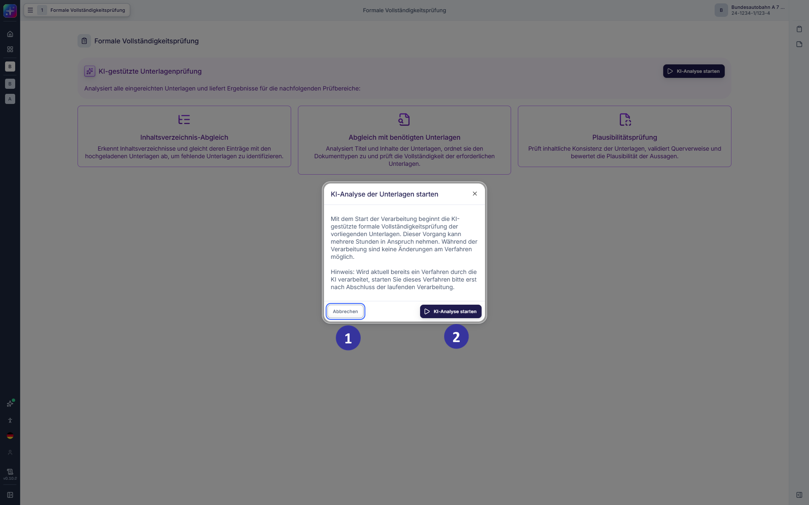
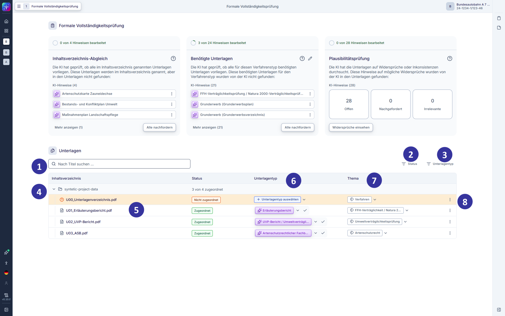
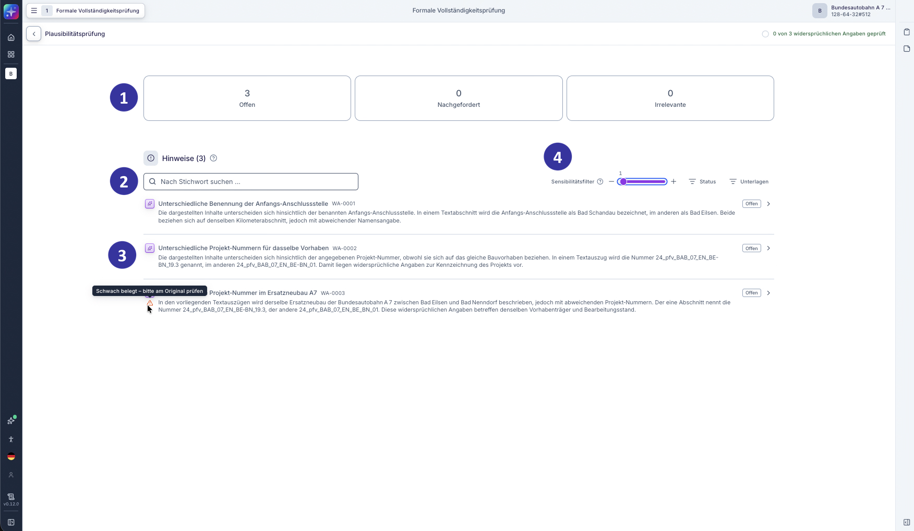
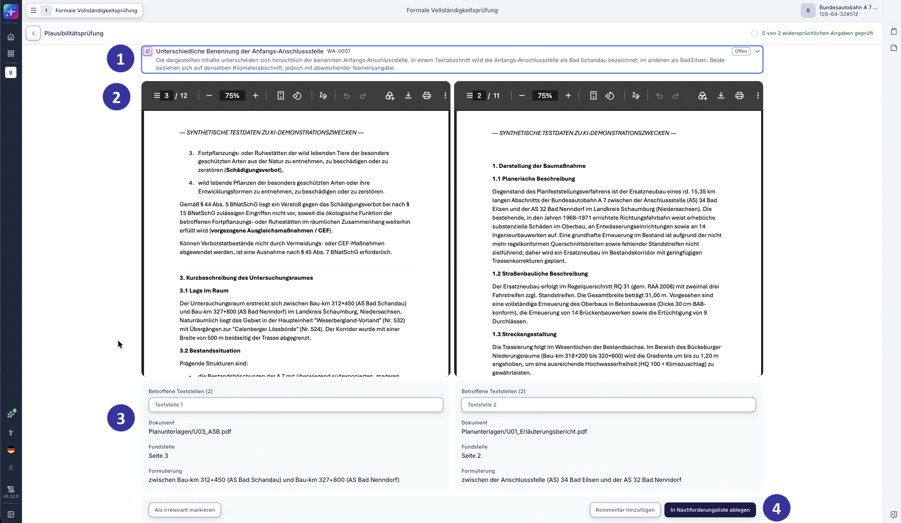
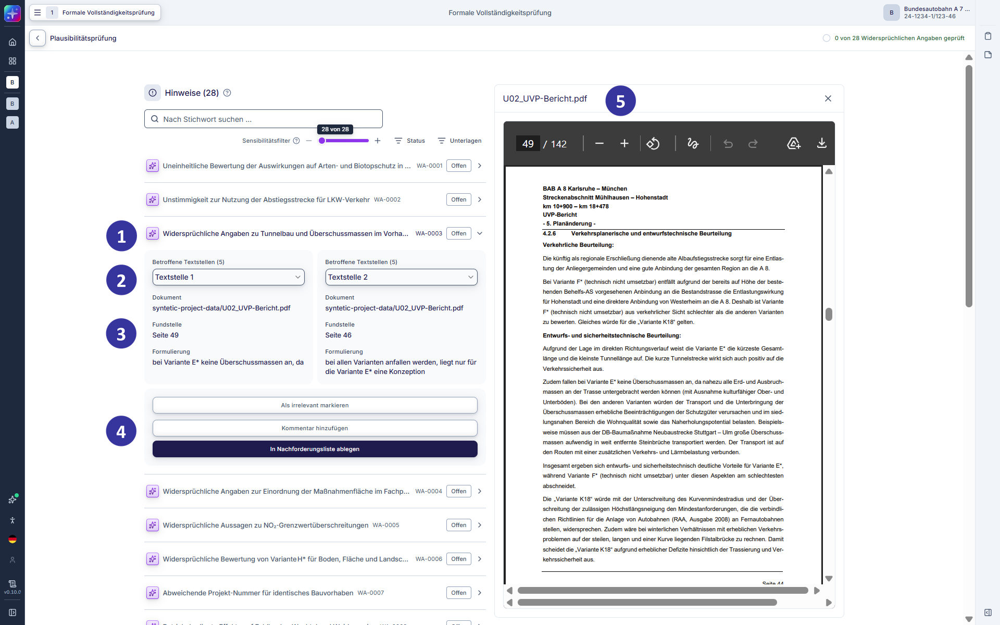

#### 5.2.13 Formale Vollständigkeitsprüfung: Hauptansicht [!toc] [#kapitel-5-2-13]

*Abbildung 19: Formale Vollständigkeitsprüfung in der Hauptansicht (Entwicklungsstand: 29.05.2026)*

**Beschreibung**

Diese Ansicht öffnet sich, wenn Nutzende in der Einzelverfahrensübersicht (s. Kapitel [5.2.11](#kapitel-5-2-11)) per Klick die KI-Analyse starten und diese abgeschlossen wurde. In der formalen Vollständigkeitsprüfung werden die hochgeladenen Unterlagen strukturiert gesichtet. Die Applikation zeigt Hinweise auf mögliche Unvollständigkeiten an und unterstützt die Zuordnung der Unterlagen. Dabei wird zwischen Unterlagen, die laut Inhaltsverzeichnis der Antragstellenden eingereicht werden, und Unterlagen, die für die jeweilige Verfahrensart standardmäßig erforderlich sind, unterschieden. Für beide Kategorien werden Hinweise angezeigt, wenn entsprechende Unterlagen nicht identifiziert werden konnten. Auf dieser Grundlage können Nutzende das Vorhandensein bzw. Fehlen von Unterlagen prüfen, Unterlagen zuordnen oder bei Bedarf einzelne Nachforderungen in den Entwurf eines Nachforderungsschreibens (verfahrensleitende Verfügung) aufnehmen. Ergänzend werden Hinweise angezeigt, wenn die vorhandenen Unterlagen Auffälligkeiten aufweisen.

> **Hinweis zur KI-Unterstützung**
>
> Die KI-Lösung prüft, ob die erforderlichen Unterlagen vorliegen. Zudem generiert die KI-Lösung Hinweise, wenn in den vorhandenen Unterlagen für das Verfahren benötigte Unterlagen fehlen, Inkonsistenzen oder andere Auffälligkeiten auftreten, welche die formale Vollständigkeit beeinträchtigen. Die fachliche Bewertung sowie die Entscheidung über das weitere Vorgehen liegen stets bei den Nutzenden.

**Elementbeschreibungen**

① Prozessschrittmenü: zeigt den aktuellen Prozessschritt im Prüfprozess an. Per Klick auf das Drop-down-Menü öffnet sich eine Übersicht aller Prüfschritte:

- „Verfahrensübersicht“ (führt zurück zur Einzelverfahrensübersicht, s. Kapitel [5.2.11](#kapitel-5-2-11))
- „Formale Vollständigkeitsprüfung“ (s. Kapitel [5.2.13](#kapitel-5-2-13))
- „Materielle Vollständigkeitsprüfung“ (s. Kapitel [5.2.14](#kapitel-5-2-14))
- „Behörden‑ und Öffentlichkeitsbeteiligung“ (s. Kapitel [5.2.15.1](#kapitel-5-2-15-1) ff.)
- „Rechtliche Prüfung und Beschlusserstellung“ (s. Kapitel [5.2.16](#kapitel-5-2-16) ff.)

Der aktuell aktive Prozessschritt wird hervorgehoben dargestellt und ist auch dann sichtbar, wenn das Auswahlfeld nicht geöffnet ist. Über das Auswahlfeld können Nutzende gezielt zu einem anderen Prüfschritt oder zurück zur Projektübersicht wechseln.

② Kachel „Inhaltsverzeichnis-Abgleich“: In diesem Bereich unterstützt die Applikation den Abgleich der hochgeladenen Antragsunterlagen mit dem von den Antragstellenden bereitgestellten Inhaltsverzeichnis. Die Kachel „Inhaltsverzeichnis-Abgleich“ gibt einen Überblick darüber, in welchem Umfang die im Inhaltsverzeichnis aufgeführten Unterlagen in den hochgeladenen Unterlagen von der KI identifiziert werden konnten. Fehlende Unterlagen werden unter „KI-Hinweise“ gekennzeichnet. Eine Fortschrittsanzeige visualisiert den aktuellen Stand.

③ Navigationsleiste: Über die Navigationsleiste können Nutzende zu systemweiten Bereichen wechseln (s. Kapitel [5.2.4](#kapitel-5-2-4)).

④ Fragezeichen-Icon: bietet eine Erklärung zum jeweiligen Element.

⑤ „KI-Hinweise“: listet alle Hinweise auf Unterlagen auf, die laut Inhaltsverzeichnis eingereicht werden, jedoch nicht eindeutig zugeordnet werden konnten. Diese Hinweise bilden die Arbeitsgrundlage für die weitere Prüfung. Für jeden Hinweis steht ein Drei‑Punkte‑Menü zur Verfügung. Über dieses Menü können Nutzende

- eine Nachforderung für die jeweilige Unterlage anlegen (s. Kapitel [6.2.2](#kapitel-6-2-2)),
- einen Kommentar zur internen Abstimmung hinzufügen (s. Kapitel [6.2.3](#kapitel-6-2-3)) oder
- den Hinweis ausblenden, etwa wenn die Unterlage unter einer abweichenden Bezeichnung identifiziert werden konnte.

Sind mehr Einträge vorhanden als angezeigt werden können, kann die Liste aller erforderlichen Unterlagen über den Button „Mehr anzeigen“ erweitert werden. Über den Button „Weniger anzeigen“ kann die ausgeklappte Liste wieder eingeklappt werden.

⑥ Button „Alle nachfordern“: überträgt sämtliche offenen Hinweise gesammelt in die Nachforderungsliste. Per Klick öffnet sich die Nachforderungsliste in der Seitenleiste (s. Kapitel [6.2](#kapitel-6-2)).

⑦ Kachel „Benötigte Unterlagen“: zeigt eine zusammenfassende Übersicht darüber, welche für die Verfahrensart behördlicherseits erforderlichen Unterlagen von der KI in den hochgeladenen Unterlagen identifiziert wurden und welche fehlen. Diese standardmäßig erforderlichen Unterlagen werden behördenspezifisch definiert. Eine Fortschrittsanzeige visualisiert den aktuellen Stand.

⑧ Bearbeiten-Icon: Per Klick auf das Icon öffnet sich das Dialogfenster zum Bearbeiten der benutzerdefinierten benötigten Unterlagen.

⑨ Kachel „Plausibilitätsprüfung“: enthält eine Auflistung der von der KI identifizierten Hinweise auf potenzielle Widersprüche in den Unterlagen. Der Button „Widersprüche einsehen“ öffnet die detaillierte Ansicht der Plausibilitätshinweise.

⑩ Seitenleiste: In der rechten Seitenleiste stehen zusätzliche Funktionen zur Verfügung (s. Kapitel [6.2](#kapitel-6-2)):

- Nachforderungsliste
- Kommentare
- Protokollierung

##### 5.2.13.1 Formale Vollständigkeitsprüfung: benötigte Unterlagen bearbeiten [!toc] [#kapitel-5-2-13-1]

*Abbildung 20: Formale Vollständigkeitsprüfung – Unterlagenstruktur bearbeiten (Entwicklungsstand: 29.05.2026)*

**Beschreibung**

Dieses Dialogfenster öffnet sich, wenn Nutzende in der formalen Vollständigkeitsprüfung auf das Bearbeiten‑Icon im Bereich der benötigten Unterlagen klicken. In diesem Schritt können die benötigten Unterlagen für das aktuelle Verfahren durch benutzerspezifische Unterlagen erweitert werden. Dabei können zusätzliche, verfahrensspezifisch benötigte Unterlagentypen ergänzt oder bearbeitet werden. Fehlende benötigte Unterlagen werden in der Übersicht angezeigt und stehen als Unterlagentyp in der Antragsunterlagentabelle zur Auswahl zur Verfügung.

**Elementbeschreibungen**

① Bereich „Benötigte Unterlagen bearbeiten“: zeigt die Struktur der für das aktuelle Verfahren benötigten Unterlagen an. Die standardmäßig benötigten Unterlagen werden behördenspezifisch definiert und sind nicht verfahrensspezifisch editierbar. Oberkategorien können per Klick auf das Expandieren- / Minimieren‑Icon aus‑ und wieder eingeklappt werden.

② „Benutzerdefiniert“-Drop-down-Menü: Im Bereich „Benutzerdefiniert“ werden alle für das aktuelle Verfahren angelegten benutzerdefinierten Unterlagentypen aufgeführt. Hier können zusätzliche, verfahrensspezifische Unterlagentypen ergänzt werden, die nicht Teil der standardmäßig benötigten Unterlagen sind. Diese benutzerdefinierten Unterlagentypen gelten ausschließlich für das aktuelle Verfahren und werden in der KI-Verarbeitung nicht berücksichtigt.

③ Button „+ Benötigte Unterlage hinzufügen“: öffnet die Eingabemaske zum Anlegen eines benutzerdefinierten Unterlagentyps im Bereich „Benutzerdefiniert“. Benutzerdefinierte Unterlagentypen werden ausschließlich für das aktuelle Verfahren berücksichtigt. Die KI‑Lösung nutzt diese Unterlagentypen nicht für automatische Zuordnungen. Sie können jedoch manuell über das Unterlagentyp‑Drop‑down einzelnen Unterlagen zugewiesen werden. Das Speichern von Änderungen kann eine erneute Analyse der zugehörigen Unterlagen erforderlich machen. Wenn ein benutzerdefinierter Unterlagentyp mit bereits verknüpften Unterlagen gelöscht wird, wird der Unterlagentyp der entsprechenden Unterlagen auf den Ausgangszustand zurückgesetzt.

④ Button „Abbrechen“: beendet die Bearbeitung ohne Speicherung der vorgenommenen Änderungen und schließt das Dialogfenster.

⑤ Button „Speichern“: speichert die Änderungen an der Unterlagenstruktur und schließt das Dialogfenster.

###### Formale Vollständigkeitsprüfung: KI-Analyse starten [!toc] [#ki-analyse-starten]

*Abbildung 21: Einzelverfahrensübersicht – Start des Prüfprozesses (Entwicklungsstand: 29.05.2026)*

**Beschreibung**

Diese öffnet sich, wenn Nutzende auf „Zum Verfahren“ klicken. Dort können sie per Klick auf „KI-Analyse starten“ das Dialogfenster öffnen, um den KI-Prüfprozess zu beginnen. In diesem Schritt wird die KI‑gestützte Verarbeitung der Unterlagen gestartet. Der Vorgang kann, je nach Umfang der Unterlagen, einige Stunden in Anspruch nehmen.

**Elementbeschreibungen**

① Button „Abbrechen“: bricht den Vorgang ab und schließt das Dialogfenster. Die KI-Analyse der Unterlagen wird nicht gestartet.

② Button „KI-Analyse starten“: startet die KI-Verarbeitung der Unterlagen.

##### 5.2.13.2 Formale Vollständigkeitsprüfung: Übersicht der Unterlagen [!toc] [#kapitel-5-2-13-2]

*Abbildung 22: Formale Vollständigkeitsprüfung – Übersicht der Antragsunterlagen (Entwicklungsstand: 29.05.2026)*

**Beschreibung**

Diese Ansicht zeigt eine strukturierte Übersicht aller im Verfahren eingereichten Unterlagen. Die Unterlagen werden in einer ausklappbaren Ordnerstruktur dargestellt und können durchsucht, gefiltert sowie einzelnen Kategorien zugeordnet werden. Die Übersicht dient der fachlichen Sichtung der Unterlagen und unterstützt die Zuordnung zu Unterlagentypen und Themen. Einzelne Unterlagen können in einer Vorschau geöffnet werden.

**Elementbeschreibungen**

① Suchfeld „Nach Titel suchen“: ermöglicht eine Volltextsuche nach Unterlagennamen. Die Suche erfolgt ohne Wildcards. Sie unterscheidet nicht zwischen Groß‑ und Kleinschreibung und findet auch Teilbegriffe. Die Ergebnisliste wird in Echtzeit aktualisiert.

② Filter „Status“ der Unterlage: ermöglicht die Filterung der Unterlagen nach folgenden Status:

- „Zugeordnet“
- „Nicht zugeordnet“
- „Auf Nachforderungsliste“

Die Filterauswahl kann über das Schließen‑Icon zurückgesetzt werden.

③ Filter „Unterlagentyp“: ermöglicht die Anzeige der Unterlagen nach vorhandenen Unterlagentypen. Die Unterlagentypen sind behördenspezifisch anpassbar. Die Filterauswahl kann über das Schließen‑Icon zurückgesetzt werden.

④ Expandieren‑ / Minimieren‑Icon: Per Klick kann die gesamte Ordnerstruktur der Planunterlagen ein‑ oder ausgeklappt werden.

⑤ Listenelemente „Unterlagen“: Per Klick auf einen Unterlagennamen wird die ausgewählte Unterlage geöffnet und in der Vorschau angezeigt.

⑥ Kategorie „Unterlagentyp“: Unterlagen können einem Unterlagentyp zugeordnet werden. Wo verfügbar, wird ein KI-generierter Vorschlag angezeigt, der per Klick bestätigt oder angepasst werden kann. Alternativ kann über ein Drop‑down ein anderer Unterlagentyp ausgewählt werden. Ist die KI-Zuordnung unsicher, wird neben dem Unterlagentyp ein Ausrufezeichen-Icon mit dem Hinweis „Zuordnung unsicher“ angezeigt.

⑦ Kategorie „Thema“: Per Drop‑down-Menü kann eine Unterlage einem Thema oder mehreren fachlichen Themen zugeordnet werden. Wo verfügbar, wird ein KI-generierter Vorschlag angezeigt, der per Klick bestätigt oder angepasst werden kann. Die Themenauswahl wird für die Zuordnung der themenbasierten Bearbeitung in den späteren Prozessschritten verwendet (s. Kapitel [5.2.14](#kapitel-5-2-14)).

⑧ Über das Drei‑Punkte‑Menü einer Unterlage stehen das Nachfordern oder Kommentieren einer Unterlage als unterlagenbezogene Aktionen zur Verfügung.

##### 5.2.13.3 Themen zur strukturierten Gliederung eines Verfahrens [!toc] [#kapitel-5-2-13-3]

Themen dienen der strukturierten Gliederung eines Verfahrens in fachlich abgegrenzte Bearbeitungsbereiche. Diese sind an der behördenspezifischen, fachlichen Gliederung des Planfeststellungsbeschlusses ausgerichtet. Ziel ist es, komplexe Inhalte in überschaubare und thematisch zusammenhängende Einheiten zu unterteilen, um eine effiziente und nachvollziehbare Bearbeitung zu ermöglichen. Themenbereiche sind beispielsweise Artenschutzrecht, Fachplanerische Alternativenprüfung, Grunderwerb oder Immissionsschutz. Bearbeitende können entsprechend ihrer fachlichen Expertise schwerpunktmäßig einem oder mehreren Themen zugeordnet werden.

Jedem Thema können in der Verfahrensübersicht (s. Kapitel [5.2.5](#kapitel-5-2-5)) eine oder mehrere Personen als Bearbeitende zugeordnet werden. Gleichzeitig kann eine Person für mehrere Themen verantwortlich sein. Bearbeitende haben ausschließlich lesenden Zugriff auf die anhand der Themen anderen Personen zugewiesenen Inhalte und sind dort nicht zur Bearbeitung berechtigt.

Die Zuordnung der Unterlagen zu Themen erfolgt initial im Rahmen der formalen Vollständigkeitsprüfung. Hierbei werden die eingehenden Unterlagen durch ein KI-gestütztes Verfahren analysiert und Themen zugeordnet. Diese Zuordnung kann angepasst werden. Eine Mehrfachzuordnung von Themen zu einer Unterlage ist möglich. Diese thematische Struktur bildet die Grundlage für die weitere Bearbeitung im (gesamten) Verfahren.

Themen werden durchgängig in allen Verfahrensschritten verwendet. So erfolgen die materielle Vollständigkeitsprüfung und die rechtliche Prüfung und Bewertung zur Beschlusserstellung themenbasiert, indem jeweils ein Thema durch eine oder mehrere zuständige Personen bearbeitet und geprüft wird. Zur Bearbeitung der Einwendungen und Stellungnahmen im Rahmen der Behörden- und Öffentlichkeitsbeteiligung werden die Einwendungen und Stellungnahmen in thematische Einzelargumente „zerschnitten“ und gegliedert. Zur Unterstützung der Beschlusserstellung werden zu den jeweiligen Kapiteln des Planfeststellungsbeschlusses die kontextuell relevanten Inhalte wie die einschlägigen Normen, die Argumente aus den Beteiligungseingängen und die entsprechenden Unterlagen themenbezogen bereitgestellt.

Durch die konsequente Nutzung von Themen wird eine klare fachliche Zuordnung, eine transparente Bearbeitung sowie eine effiziente Zusammenarbeit im Verfahren unterstützt.

##### 5.2.13.4 Symbole und Statuskennzeichnungen in der Übersicht der Unterlagen [!toc] [#kapitel-5-2-13-4]

In der Übersicht der Unterlagen werden verschiedene Symbole und Kennzeichnungen verwendet, um den Status und die Einordnung einzelner Unterlagen auf einen Blick sichtbar zu machen. Die nachfolgende Übersicht erläutert die Bedeutung der verwendeten Symbole.

Ordner-Icon: kennzeichnet eine Ordnerstruktur, in der mehrere Unterlagen zusammengefasst dargestellt werden. Ordner können per Klick ein‑ oder ausgeklappt werden.

Unterlagen‑Icon: kennzeichnet eine einzelne Unterlage innerhalb der Ordnerstruktur. Unterlagen können per Klick ausgewählt und in der Vorschau geöffnet werden.

Fragezeichen‑Icon: kennzeichnet Unterlagen, zu denen die Zuordnung zu einem Unterlagentyp fehlt. Die Kennzeichnung dient der Aufmerksamkeit. Die fachliche Bewertung erfolgt durch die Nutzenden.

Stern-Icon: kennzeichnet Zuordnungsvorschläge oder Hinweise, die durch KI‑gestützte Funktionen erzeugt wurden. Diese Kennzeichnung dient der Transparenz. Die fachliche Bewertung sowie die Entscheidung über die weitere Verwendung liegen stets bei den Nutzenden.

Link‑Icon: kennzeichnet Zuordnungen oder Hinweise, deren zugrunde liegender KI‑Vorschlag bereits durch Nutzende geprüft und bestätigt wurde. Das Symbol signalisiert, dass die Zuordnung menschlich geprüft wurde und als fachlich nachvollzogen gilt.

Tag-Icon: kennzeichnet die Zuordnung einzelner Unterlagen zu einem Thema. Eine Unterlage kann mehreren Themen zugeordnet werden.

Weitere Symbole können im Verlauf des Verfahrens hinzukommen und werden entsprechend erläutert.

##### 5.2.13.5 Formale Vollständigkeitsprüfung: Plausibilitätsprüfung [!toc] [#kapitel-5-2-13-5]

*Abbildung 23: Formale Vollständigkeitsprüfung – Plausibilitätsprüfung (Entwicklungsstand: 08.10.2026)*

**Beschreibung**

Diese Ansicht öffnet sich, wenn Nutzende in der formalen Vollständigkeitsprüfung in der Hauptansicht (s. Kapitel [5.2.13](#kapitel-5-2-13)) in der Kachel „Plausibilitätsprüfung“ auf „Widersprüche einsehen“ klicken. In diesem Prozessschritt erfolgt die Plausibilitätsprüfung der Unterlagen. Nutzende können Hinweise sichten, filtern und im Detail prüfen. Dazu stehen Funktionen zum Vergleich von Unterlagen sowie zur vertieften Einsicht in einzelne Unterlagen zur Verfügung. KI‑gestützte Hinweise können so gezielt nachvollzogen, bewertet und weiterverarbeitet werden.

> **Hinweis zur KI-Unterstützung**
>
> Die KI-Plausibilitätsprüfung vergleicht die Inhalte der Unterlagen und prüft auf Widersprüche. Es werden potenzielle Widersprüche in einer Unterlage (unterlageninterne Prüfung) und zwischen verschiedenen Unterlagen (unterlagenübergreifende Prüfung) identifiziert. Die Plausibilitätsprüfung wertet ausschließlich textbasierte Inhalte aus. Inhalte aus Abbildungen, Plänen oder Tabellen werden derzeit nicht systematisch analysiert. Unsichere KI-Hinweise werden durch ein Ausrufezeichen-Icon markiert.
>
> Die fachliche Bewertung der angezeigten Hinweise sowie die Entscheidung über das weitere Vorgehen liegen stets bei den Nutzenden.

**Elementbeschreibungen**

① Anzeige „Offen“, „Nachgefordert“ und „Irrelevante“: zeigt eine Zusammenfassung aller Hinweise nach Statuszuordnung. Die Anzeige korrespondiert mit der von den Nutzenden vorgenommenen Bearbeitung auf Hinweisebene.

② Suchfeld und Filter: Die Hinweise können nach Stichworten durchsucht und nach Status sowie Unterlagen gefiltert werden.

- „Nach Stichwort suchen“: durchsucht die Liste der Hinweise auf Inhaltsebene. Nach Eingabe des Stichworts in das Suchfeld werden in der Hinweisliste alle Treffer angezeigt. Die Suche wird nach Klick auf das Schließen-Icon zurückgesetzt.
- „Status“: filtert die Hinweise nach den Status „Offen“, „Auf Nachforderungsliste“ und „Irrelevant“.
- „Unterlage“: filtert die Hinweise nach den Unterlagen, auf die sie sich beziehen.

③ Hinweise (KI-generiert, gekennzeichnet): zeigt eine KI-Zusammenfassung des jeweiligen Plausibilitätshinweises an.

- Titel und Text des Hinweises: KI-generierte Beschreibung des identifizierten Widerspruchs
- „Fundstellen“: Verweise auf die durch die KI identifizierten Textstellen in den betroffenen Unterlagen, um die Nachvollziehbarkeit der Hinweise zu gewährleisten. Unsichere KI-Hinweise werden durch ein Ausrufezeichen-Icon markiert.
- „Status“ eines Hinweises (z. B. „Offen“): wird initial auf „Offen“ gesetzt; mögliche Status sind „Offen“, wenn der Hinweis nicht weiterbearbeitet wurde, „Auf Nachforderungsliste“, wenn der Hinweis in die Nachforderungsliste aufgenommen wurde, und „Irrelevant“, wenn der Hinweis als irrelevant markiert wurde.
- Klick auf den Hinweis: öffnet die Prüfansicht, in der Nutzende den durch die KI gefundenen Plausibilitätshinweis prüfen können.

④ Sensibilitätsfilter: filtert, ab welcher Schwelle Hinweise angezeigt werden. Es kann zwischen „geringer Sensibilität“ (links) und „hoher Sensibilität“ (rechts) gewählt werden. (Die Auswahl „geringer Sensibilität“ zeigt alle verfügbaren Widersprüche an. Es werden gegebenenfalls auch weniger widersprüchliche Hinweise angezeigt. Die Auswahl „hoher Sensibilität“ zeigt einzig Hinweise auf widersprüchlichere Textstellen an. Dadurch können als relevant erachtete Widersprüche ausgeblendet werden.)

##### 5.2.13.6 Formale Vollständigkeitsprüfung: Plausibilitätsprüfung: erste Prüfebene [!toc] [#kapitel-5-2-13-6]

*Abbildung 24: Formale Vollständigkeitsprüfung – Plausibilitätsprüfung – erste Prüfebene (Entwicklungsstand: 08.10.2026)*

**Beschreibung**

Diese Ansicht öffnet sich, wenn Nutzende in der Plausibilitätsprüfung per Klick einen Hinweis aufklappen, um diesen zu prüfen. In der ersten Prüfebene können zwei inhaltlich korrelierende Unterlagen parallel betrachtet werden. Die Vorschau zeigt die relevanten Textstellen beider Unterlagen an, um mögliche inhaltliche Widersprüche oder Unstimmigkeiten für die Prüfung nachvollziehbar darzustellen. Zusätzlich werden kontextualisierte Informationen angezeigt, darunter der Unterlagenname, die Seitenzahl der jeweiligen Fundstelle, die extrahierte Textpassage sowie eine KI‑gestützte Beschreibung des identifizierten Hinweises. Auf dieser Grundlage können Nutzende entscheiden, wie mit dem Hinweis weiter verfahren wird. Nutzende können die Hinweise entweder als irrelevant markieren, in der Nachforderungsliste ablegen oder einen Kommentar hinterlassen.

**Elementbeschreibungen**

① Hinweis (KI-generiert, gekennzeichnet): zeigt einen KI-generierten Hinweis auf eine mögliche Inkonsistenz an.

- Titel des Hinweises: KI-generierte Beschreibung des identifizierten Widerspruchs
- „Fundstelle“: zeigt KI-generierte Hinweise auf die entsprechenden Fundstellen in den Unterlagen, um die KI-Ausgabe zu überprüfen.
- „Status“ eines Hinweises (z. B. „Offen“): wird initial auf „Offen“ gesetzt; mögliche Status sind „Offen“, wenn der Hinweis nicht weiterbearbeitet wurde, „Auf Nachforderungsliste“, wenn der Hinweis in eine Nachforderung gemündet ist, und „Irrelevant“, wenn der Hinweis als irrelevant markiert wurde.
- Klick auf den Hinweis: schließt die Prüfebene.

② Vorschaufenster: öffnet die ausgewählte Unterlage in eigenem Fenster; da die browser-eigene PDF-Ansicht verwendet wird, variiert der Funktionsumfang der PDF-Ansicht browser-spezifisch.

③ Textstellen und Details: zeigt Informationen, welche den Hinweis in den Fundstellen konkretisieren, sowie eine KI-generierte Beschreibung des Widerspruchs:

- „Textstelle 1“ / „Textstelle 2“: Es werden zwei oder mehrere Textstellen miteinander verglichen und mit „Textstelle 1“ und „Textstelle 2“ und fortführend unterschieden. Klick auf das Element öffnet eine Prüfebene, welche eine vergrößerte Detailsicht der ausgewählten Unterlage zeigt (s. Kapitel [5.2.13.7](#kapitel-5-2-13-7)).
- „Dokument“: zeigt den Unterlagennamen. Klick auf das Element öffnet eine Prüfebene, welche eine vergrößerte Detailsicht der ausgewählten Unterlage zeigt.
- „Fundstelle“: zeigt die Seitenzahl der Unterlage, auf welche sich die Fundstelle bezieht. Es wird dabei die absolute Seitenzahl referenziert, nicht die im PDF ausgezeichneten Seitenzahlen.
- „Formulierung“: zeigt die aus der Unterlage entnommene Originalformulierung, auf die sich der Fund bezieht.

④ Aktionen: Nutzende können die Hinweise entweder ignorieren, in der Nachforderungsliste ablegen oder einen Kommentar hinzufügen.

- „Als irrelevant markieren“: Klick markiert den Hinweis als irrelevant, wenn dieser als nicht für die Bearbeitung relevant erachtet wird.
- „In Nachforderungsliste ablegen“: fügt den Hinweis als Nachforderung der Nachforderungsliste hinzu. Klick öffnet die Nachforderungsliste in der rechten Seitenleiste (s. Kapitel [6.2.2](#kapitel-6-2-2)).
- „Kommentar hinzufügen“: ermöglicht das Hinterlegen von Kommentaren. Klick öffnet das Kommentarmodul in der Seitenleiste (s. Kapitel [6.2.3](#kapitel-6-2-3)).

##### 5.2.13.7 Formale Vollständigkeitsprüfung: Plausibilitätsprüfung: zweite Prüfebene [!toc] [#kapitel-5-2-13-7]

*Abbildung 25: Formale Vollständigkeitsprüfung – Plausibilitätsprüfung – zweite Prüfebene (Entwicklungsstand: 29.05.2026)*

**Beschreibung**

Diese Ansicht öffnet sich, wenn Nutzende in der ersten Prüfebene der Plausibilitätsprüfung per Klick eine Textstelle zur vertieften Betrachtung auswählen. In der zweiten Prüfebene kann eine einzelne Unterlage detailliert eingesehen werden. Der Fokus liegt auf der Prüfung der durch die KI identifizierten Textstelle im jeweiligen Kontext der Unterlage. Ergänzend werden Informationen zur Fundstelle, zur Unterlage sowie eine KI‑gestützte Beschreibung des Hinweises angezeigt. Auf dieser Grundlage können Nutzende entscheiden, wie der Hinweis weiterbearbeitet wird.

**Elementbeschreibungen**

① Hinweis (KI-generiert, gekennzeichnet): zeigt einen KI-generierten Hinweis auf eine mögliche Inkonsistenz an.

- Titel des Hinweises: KI-generierte Beschreibung des identifizierten Widerspruchs
- „Status“ eines Hinweises: Der Status eines Hinweises gibt dessen aktuellen Bearbeitungsstand wieder. Der Hinweis wird initial mit dem Status „Offen“ versehen. Mögliche Status sind:
- „Offen“: Der Hinweis wurde noch nicht weiterbearbeitet.
- „Auf Nachforderungsliste“: Der Hinweis wurde in der Nachforderungsliste abgelegt.
- „Irrelevant“: Der Hinweis wurde geprüft und ignoriert.
- Klick auf den Hinweis: schließt die Prüfebene.

② Bereich „Betroffene Textstellen“: Falls mehr als zwei Textstellen Widersprüche aufweisen, können über das Drop-down-Menü die verschiedenen Textstellen zum Vergleich miteinander ausgewählt werden.

③ Textstellen und Details: zeigt Informationen, welche die Fundstellen konkretisieren, sowie eine KI-generierte Beschreibung des Widerspruchs.

- „Textstelle 1“ / „Textstelle 2“: Es werden die als widersprüchlich identifizierten Textstellen miteinander verglichen und mit „Textstelle 1“ und „Textstelle 2“ und fortführend unterschieden. Klick auf das Element öffnet eine Prüfebene, welche eine vergrößerte Detailsicht der ausgewählten Unterlage zeigt.
- „Dokument“: zeigt den Unterlagennamen.
- „Fundstelle“: zeigt die Seitenzahl der Unterlage, auf welche sich der Fund bezieht.
- „Formulierung“: zeigt die aus der Unterlage entnommene Originalformulierung, auf die sich der Fund bezieht.

④ Aktionen: Nutzende können die Hinweise entweder als irrelevant markieren, in der Nachforderungsliste ablegen oder einen Kommentar hinzufügen.

- Button „Als irrelevant markieren“: Ein Klick markiert den Hinweis als geprüft und für irrelevant befunden.
- Button „In Nachforderungsliste ablegen“: fügt den Hinweis als Nachforderung der Nachforderungsliste hinzu. Per Klick öffnet sich die Nachforderungsliste in der rechten Seitenleiste (s. Kapitel [6.2.2](#kapitel-6-2-2)).
- Button „Kommentar hinzufügen“: ermöglicht das Hinterlegen von Kommentaren. Per Klick öffnet sich das Kommentarmodul in der rechten Seitenleiste (s. Kapitel [6.2.3](#kapitel-6-2-3)).

⑤ Vorschaufenster: öffnet die ausgewählte Unterlage in eigenem Fenster; da die browser-eigene PDF-Ansicht verwendet wird, variiert der Funktionsumfang der PDF-Ansicht browser-spezifisch. Die Ansicht kann über das Schließen-Icon geschlossen werden.
