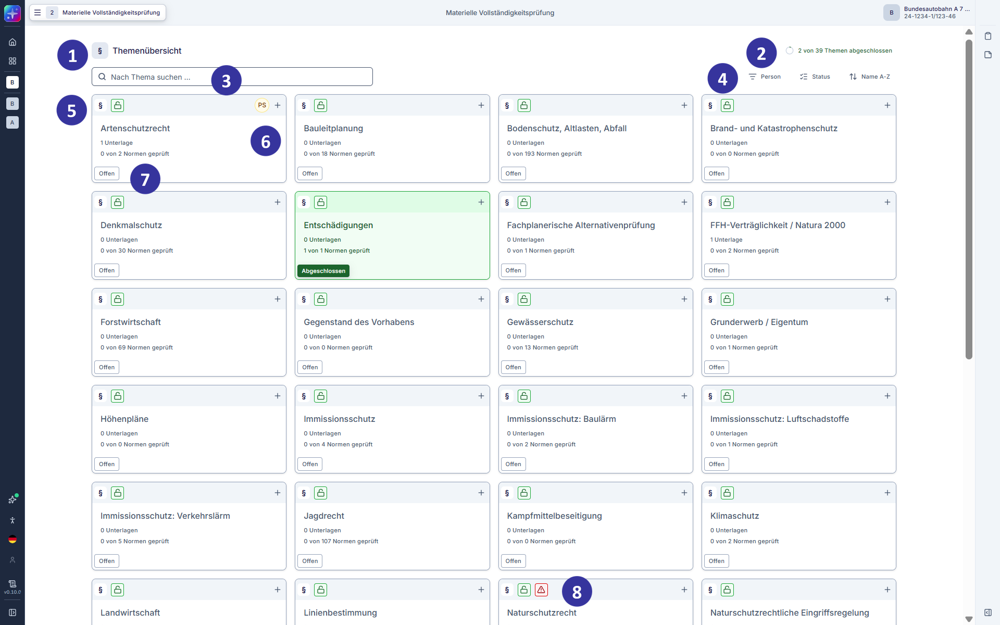
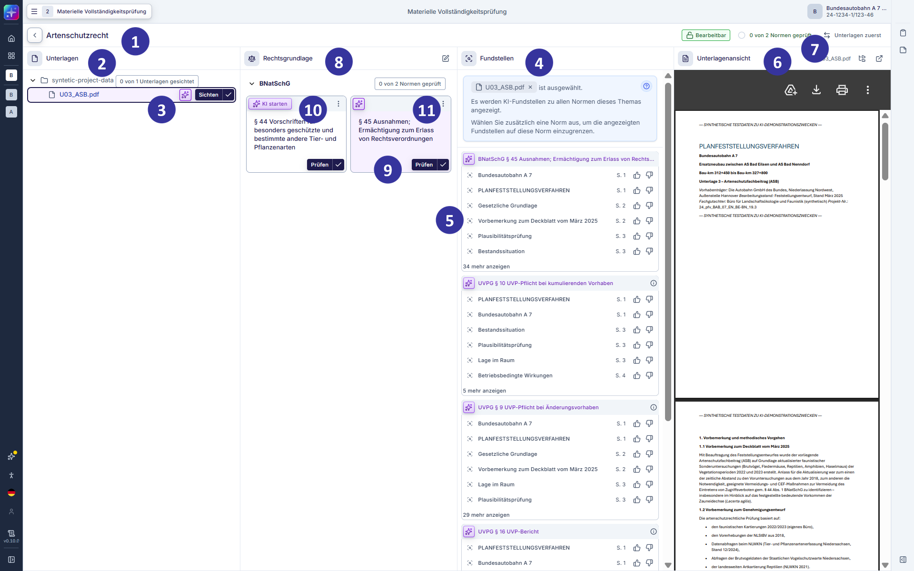
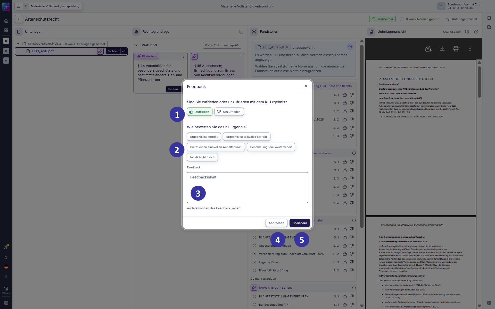
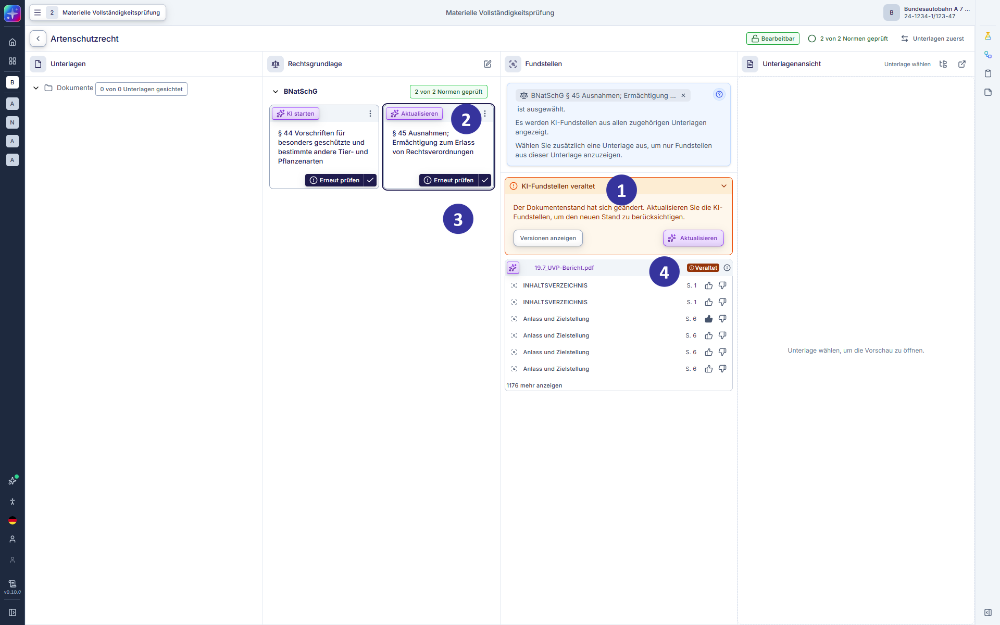
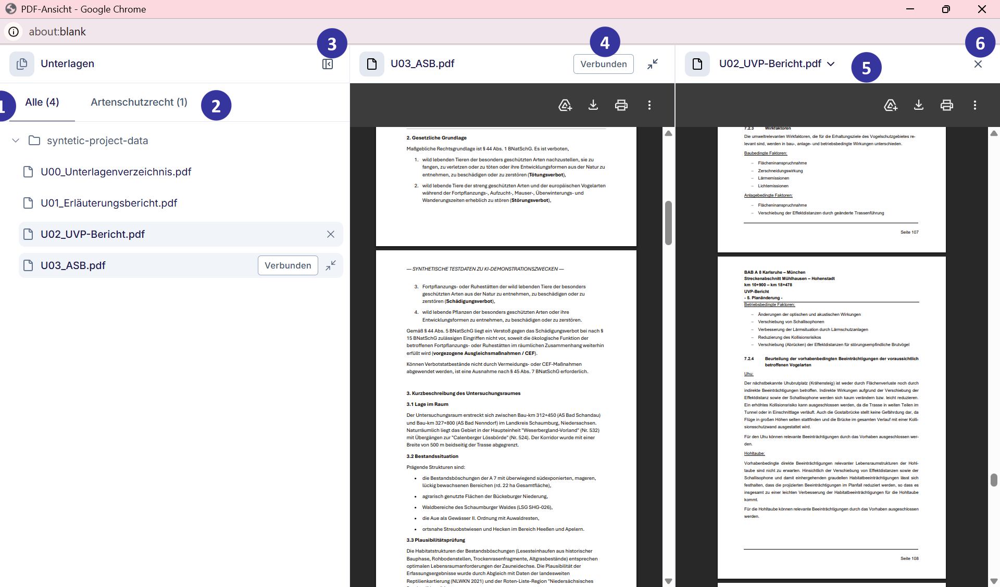

#### 5.2.14 Materielle Vollständigkeitsprüfung: Themenübersicht [!toc] [#kapitel-5-2-14]

*Abbildung 26: Themenübersicht in der materiellen Vollständigkeitsprüfung (Entwicklungsstand: 29.05.2026)*

**Voraussetzungen und Einordnung**

In der materiellen Vollständigkeitsprüfung wird untersucht, ob die Planunterlagen Anstoßwirkung entfalten.

Die materielle Vollständigkeitsprüfung baut auf der formalen Vollständigkeitsprüfung auf.

Für die Nutzung der themenbezogenen Prüfansicht gelten folgende Voraussetzungen:

- Das Verfahren enthält Planunterlagen.
- Die Unterlagen wurden in der formalen Vollständigkeitsprüfung einem Thema zugewiesen.

Unterlagen, die keinem Thema zugewiesen sind, werden in der materiellen Vollständigkeitsprüfung in keiner der Themenkacheln angezeigt. Werden im weiteren Verlauf des Verfahrens neue oder geänderte Unterlagen hochgeladen, erfolgt deren Zuordnung zu den Themen erneut über die formale Vollständigkeitsprüfung (s. Kapitel [5.2.13](#kapitel-5-2-13)). Anschließend können diese Unterlagen in der materiellen Vollständigkeitsprüfung berücksichtigt werden.

**Beschreibung**

Die Ansicht „Themenübersicht“ öffnet sich, wenn Nutzende im Prozessschrittmenü den Schritt „Materielle Vollständigkeitsprüfung“ auswählen. Die Themenübersicht bildet den Einstieg in die materielle Vollständigkeitsprüfung. In der materiellen Vollständigkeitsprüfung wird themenbezogen geprüft, ob die beurteilungsrelevanten rechtlichen Voraussetzungen in den vorgelegten Planunterlagen hinreichend abgehandelt werden und die Ausführungen in den Unterlagen der Öffentlichkeit die Möglichkeit geben, den Grad ihrer Betroffenheit abzuschätzen und sich das Interesse, Einwendungen zu erheben, bewusst machen zu können, d. h. ob die Unterlagen Anstoßwirkung entfalten. Die Themenübersicht stellt die Themen in einer kachelbasierten Übersicht dar. In den Themen werden beurteilungsrelevante rechtliche Voraussetzungen und Planunterlagen themenbezogen zusammengeführt und angezeigt. Unter Berücksichtigung der Tatbestandsvoraussetzungen der einschlägigen Normen gibt die KI zu jedem Thema Fundstellen aus den Planunterlagen aus. In den Übersichts-Kacheln werden zu jedem Thema der aktuelle Bearbeitungsstatus, der Prüfungsfortschritt sowie Hinweise auf fachlich relevante Änderungen übersichtlich angezeigt.

Einer oder mehreren Personen zugewiesene Themen können nur von den zugewiesenen Personen und der Verfahrensleitung bearbeitet werden. Nicht zugewiesene Themen werden entsprechend markiert und können bis zur Zuweisung durch alle Mitglieder des Verfahrensteams bearbeitet werden.

**Elementbeschreibungen**

① Themenübersicht: zeigt alle im Verfahren vorhandenen Themen in einer kachelbasierten Übersicht. Jede Themenkachel repräsentiert ein Thema und stellt die wesentlichen Informationen zum Bearbeitungsstand zusammengefasst dar.

② Fortschrittsanzeige: visualisiert den Gesamtfortschritt der materiellen Vollständigkeitsprüfung über alle Themen hinweg. Der Fortschritt steigt mit jedem abgeschlossenen Thema.

③ Suchfeld: ermöglicht die Volltextsuche nach Themen anhand des Thementitels. Die Suche erfolgt ohne Wildcards, unterscheidet nicht zwischen Groß‑ und Kleinschreibung und aktualisiert die Ergebnisanzeige in Echtzeit.

④ Filter und Sortierung: ermöglicht die Filterung und Sortierung der Themenkacheln, beispielsweise nach dem Status eines Themas.

- Filter „Person“:

zeigt nach Auswahl einer Person die Themen, die einer Person zugeordnet sind. Auswahl von mehreren Personen ist möglich.

- Filter „Status“

„Offen“, „In Prüfung“, „Geprüft“: zeigt jeweils nur Themen mit dem ausgewählten Status.

- Sortierung „Name A-Z“

„Name A-Z“: Themen alphabetisch aufsteigend sortieren.

„Name Z-A“: Themen alphabetisch absteigend sortieren.

⑤ Themenkachel: zeigt verschiedene Informationen zum jeweiligen Thema:

- zugeordnete Person oder Personen, die das Thema bearbeiten
- einen visuellen Hinweis auf verfügbare KI-Fundstellen, wenn vorhanden
- einen visuellen Hinweis auf eine Rechtsänderung oder Änderungen an den zugeordneten Planunterlagen (z. B. bei Planänderungen), wenn vorhanden
- Titel des Themas
- Anzahl zugeordneter Planunterlagen
- Anzeige der geprüften Normen
- aktueller Status des Themas

⑥ Bearbeitende-Anzeige: zeigt an, welcher Person bzw. welchen Personen des Verfahrensteams das Thema zugeordnet ist. Zugeordnete Themen können nur von zugeordneten Personen oder der Verfahrensleitung bearbeitet, jedoch von allen Personen eingesehen / gelesen werden. Nicht zugeordnete Themen können von allen Teammitgliedern bearbeitet werden. Das Plus-Icon ermöglicht die manuelle Anpassung der Themenzuweisung. Themen können Personen zugewiesen werden, die sich bereits im Verfahrensteam befinden. Weitere Personen können über die Einzelverfahrensübersicht (s. Kapitel [5.2.11](#kapitel-5-2-11)) hinzugefügt werden.

⑦ Status-Anzeige eines Themas: Der Status eines Themas gibt den Bearbeitungsstand wieder.

- „Offen“: Das Thema wurde fachlich noch nicht bearbeitet.
- „In Prüfung“: Mindestens eine für das Thema relevante Norm wurde fachlich als geprüft bewertet.
- „Geprüft“: Alle für das Thema relevanten Normen wurden fachlich als geprüft bewertet.

⑧ Kennzeichnung relevanter Änderungen durch Ausrufezeichen-Icon: signalisiert, dass sich die Ausgangslage für das Thema geändert hat und daher eine erneute Prüfung erforderlich sein könnte.

Gekennzeichnet werden:

- Änderungen an den Unterlagen: neu hinzugefügte, gelöschte oder geänderte Unterlagen
- Rechtsänderungen: relevante Änderungen der einschlägigen Rechtsgrundlagen seit Verfahrensbeginn.

##### 5.2.14.1 Materielle Vollständigkeitsprüfung: themenbezogene Prüfansicht [!toc] [#kapitel-5-2-14-1]

*Abbildung 27: Themenbezogene Prüfansicht in der materiellen Vollständigkeitsprüfung (Entwicklungsstand: 29.05.2026)*

**Beschreibung**

Diese Ansicht öffnet sich, wenn Nutzende in der Themenübersicht der materiellen Vollständigkeitsprüfung ein Thema auswählen. In der themenbezogenen Prüfansicht erfolgt die fachliche Prüfung der materiellen Vollständigkeit für das ausgewählte Thema. Die Prüfansicht stellt alle dem Thema zugeordneten Normen, Unterlagen und Fundstellen übersichtlich dar und unterstützt die Bewertung, ob die einschlägigen Normen durch die vorhandenen Unterlagen in ausreichender inhaltlicher Tiefe behandelt werden und die für die Anstoßwirkung im Übrigen relevanten Voraussetzungen erfüllt sind. Unterlagen und zugehörige Fundstellen können eingesehen und die Unterlagen können überprüft werden. Themenspezifische Rechtsgrundlagen werden angezeigt und können angepasst werden.

> **Hinweis zur KI-Unterstützung**
>
> KI-Bewertungen können pro Norm generiert werden. KI‑generierte Fundstellen sind Vorschläge und werden als KI-generiert gekennzeichnet. Sie dienen einer ersten Orientierung innerhalb der Unterlagen. Die rechtliche Bewertung und die Entscheidung über das weitere Vorgehen liegen stets bei den Nutzenden. Zu einzelnen Fundstellen kann Feedback gegeben werden, um eine Bewertung für die KI-Ergebnisse abzugeben.

Offene inhaltliche Aspekte können aus der Prüfansicht heraus dokumentiert oder als Nachforderungen erfasst werden. Der fachliche Bearbeitungsstand des Themas wird fortlaufend aktualisiert. Ein Wechsel zurück zur Themenübersicht ist jederzeit möglich.

**Elementbeschreibungen**

① Titel des Themas: zeigt, welches Thema der materiellen Vollständigkeitsprüfung zur Bearbeitung ausgewählt wurde. Durch Klick auf das Pfeil-Icon gelangen Nutzende zurück zur Themenübersicht.

② Bereich „Unterlagen“: zeigt alle dem ausgewählten Thema zugeordneten Unterlagen in der Ordnerstruktur des Verfahrens an. Ordner können ein- und ausgeklappt werden.

③ Unterlage: Das Stern-Icon zeigt an, dass diese Unterlage KI-Fundstellen enthält. Durch Auswahl einer Unterlage werden die KI-generierten Fundstellen im Fundstellenbereich angezeigt und die Unterlage im Vorschaufenster geöffnet. Zu jeder Unterlage wird der aktuelle Bearbeitungsstatus angezeigt. Der Status wird direkt im Unterlagenbereich angezeigt. Folgende Status der Unterlagen sind vorgesehen:

- „Sichten“: Die Unterlage ist dem Thema zugeordnet, wurde jedoch noch nicht gesichtet.
- „Gesichtet“: Die Unterlage wurde im Themenkontext fachlich abschließend gesichtet.

Durch Klick auf den Button „Sichten“ wird die Unterlage als gesichtet markiert.

④ Bereich „Fundstellen“: zeigt die KI-generierten Fundstellen unter Berücksichtigung der Tatbestandsvoraussetzungen der einschlägigen Normen in den Planunterlagen an. Die Fundstellen werden in einer Liste dargestellt und beziehen sich auf konkrete Textstellen in der ausgewählten Planunterlage. Wird eine andere Planunterlage im Bereich „Unterlagen“ oder eine andere Norm im Bereich „Rechtsgrundlage“ ausgewählt, aktualisiert sich der Fundstellenbereich entsprechend. Durch einen lilafarbenen Hintergrund sowie das KI-Icon wird gekennzeichnet, in welcher Planunterlage zu einer ausgewählten Norm Fundstellen enthalten sind. Ebenso wird gekennzeichnet, zu welchen Normen eine ausgewählte Planunterlage Fundstellen enthält. Die Angabe „Fokus: x von y“ zeigt eine KI-Einschätzung, mit welchen Fundstellen die Prüfung beginnen sollte. Diese enthalten konkrete Angaben zum Sachverhalt. Fundstellen mit dem Hinweis „Nicht im Fokus“ enthalten keine konkreten Angaben zum Sachverhalt oder wurden von der KI nicht eingeschätzt, können für die Prüfung aber dennoch nützlich sein.

⑤ Fundstellen-Kachel: verweist auf eine konkrete, von der KI identifizierte Textstelle in einer Planunterlage. Jede Fundstelle enthält einen Textbezug und eine Seitenzahlangabe aus der Planunterlage. Durch Auswahl einer Fundstelle wird die zugehörige Seite der Planunterlage im Vorschaufenster angezeigt. Fundstellen können mit Klick auf das Icon Daumen hoch oder Daumen herunter bewertet werden (s. Kapitel [5.2.14.2](#kapitel-5-2-14-2)).

⑥ Bereich „Unterlagenansicht“: zeigt die aktuell ausgewählte Planunterlage zur inhaltlichen Prüfung an. Das Vorschaufenster kann durch Klick auf das Expandieren-Icon für die parallele Arbeit auf einem zweiten Bildschirm vom Hauptfenster losgelöst werden (s. Kapitel [5.2.14.4](#kapitel-5-2-14-4)). Planunterlagen, Fundstellen und Rechtsgrundlagen bleiben dabei im Hauptfenster verfügbar. Durch Klick auf das Ordnerstruktur-Icon wird die Übersicht aller Unterlagen angezeigt.

⑦ Ansichtswechsel: wechselt die Position der Bereiche „Unterlagen“ und „Rechtsgrundlage“, um die Ansicht der persönlichen Arbeitsreihenfolge (ausgehend von der Rechtsgrundlage oder ausgehend von den Planunterlagen) anzupassen. Diese Einstellung wird (nur) für den jeweiligen Nutzenden gespeichert.

⑧ Bereich „Rechtsgrundlage“: zeigt die dem ausgewählten Thema zugeordneten Normen an. Diese Auswahl wird verfahrensübergreifend festgelegt. Über das Bearbeiten‑Icon kann die themenspezifische Rechtsgrundlage angepasst werden. Im Dialog „Rechtsgrundlage bearbeiten“ stehen dazu alle verfügbaren Normen zur Auswahl. Die Auswahl von landesrechtlichen Normen ist bereits auf das für das Verfahren einschlägige Landesrecht begrenzt. Die manuell hinzugefügten Normen werden mit einem blauen Verknüpfung-Icon gekennzeichnet.

⑨ Norm-Kachel: zeigt jeweils eine dem Thema zugeordnete Norm an. Die Norm-Kachel zeigt den Paragrafen bzw. Artikel, die entsprechende amtliche Überschrift der Norm sowie den aktuellen fachlichen Bearbeitungsstand an. Geprüfte Normen sind visuell von ungeprüften Normen unterscheidbar. Die Markierung einer Norm als geprüft kann gesetzt und wieder aufgehoben werden. Nutzende können den Volltext einer Norm einsehen und die fachliche Bewertung vornehmen, ob die Norm durch die dem Thema zugeordneten Unterlagen, den Voraussetzungen der materiellen Vollständigkeitsprüfung entsprechend, ausreichend abgehandelt ist. Wenn eine Rechtsänderung vorliegt, wird diese in der Norm-Kachel markiert.

⑩ Button „KI starten“: Per Klick durchsucht die KI die dem Thema zugeordneten Planunterlagen auf Sachverhalts-Fundstellen zur gewählten Norm. Diese werden im Bereich „Fundstellen“ angezeigt.

⑪ Über das Drei-Punkte-Menü der Norm-Kachel stehen zusätzliche Aktionen zur Verfügung:

- „Nachfordern“: ermöglicht das Erstellen einer Nachforderung. Per Klick öffnet sich die Nachforderungsliste in der Seitenleiste (s. Kapitel [6.2.2](#kapitel-6-2-2)).
- „Kommentar hinzufügen“: ermöglicht das Hinterlegen von Kommentaren. Per Klick öffnet sich das Kommentarmodul in der rechten Seitenleiste (s. Kapitel [6.2.3](#kapitel-6-2-3)).
- „Normtext anzeigen“: öffnet den Volltext der ausgewählten Norm.
- „Norm entfernen“: entfernt die Norm aus der themenspezifischen Rechtsgrundlage. Entfernte Normen können über das Bearbeiten-Icon im Bereich „Rechtsgrundlage“ wieder hinzugefügt werden.

##### 5.2.14.2 Materielle Vollständigkeitsprüfung: themenbezogene Prüfansicht, Feedback Fundstellen [!toc] [#kapitel-5-2-14-2]

*Abbildung 28: Materielle Vollständigkeitsprüfung: themenbezogene Prüfansicht, Feedback Fundstellen (Entwicklungsstand: 29.05.2026)*

**Beschreibung**

KI-generierte Inhalte in der materiellen Vollständigkeitsprüfung sowie der rechtlichen Prüfung und Beschlusserstellung, wie beispielsweise Fundstellen oder Bewertungen, können durch Nutzende mittels „Daumen hoch“ bzw. „Daumen herunter“ bewertet werden. Diese Bewertungen sind für andere Nutzende sichtbar und tragen zur transparenten Einordnung der KI-Ergebnisse bei.

Nach Abgabe einer Bewertung öffnet sich ein Dialogfenster, in dem optional eine weiterführende Einschätzung vorgenommen werden kann. Hierbei steht eine Auswahl vordefinierter Aussagen zur Verfügung, von denen eine per Klick ausgewählt werden kann. Ergänzend besteht die Möglichkeit, die Bewertung durch einen Freitext zu konkretisieren.

Die abgegebenen Rückmeldungen sind für andere Nutzende einsehbar und unterstützen die gemeinsame Bewertung und kontinuierliche Verbesserung der KI-Ergebnisse.

**Elementbeschreibungen**

① Bewertung: bietet die Möglichkeit, ein KI-Ergebnis wie eine Fundstelle als positiv oder negativ zu bewerten.

② Feedback-Auswahl: bietet in Bezug auf die positive oder negative Bewertung eine Auswahl vordefinierter Aussagen an, von denen eine per Klick ausgewählt werden kann.

③ Freitextfeld: ermöglicht die Eingabe einer detaillierten Rückmeldung. Die Eingabe von 500 Zeichen ist möglich.

④ Button „Abbrechen“: verwirft die Eingaben und schließt die Bearbeitungsansicht.

⑤ Button „Speichern“: übernimmt die getätigten Eingaben und schließt die Bearbeitungsansicht, auch wenn keine weiterführende Einschätzung vorgenommen wurde.

##### 5.2.14.3 Materielle Vollständigkeitsprüfung: themenbezogene Prüfansicht, geänderte Unterlagen [!toc] [#kapitel-5-2-14-3]

*Abbildung 29: Materielle Vollständigkeitsprüfung: themenbezogene Prüfansicht, geänderte Unterlagen (Entwicklungsstand: 29.05.2026)*

**Beschreibung**

Änderungen der Unterlagen können zu einem veränderten Sachverhalt im Verfahren führen. Um diese Änderungen in der fachlichen Bewertung zu berücksichtigen, besteht die Möglichkeit, bestehende KI-Ergebnisse zu aktualisieren.

Nutzende werden in der Applikation durch eine Hinweismeldung auf entsprechende Änderungen aufmerksam gemacht. Gleichzeitig wird in der Fundstellenansicht kenntlich gemacht, dass die zugrunde liegenden Ergebnisse auf veralteten Unterlagen basieren.

Zur Einordnung der Relevanz einer Aktualisierung können die verschiedenen Versionsstände der Unterlagen eingesehen werden. Auf diese Weise lässt sich prüfen, ob Änderungen im Sachstand die vorliegende Norm betreffen und daraus resultierend eine erneute Auswertung sinnvoll ist.

Sofern bereits ein Prüfergebnis auf Grundlage einer zwischenzeitlich veralteten Unterlage vorliegt, wird dieses in der Applikation entsprechend gekennzeichnet und auf den Status „erneut prüfen“ zurückgesetzt. Dadurch wird sichergestellt, dass Bewertungen auf einer aktuellen und konsistenten Datengrundlage erfolgen.

**Elementbeschreibungen**

① Hinweis auf Änderung der Unterlage: meldet eine Änderung der Unterlage und bietet die Möglichkeit, die aktuelle Version und die vorangegangenen Versionen auf der Einzelverfahrensübersicht einzusehen.

② „Aktualisieren“-Button: startet die normbezogene KI-Analyse auf Basis der aktuellen (neuen / geänderten) Unterlagen.

③ „Erneut prüfen“-Button: Die Sätze der Norm/en waren vor der Änderung der Unterlagen als „geprüft“ gekennzeichnet. Durch die nachträgliche Änderung kann sich der zugrunde liegende Sachverhalt verändert haben, sodass eine erneute Prüfung erforderlich ist.

Die Applikation kennzeichnet diesen Fall entsprechend. Nach erneuter fachlicher Bewertung kann der Status per Klick wieder auf „geprüft“ gesetzt werden.

④ Änderungshinweis: kennzeichnet KI-Ergebnisse, die auf veralteten Unterlagen basieren.

##### 5.2.14.4 Materielle Vollständigkeitsprüfung: Vergleichsansicht für Unterlagen [!toc] [#kapitel-5-2-14-4]

*Abbildung 30: Vergleichsansicht für Unterlagen in der materiellen Vollständigkeitsprüfung (Entwicklungsstand: 29.05.2026)*

**Beschreibung**

Diese Ansicht öffnet sich, wenn Nutzende in der themenbezogenen Prüfansicht der materiellen Vollständigkeitsprüfung (s. Kapitel [5.2.14.1](#kapitel-5-2-14-1)) das Vorschaufenster erweitern, um es vergrößert oder auf einem zweiten Bildschirm anzuzeigen. Die Vergleichsansicht für Unterlagen dient der parallelen Einsicht und Gegenüberstellung von Planunterlagen, zum Beispiel während der Sichtung themenbezogener Planunterlagen im Rahmen der materiellen Vollständigkeitsprüfung.

Die Darstellung erfolgt über die PDF‑Anzeige des verwendeten Browsers. Der verfügbare Funktionsumfang kann daher je nach Browser variieren.

**Elementbeschreibungen**

① Filter „Alle“: zeigt alle im Verfahren vorhandenen Planunterlagen an.

② Filter „Ausgewähltes Thema“: zeigt die zugeordneten Planunterlagen zum jeweiligen Thema an.

③ Minimieren-Icon: minimiert den Bereich „Unterlagen“. Durch Klick auf das Maximieren-Icon kann die Vergleichsansicht für Unterlagen wieder geöffnet werden.

④ Label „Verbunden“: kennzeichnet die Planunterlage, die mit der Hauptansicht verbunden bleibt. Bei Wechsel der ausgewählten Planunterlage in der Hauptansicht ändert sich die Planunterlage in der Spalte „Verbunden“, die anderen Planunterlagen bleiben sichtbar.

⑤ Vergleichsansicht: zeigt Planunterlagen nebeneinander an und ermöglicht deren gleichzeitige Sichtung. Weitere Planunterlagen können durch Klick auf eine weitere Planunterlage im Unterlagenbaum hinzugefügt werden.

⑥ Schließen-Icon: schließt die maximierte Darstellung der Vergleichsansicht für Unterlagen.
