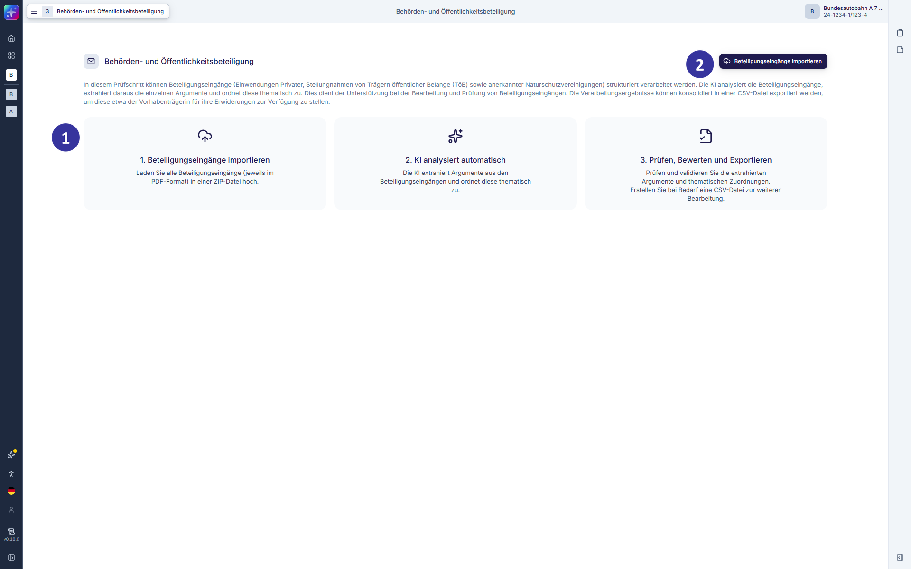
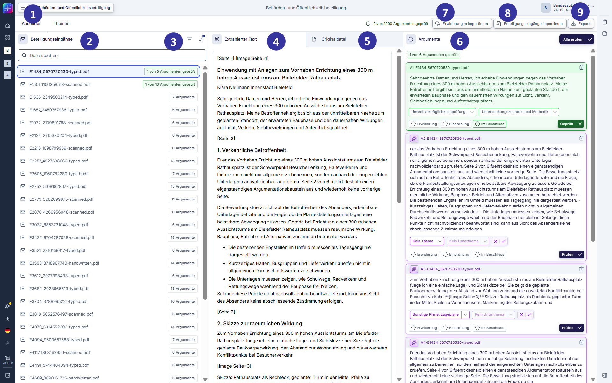
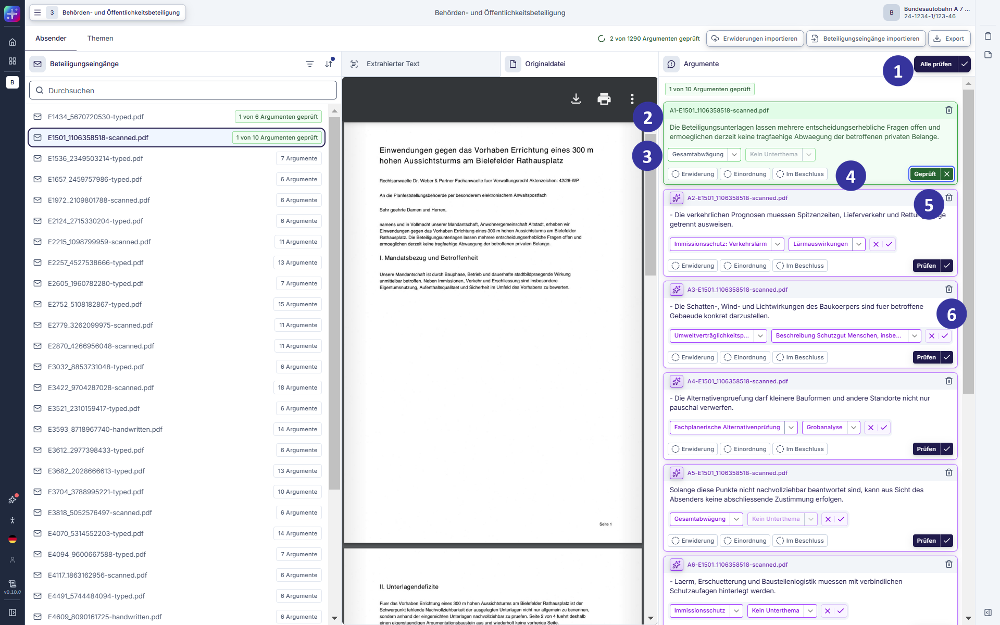
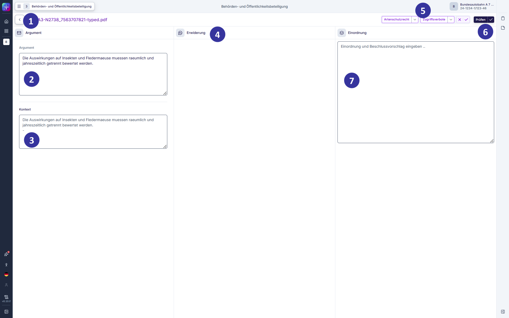
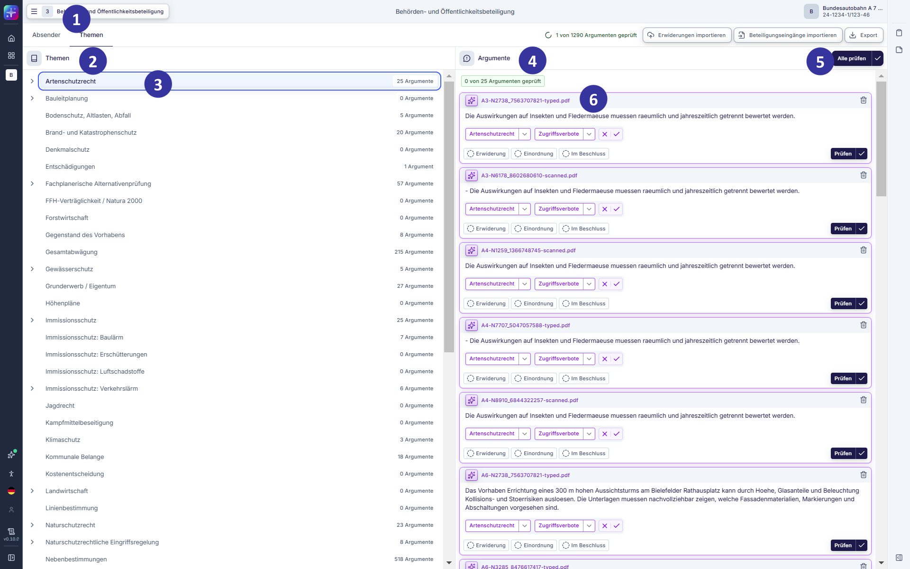

#### 5.2.15 Behörden- und Öffentlichkeitsbeteiligung [!toc] [#kapitel-5-2-15]

##### 5.2.15.1 Behörden- und Öffentlichkeitsbeteiligung: Beteiligungseingänge importieren [!toc] [#kapitel-5-2-15-1]

*Abbildung 31: Behörden- und Öffentlichkeitsbeteiligung – Beteiligungseingänge importieren (Entwicklungsstand: 29.05.2026)*

**Voraussetzungen und Einordnung**

Im Rahmen des Anhörungsverfahrens / der Behörden- und Öffentlichkeitsbeteiligung werden u. a. Einwendungen und Stellungnahmen bearbeitet, die nach Auslegung der Planunterlagen eingehen. Die Beteiligungseingänge (Einwendungen von Privatpersonen und Stellungnahmen von Behörden und sonstigen Trägern öffentlicher Belange sowie anerkannten Naturschutzvereinigungen) werden durch die KI in Einzelargumente zerschnitten; diese werden einem Thema zugeordnet (s. Kapitel [5.2.13.2](#kapitel-5-2-13-2)). Die so aufbereiteten Beteiligungseingänge können der Vorhabenträgerin zur effizienten und zielgerichteten Bearbeitung zur Verfügung gestellt werden.

Die Vorhabenträgerin erwidert die Einwendungen und Stellungnahmen; dabei wird jedes Einzelargument erwidert. Die Erwiderung wird von den Bearbeitenden geprüft; bei Bedarf werden Anmerkungen zum Einzelargument oder der Erwiderung verfasst (Einordnung). Ziel des Prozessschritts Behörden- und Öffentlichkeitsbeteiligung ist, alle in den Beteiligungseingängen enthaltenen Argumente und Erwiderungen thematisch so zuzuordnen und ggf. vorzustrukturieren, dass sie im weiteren Verfahren und im Beschluss adäquat und effizient berücksichtigt werden können.

**Beschreibung**

Die Ansicht „Behörden- und Öffentlichkeitsbeteiligung: Beteiligungseingänge importieren“ öffnet sich, wenn Nutzende im Prozessschrittmenü den Schritt „Behörden- und Öffentlichkeitsbeteiligung“ auswählen und noch keine Beteiligungseingänge importiert wurden. Die Ansicht bildet den Einstieg in die Behörden- und Öffentlichkeitsbeteiligung und bietet die Möglichkeit, Beteiligungseingänge hochzuladen. Beteiligungseingänge können ausschließlich im PDF-Format in einem ZIP-Archiv importiert werden. Um die Zuordnung zum jeweiligen Absender sicherzustellen, ist eine korrekte Benennung der PDF-Dateien essenziell. Dies geschieht mithilfe der E/S/N-Nummer:

- E: Einwendungen von Privatpersonen
- S: Stellungnahme einer Behörde oder eines Trägers öffentlicher Belange
- N: Stellungnahme einer anerkannten Naturschutzvereinigung

Auf den Kennbuchstaben folgt eine vierstellige Ziffernfolge. Pro Kennbuchstaben wird nach Verfahrensbeteiligtem hochgezählt. So können Beteiligungseingänge eines Absenders gruppiert werden. Dateibenennungen dürfen nicht doppelt vergeben werden.

Beim Upload werden die Beteiligungseingänge nach Prompt Injection (dt. „Aufgaben-Injektion“; potenziell schädliche Anweisungen an die KI) durchsucht. Beteiligungseingänge, die Prompt Injection enthalten, werden gekennzeichnet und nicht weiterverarbeitet.

**Elementbeschreibungen**

① Prozesserläuterung: erläutert die folgenden Arbeitsschritte.

② Import-Button: ermöglicht das Hochladen von Beteiligungseingängen als PDF-Dateien in einem ZIP-Archiv. Die PDF-Dateien müssen nach dem Schema E/S/N + vierstellige Ziffernfolge benannt sein. Der Import startet die Verarbeitung durch die KI.

##### 5.2.15.2 Behörden- und Öffentlichkeitsbeteiligung: Ansicht Beteiligungseingänge / Absender-Ansicht [!toc] [#kapitel-5-2-15-2]

*Abbildung 32: Behörden- und Öffentlichkeitsbeteiligung – Absender-Ansicht (Entwicklungsstand: 29.05.2026)*

**Beschreibung**

Nach erfolgreichem Import sowie der Zerschneidung und Kategorisierung der Beteiligungseingänge werden diese in der Hauptansicht der Behörden- und Öffentlichkeitsbeteiligung angezeigt. Die Ansicht ermöglicht eine Bearbeitung nach Beteiligungseingang und zudem die themenbezogene Bearbeitung der kategorisierten Argumente.

**Elementbeschreibungen**

① Ansichtswechsel: zeigt die Beteiligungseingänge nach Verfahrensbeteiligten sortiert sowie die in Einzelargumente zerschnittenen Beteiligungseingänge, die nach dem zugeordneten Thema und Unterthema sortiert sind.

② Beteiligungseingänge: listet alle Dateien der Beteiligungseingänge auf. Ein Klick auf einen Beteiligungseingang öffnet die Ansicht der Originaldatei, des extrahierten Textes sowie der extrahierten Argumente.

③ Suche und Filter: ermöglicht die Suche nach Beteiligungseingängen über deren Dateinamen sowie die Filterung nach Einwendungen, Stellungnahmen von Behörden und sonstigen Trägern öffentlicher Belange und Stellungnahmen anerkannter Vereinigungen.

④ Bereich „Extrahierter Text“: zeigt den durch die KI aus dem Beteiligungseingang extrahierten Text an.

⑤ Bereich „Originaldatei“: zeigt die PDF-Datei des Beteiligungseingangs an.

⑥ Bereich „Argumente“: bildet die aus einem Beteiligungseingang extrahierten (Einzel-)Argumente ab.

⑦ Button „Erwiderungen importieren“: ermöglicht das Hochladen der CSV-Datei, in der die Vorhabenträgerin in der Spalte „Erwiderungen“ auf die einzelnen Argumente erwidert hat. Alle weiteren Informationen in der Datei dürfen nicht verändert werden, um einen erneuten Import zu ermöglichen.

⑧ Button „Beteiligungseingänge importieren“: ermöglicht das Hochladen von weiteren Beteiligungseingängen. Der erneute Upload von gleichbenannten Dateien ist nicht möglich.

⑨ Button „Export“: ermöglicht das Herunterladen der zerschnittenen und kategorisierten Beteiligungseingänge, z. B. für den Versand an die Vorhabenträgerin als CSV-Datei. Diese kann beispielsweise in Excel weiterverarbeitet werden.

##### 5.2.15.3 Behörden- und Öffentlichkeitsbeteiligung: Argumentkacheln [!toc] [#kapitel-5-2-15-3]

*Abbildung 33: Behörden- und Öffentlichkeitsbeteiligung – Argumentkacheln (Entwicklungsstand: 29.05.2026)*

**Beschreibung**

Nach erfolgreichem Import sowie der Aufbereitung der Beteiligungseingänge, einschließlich der Extraktion und thematischen Kategorisierung der Argumente, werden diese in der Hauptansicht der Behörden- und Öffentlichkeitsbeteiligung dargestellt. Die Argumentkachel bietet dabei einen kompakten Überblick über den Inhalt, den jeweiligen Bearbeitungsstand sowie den Status eines Arguments.

Ein Argument durchläuft im weiteren Verfahren mehrere Bearbeitungsstufen, die in der Argumentkachel wie folgt visualisiert werden:

- Vor Sichtung und Bestätigung: Die Extraktion des Arguments und die Themenzuordnung wurden noch nicht bestätigt.
- Nach Sichtung und Bestätigung oder Anpassung: Die Extraktion und die Themenzuordnung wurden geprüft und ggf. angepasst.
- „Erwiderung“: Es liegt eine Erwiderung vor oder diese steht noch aus.
- „Einordnung“: Eine fachliche Einordnung des Arguments ist bei Bedarf erfolgt.
- Prüfung: Das Argument wurde vom Bearbeitenden geprüft oder ist noch offen.
- „Berücksichtigung im Beschluss“-Button: Das Argument wurde im Beschluss behandelt oder ist noch nicht berücksichtigt.

Durch die strukturierte Darstellung der Bearbeitungsstände wird eine transparente Nachverfolgung des Fortschritts einzelner Argumente ermöglicht.

**Elementbeschreibungen**

① Button „Alle prüfen“: setzt alle Argumente auf den Status „geprüft“.

② Argument-Kachel: zeigt den Titel, den Text, die thematische Zuordnung sowie den Bearbeitungsstand des Arguments an.

Vor Bestätigung der Themenzuordnung ist die Kachel lila gefärbt, nach Bestätigung der Themenzuordnung aber vor Statuswechsel auf „geprüft“ weiß gefärbt und nach Setzung des Status „geprüft“ grün eingefärbt.

③ Themenzuordnung: Jedes Argument kann einem Thema und Unterthema zugeordnet werden. Dies wird initial durch die KI-Verarbeitung vorgeschlagen und kann bestätigt oder verändert werden. Unsichere KI-Vorschläge werden durch ein Ausrufezeichen-Icon markiert.

④ Statusanzeigen „Erwiderung“, „Einordnung“ und „im Beschluss“: zeigen mit einem grünen Haken an, ob zum Argument eine Erwiderung der Vorhabenträgerin vorliegt, ob eine Einordnung verfasst wurde und ob das Argument im Schritt „Rechtliche Prüfung und Beschlusserstellung“ als „im Beschluss“ markiert wurde.

⑤ Button „Prüfen“: ermöglicht es, ein Argument als fachlich geprüft zu markieren.

⑥ Button „Löschen“: ermöglicht es, Argumente zu löschen.

##### 5.2.15.4 Behörden- und Öffentlichkeitsbeteiligung: Argument-Ansicht [!toc] [#kapitel-5-2-15-4]

*Abbildung 34: Behörden- und Öffentlichkeitsbeteiligung – Argument-Ansicht (Entwicklungsstand: 29.05.2026)*

**Beschreibung**

Die Detailansicht eines Arguments dient der vertieften Prüfung und Bearbeitung einzelner Beteiligungseingänge auf Einzelarguments-Ebene. Sie stellt alle relevanten Informationen übersichtlich dar und unterstützt eine fundierte fachliche Einordnung.

In der Detailansicht werden das Argument selbst sowie dessen thematische Zuordnung angezeigt. Ergänzend wird der inhaltliche Kontext des Einzelarguments dargestellt, indem die umgebenden Textpassagen des Beteiligungseingangs eingeblendet werden. Dies ist sowohl bei kurzen Argumenten als auch bei umfangreichen Ausführungen hilfreich, um den inhaltlichen Zusammenhang nachvollziehen zu können.

Sofern bereits vorhanden, wird zudem die Erwiderung der Vorhabenträgerin angezeigt. Darüber hinaus besteht die Möglichkeit, eine eigene fachliche Einordnung zum Argument zu erfassen.

Zur Dokumentation des Bearbeitungsstands kann das Argument als „geprüft“ markiert werden.

**Elementbeschreibungen**

① Kennung des Arguments: Die einzelnen extrahierten Argumente eines Beteiligungseingangs werden mit dem Kennbuchstaben „A“ gekennzeichnet und durchnummeriert.

② Argument: zeigt den extrahierten Text des Arguments an. Das Stift-Icon ermöglicht die Bearbeitung des Argument- und Kontexttextes.

③ Kontext: zeigt den inhaltlichen Kontext des Einzelarguments an, indem die das Argument umgebenden Textpassagen des Beteiligungseingangs angezeigt werden.

④ Erwiderung: zeigt die Erwiderung der Vorhabenträgerin auf das jeweilige Argument an, wenn bereits vorhanden.

⑤ Thema: zeigt Thema und Unterthema des Arguments an. Die lila Markierung der KI-generierten Ersteinschätzung verschwindet nach Abhaken oder Editieren der Kategorisierung.

⑥ Prüfen: markiert das Argument als fachlich geprüft.

⑦ Einordnung: Freitextfeld zum Verfassen einer fachlichen Einordnung zum Argument oder der Erwiderung.

##### 5.2.15.5 Behörden- und Öffentlichkeitsbeteiligung: Themen-Ansicht [!toc] [#kapitel-5-2-15-5]

*Abbildung 35: Behörden- und Öffentlichkeitsbeteiligung – Themen-Ansicht (Entwicklungsstand: 29.05.2026)*

**Beschreibung**

Alternativ zur Darstellung nach einzelnen Beteiligungseingängen eines Absendenden / Verfahrensbeteiligten können Argumente in der Applikation themenbasiert angezeigt werden. Dabei erfolgt eine Strukturierung nach Themen und Unterthemen, um eine fachlich gebündelte Übersicht zu ermöglichen.

Durch Auswahl eines Themas werden alle dem Thema zugeordneten Argumente angezeigt. Diese Ansicht umfasst sowohl KI-generierte Themenzuordnungen als auch die bereits durch Nutzende bestätigten oder angepassten Inhalte.

Die themenbasierte Darstellung unterstützt eine gezielte inhaltliche Bearbeitung und erleichtert die strukturierte Auseinandersetzung mit Argumenten im jeweiligen fachlichen Kontext.

**Elementbeschreibungen**

① Ansichtswechsel: zeigt die Beteiligungseingänge sortiert nach Verfahrensbeteiligten oder die zerschnittenen Argumente kategorisiert nach dem zugeordneten Thema und Unterthema.

② Themenansicht: zeigt die Themen und Unterthemen und die Anzahl der zugeordneten Argumente sowie deren Bearbeitungsstand an.

③ Ausgewähltes Thema: Die dem ausgewählten Thema oder Unterthema zugeordneten Argumente werden in der Argumente-Ansicht im rechten Bildschirmbereich angezeigt.

④ Bereich „Argumente“: bildet die einem Thema und / oder Unterthema zugeordneten, extrahierten Argumente ab. Wird das Thema oder Unterthema in dieser Ansicht verändert, wird das Argument entsprechend verschoben.

⑤ Button „Alle prüfen“: markiert alle Argumente eines Themas oder Unterthemas als „geprüft“.

⑥ Argument-Kachel: ermöglicht die Bearbeitung eines Arguments. Klick auf den Argumenttitel öffnet die Detailansicht eines Arguments.
