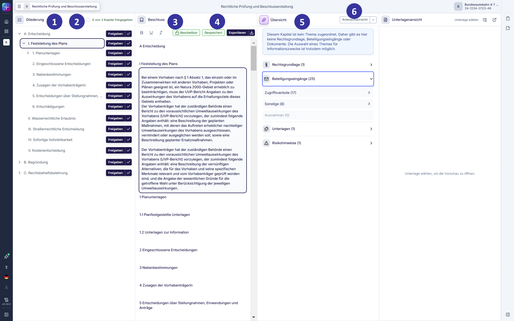
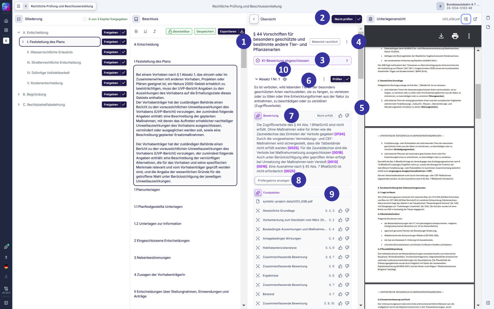
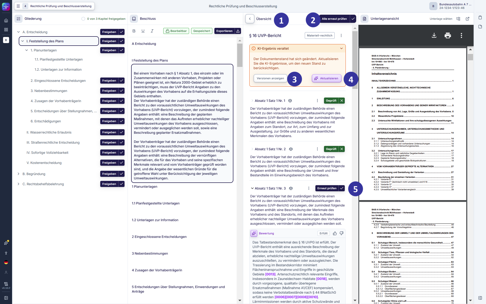
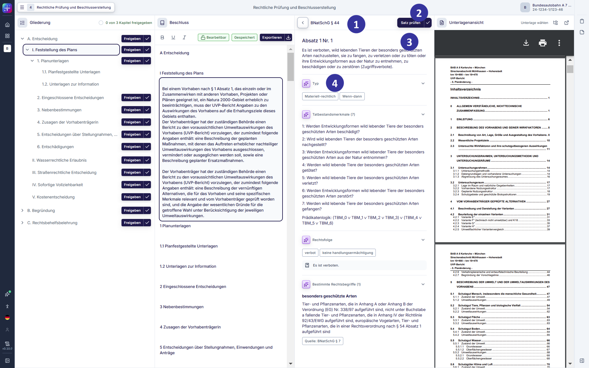
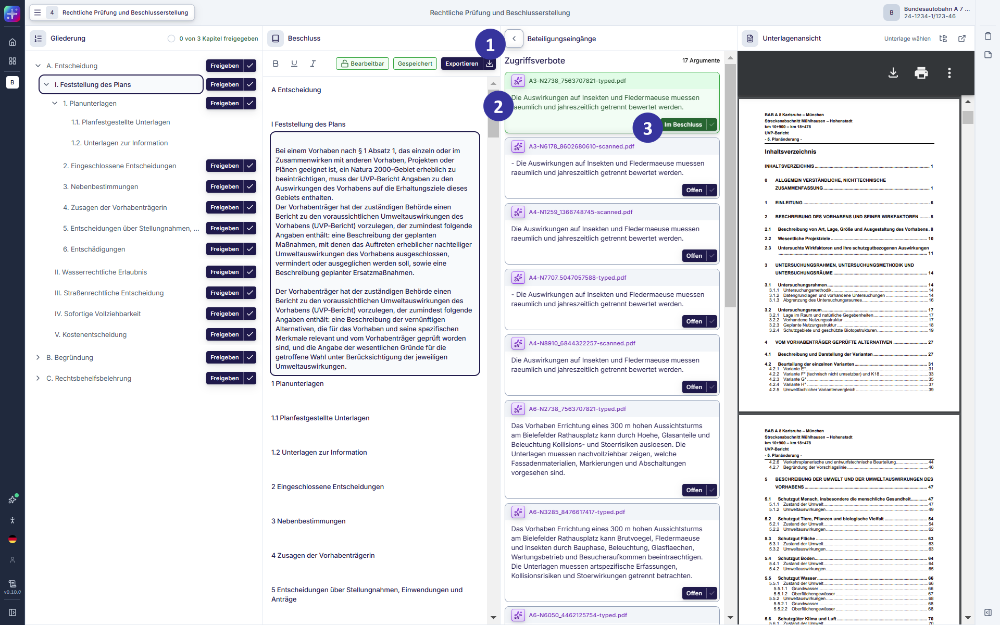
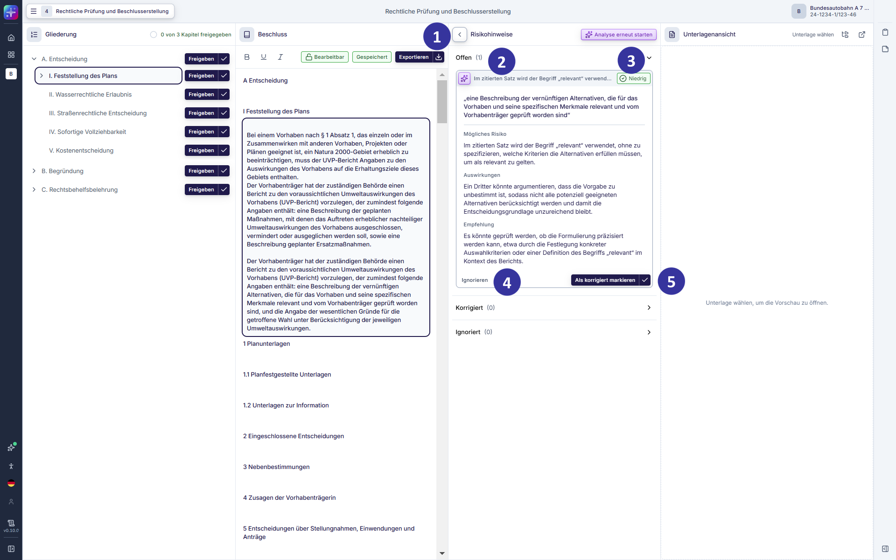

#### 5.2.16 Rechtliche Prüfung und Beschlusserstellung: Hauptansicht [!toc] [#kapitel-5-2-16]

*Abbildung 36: Hauptansicht der rechtlichen Prüfung und Beschlusserstellung (Entwicklungsstand: 29.05.2026)*

**Voraussetzungen und Einordnung**

Im Rahmen der rechtlichen Prüfung und Beschlusserstellung wird das Vorhaben anhand der einschlägigen Rechtsgrundlagen auf seine Genehmigungsfähigkeit geprüft und ein Beschluss verfasst. Beim Abfassen des Beschlusses werden auch die Kapitel des Beschlusses verfasst, die nicht auf die Prüfung materieller Normen zurückgehen (bspw. Tenor, Nebenbestimmungen, Zusagen, Sachverhalt / Verfahrensgang, Behandlung der Einwendungen und Stellungnahmen).

Die Funktionen der rechtlichen Prüfung und Beschlusserstellung greifen auf Inhalte zurück, die in den vorgelagerten Prozessschritten angelegt bzw. vorbereitet wurden.

Für die Nutzung der Funktionen der rechtlichen Prüfung und Beschlusserstellung gelten folgende Voraussetzungen:

- Unterlagen stehen zur Verfügung, wenn sie im Verfahren formal erfasst und einem Thema zugeordnet wurden.
- Einschlägige Rechtsnormen eines Themas werden aus dem Bearbeitungsstand der materiellen Vollständigkeitsprüfung übernommen.
- Beteiligungseingänge sind sichtbar, sofern sie einem Thema zugeordnet sind.
- Die Beschlussgliederung wird behördenspezifisch bereitgestellt und bildet den strukturellen Rahmen der Bearbeitung.
- Neue bzw. geänderte Planunterlagen werden erst dann in der rechtlichen Prüfung berücksichtigt, wenn sie in den vorgelagerten Prüfschritten einem Thema zugeordnet wurden.

**Beschreibung**

Diese Ansicht öffnet sich, wenn Nutzende im Prozessschrittmenü den Schritt „Rechtliche Prüfung und Beschlusserstellung“ auswählen. In dieser Ansicht erfolgen die rechtliche Prüfung und die Erstellung eines Beschlusses. Nutzende bearbeiten den Beschluss gemäß der behördenspezifischen Gliederung, prüfen die Genehmigungsfähigkeit des Vorhabens anhand der einschlägigen Normen und sonstiger beurteilungsrelevanter rechtlicher Voraussetzungen und überprüfen in diesem Kontext etwaige rechtliche Bewertungen aus vorherigen Prüfschritten. Die einzelnen Abschnitte des Beschlusses sind über das jeweilige Thema mit den zugehörigen Normen, Planunterlagen und Beteiligungseingängen verknüpft. Die Prüfung der rechtlichen Voraussetzungen und die Erstellung des Beschlusses erfolgen dabei integriert in einer Arbeitsansicht.

Über die Themenzuordnung sind die Kapitel des Beschlusses Teammitgliedern zur Bearbeitung zugewiesen. Kapitel, die nicht auf die Prüfung materieller Normen zurückgehen (bspw. Tenor, Nebenbestimmungen, Zusagen, Sachverhalt / Verfahrensgang, Behandlung der Einwendungen und Stellungnahmen), d. h. Kapitel „ohne Thema“, sowie Kapitel, die auf die Prüfung materieller Normen zurückgehen, d. h. Kapitel „mit Thema“, das keiner Person explizit zugewiesen ist, können von allen Verfahrensteammitgliedern bearbeitet werden.

**Elementbeschreibungen**

① Bereich „Gliederung“: bildet die formale, behördenspezifisch vorgegebene Struktur des Beschlusses ab. Die Gliederungspunkte entsprechen den vorgesehenen Kapiteln des Beschlusses. Durch Auswahl eines Gliederungspunkts wird das zugehörige Kapitel im Beschlusseditor angezeigt und zur Bearbeitung geöffnet. So können die Inhalte abschnittsweise erstellt, geprüft und überarbeitet werden.

Personen mit der Rolle Bearbeitende können Kapitel ihres Themenbereichs als abgeschlossen markieren. Administration oder Verfahrensleitung können ein Kapitel als freigegeben markieren.

② Fortschrittsanzeige: visualisiert den Bearbeitungsstand des Beschlusses. Bearbeitende können die von ihnen bearbeiteten Kapitel als „Abgeschlossen“ und bereit zur Freigabe durch die Rolle Verfahrensleitung oder Administration markieren. Durch Bearbeitende abgeschlossene Kapitel werden der Verfahrensleitung oder Administration durch ein Icon angezeigt.

③ Bereich „Beschluss“: bildet den zentralen Arbeitsbereich zur Erstellung und Überarbeitung des Beschlusses. Im Editor wird der bestehende Text des aktuell ausgewählten Gliederungspunkts angezeigt und bearbeitet. Änderungen werden automatisch gespeichert und bleiben beim Wechsel zwischen Gliederungspunkten erhalten.

④ Aktionsanzeige: zeigt den aktuellen Speicherstatus des Beschlusstextes an und stellt exportbezogene Funktionen bereit.

- Label „Gespeichert“: kennzeichnet, dass der aktuelle Bearbeitungsstand des Beschlusses gesichert wurde.
- Button „Exportieren“: ermöglicht den Export des Beschlusses zur externen Weiterverarbeitung. Personen mit der Rolle Administration oder Verfahrensleitung können den Beschlusstext per Klick auf den Export-Button als Word-Datei oder PDF-Datei in der hinterlegten Formatvorlage exportieren.

⑤ Der Bereich „Übersicht“ stellt kontextbezogene Informationen zur Unterstützung der rechtlichen Prüfung bereit. Der Bereich ist mit einem KI‑Icon gekennzeichnet, um automatisiert bereitgestellte Inhalte kenntlich zu machen.

Im Übersichtsbereich werden folgende Inhalte angezeigt:

- Rechtsgrundlage: zeigt die als prüfrelevant beurteilten, thematisch zugeordneten Normen an. Wenn Rechtsänderungen vorliegen, werden diese durch ein Icon mit Tooltip markiert.
- Beteiligungseingänge: zeigt die dem Thema zugeordneten Argumente aus Einwendungen und Stellungnahmen an.
- Unterlagen: zeigt die als beurteilungsrelevant eingestuften, dem Thema zugeordneten Unterlagen an. Die Auswahl einer Unterlage öffnet diese in der Unterlagenvorschau.

Die einzelnen Bereiche können ein‑ und ausgeklappt werden.

⑥ Drop-down Thema, hier „Artenschutzrecht“: zeigt das zum Kapitel zugehörige Thema an und erlaubt einen Wechsel des Themas. Die Auswahl steuert, welche Rechtsgrundlagen, Beteiligungseingänge und Unterlagen im Übersichtsbereich angezeigt werden.

##### 5.2.16.1 Rechtliche Prüfung und Beschlusserstellung: Detailansicht Rechtsgrundlage [!toc] [#kapitel-5-2-16-1]

*Abbildung 37: Detailansicht der Rechtsgrundlage in der rechtlichen Prüfung und Beschlusserstellung (Entwicklungsstand: 29.05.2026)*

**Beschreibung**

Diese Ansicht öffnet sich, wenn Nutzende im Übersichtsbereich der rechtlichen Prüfung und Beschlusserstellung eine Norm auswählen. Die Detailansicht dient der vertieften Prüfung einzelner Sätze der ausgewählten Norm. Sie stellt die KI‑gestützte rechtliche Bewertung sowie zugeordnete Unterlagen-Fundstellen bereit und unterstützt die vorzunehmende rechtliche Prüfung / Würdigung und Beschlusserstellung durch die Nutzenden.

**Elementbeschreibungen**

① Norm-Ansicht: Die Ansicht zeigt die gewählte Norm auf Satz-Ebene an. Wenn bezüglich der ausgewählten Norm Rechtsänderungen vorliegen, werden diese durch ein Icon mit Tooltip markiert.

② Button „Norm prüfen“: ermöglicht es, alle Sätze der ausgewählten Norm gesammelt als geprüft zu kennzeichnen.

③ Button „KI-Analyse starten“, hier zu sehen als „KI-Bewertung abgeschlossen“: stößt die KI‑gestützte Bewertung der ausgewählten Norm unter Berücksichtigung / Auswertung des vorliegenden Sachverhalts an. Im Ergebnis stellt die KI-Lösung Kurzbewertungen und ausführliche Prüfergebnisse zu den einzelnen Sätzen der Norm zur Verfügung. Die erzeugten Inhalte sind als KI‑generierte Hinweise gekennzeichnet. Eine Bewertung wird nur generiert, wenn ausreichend Informationen zur Bewertung des Sachverhalts vorliegen. Wenn dies nicht der Fall ist, wird eine entsprechende Meldung ausgegeben.

④ Über das Drei‑Punkte‑Menü auf Normebene stehen folgende Aktionen zur Verfügung:

- Normtext anzeigen: öffnet den vollständigen Text der ausgewählten Norm.
- „Nachfordern“: ermöglicht das Erstellen einer Nachforderung auf Normebene. Per Klick öffnet sich die Nachforderungsliste in der Seitenleiste.
- „Kommentar hinzufügen“: ermöglicht das Hinterlegen von Kommentaren auf Normebene. Per Klick öffnet sich das Kommentarmodul in der rechten Seitenleiste.

⑤ Button „Prüfen“: kennzeichnet den aktuell ausgewählten Satz als fachlich geprüft. Die Kennzeichnung dokumentiert den Prüfstatus des einzelnen Satzes und wird für die Fortschrittsanzeige herangezogen.

⑥ Über das Drei‑Punkte‑Menü auf Satz-Ebene stehen folgende Aktionen zur Verfügung:

- „Nachfordern“: ermöglicht das Erstellen einer Nachforderung auf Satz-Ebene. Per Klick öffnet sich die Nachforderungsliste in der Seitenleiste.
- „Kommentar hinzufügen“: ermöglicht das Hinterlegen von Kommentaren auf Satz-Ebene. Per Klick öffnet sich das Kommentarmodul in der rechten Seitenleiste.

⑦ KI-Bewertung (z. B. „erfüllt“ / „nicht erfüllt“): Die Anzeige gibt die KI‑gestützte Einschätzung wieder, ob die im Satz enthaltenen Tatbestandsmerkmale als erfüllt oder nicht erfüllt bewertet werden. Die Anzeige stellt eine Bewertungshilfe dar und ersetzt keine eigenständige, durch den Nutzenden in jedem Fall vorzunehmende rechtliche Prüfung. Ein Klick auf einen Verweis in der KI-Bewertung oder die nachfolgend aufgeführten Fundstellen öffnet die entsprechende Seite in der Unterlagenansicht.

⑧ Button „Prüfergebnis anzeigen“: öffnet eine detaillierte Darstellung der KI‑Bewertung zu dem ausgewählten Tatbestandsmerkmal. Die Detaildarstellung des Prüfergebnisses enthält eine ausführliche Begründung der Bewertung im Kontext der zugeordneten Sachverhaltsinformationen. Ein Klick auf einen Verweis im Prüfergebnis oder die nachfolgend aufgeführten Fundstellen öffnet die entsprechende Seite in der Unterlagenansicht.

⑨ Bewertung: Fundstellen sowie Bewertung können mit Klick auf das Icon Daumen hoch oder Daumen herunter bewertet werden (s. Kapitel [5.2.14.2](#kapitel-5-2-14-2)).

⑩ Rechtsmethodik-Icon: öffnet die Rechtsmethodik-Ansicht des jeweiligen Satzes.

##### 5.2.16.2 Rechtliche Prüfung und Beschlusserstellung: Detailansicht Rechtsgrundlage mit geänderten Unterlagen [!toc] [#kapitel-5-2-16-2]

*Abbildung 38: Detailansicht der Rechtsgrundlage in der rechtlichen Prüfung und Beschlusserstellung, Übersicht (Entwicklungsstand: 29.05.2026)*

**Beschreibung**

Änderungen der Unterlagen, beispielsweise infolge von Planänderungen, können zu einem veränderten Sachstand im Verfahren führen. Um diese Änderungen in der fachlichen Bewertung zu berücksichtigen, besteht die Möglichkeit, bestehende KI-Ergebnisse zu aktualisieren.

Nutzende werden in der Applikation durch eine Hinweismeldung auf entsprechende Änderungen aufmerksam gemacht. Gleichzeitig wird an der KI-Bewertung sowie in der Fundstellenansicht kenntlich gemacht, dass die zugrunde liegenden Ergebnisse auf veralteten Unterlagen basieren.

Zur Einordnung der Relevanz einer Aktualisierung können die verschiedenen Versionsstände der Unterlagen eingesehen werden. Auf diese Weise lässt sich prüfen, ob Sachverhaltsänderungen für die Prüfung und Bewertung der vorliegenden Norm relevant sind und ob infolgedessen eine erneute KI-Auswertung hilfreich und sinnvoll ist.

Sofern bereits ein Prüfergebnis auf Grundlage veralteter Unterlagen vorliegt, wird dieses in der Applikation gekennzeichnet und auf den Status „erneut prüfen“ zurückgesetzt. Dadurch wird sichergestellt, dass rechtliche Bewertungen auf der aktuellen, entscheidungserheblichen Datengrundlage beruhen.

**Elementbeschreibungen**

① Zurück-Button: kehrt zur Übersicht zurück.

② Button „Alle prüfen“: markiert den ausgewählten Satz der Norm als geprüft.

③ Hinweis auf Änderung der Unterlagen: meldet eine Änderung der Unterlagen und bietet die Möglichkeit, aktuelle und vorhergehende Stände der Unterlagen in der Verfahrensübersicht (s. Kapitel [5.2.5](#kapitel-5-2-5)) einzusehen.

④ Button „Aktualisieren“: startet die erneute KI-Analyse auf Basis der aktuellen Unterlagen.

⑤ Button „Erneut prüfen“: Der Satz der ausgewählten Norm war vor der Änderung der Unterlagen als „geprüft“ gekennzeichnet. Durch die nachträgliche Änderung kann sich der zugrunde liegende Sachverhalt verändert haben, sodass eine erneute Prüfung erforderlich werden könnte. Über den Button wird bestätigt, dass der geänderte Sachverhalt zur Kenntnis genommen wurde und eine Überprüfung der rechtlichen Bewertung erfolgt ist. Nach erneuter fachlicher Bewertung kann der Status daher per Klick wieder auf „geprüft“ gesetzt werden, sofern die Änderungen im Beschluss bei Bedarf sachgerecht berücksichtigt wurden.

⑥ Änderungshinweis: kennzeichnet KI-Ergebnisse, die auf veralteten Unterlagen basieren.

##### 5.2.16.3 Rechtliche Prüfung und Beschlusserstellung: Detailansicht Rechtsmethodik [!toc] [#kapitel-5-2-16-3]

*Abbildung 39: Detailansicht der Rechtsmethodik in der rechtlichen Prüfung und Beschlusserstellung (Entwicklungsstand: 29.05.2026)*

**Beschreibung**

Diese Ansicht öffnet sich, wenn Nutzende nach Öffnung einer Norm im Prozessschritt der rechtlichen Prüfung und Beschlusserstellung auf das Rechtsmethodik-Icon eines Satzes klicken. Die Detailansicht dient der vertieften Ansicht der rechtsmethodischen Hintergründe einzelner Sätze der ausgewählten Norm. Sie stellt weiterführende Informationen für die rechtliche Bewertung bereit und kann die vorzunehmende rechtliche Prüfung / Würdigung und Beschlusserstellung durch die Nutzenden unterstützen.

**Elementbeschreibungen**

① Zurück-Button: kehrt zur Übersicht zurück.

② Button „Satz prüfen“: markiert den ausgewählten Satz der Norm als geprüft.

③ Satzdarstellung: zeigt den Satz, für den die Detailansicht der Rechtsmethodik geöffnet wurde.

④ Rechtsmethodik: listet die KI-generierte Dekonstruktion der Norm auf, namentlich:

- Typ der Norm
- Tatbestandsmerkmale und Prädikatenlogik
- Rechtsfolge und Rechtsfolgentypisierung
- bestimmte Rechtsbegriffe, wenn im Satz enthalten, und ihre Definition
- unbestimmte Rechtsbegriffe, wenn im Satz enthalten, und ihren Auslegungsvorschlag (Wortlaut, Systematik, Historie, Telos sowie „Gesamtauslegung“)
- Verweise, wenn im Satz enthalten

##### 5.2.16.4 Rechtliche Prüfung und Beschlusserstellung: Detailansicht Beteiligungseingänge [!toc] [#kapitel-5-2-16-4]

*Abbildung 40: Detailansicht der Beteiligungseingänge in der rechtlichen Prüfung und Beschlusserstellung (Entwicklungsstand: 29.05.2026)*

**Beschreibung**

Argumente aus Beteiligungseingängen werden in der Applikation thematisch kategorisiert. Dadurch wird eine strukturierte Bearbeitung im weiteren Verfahren ermöglicht. Die Zuordnung stellt sicher, dass eingegangene Argumente bei Bedarf im fachlich passenden Kontext der entsprechenden Beschlusskapitel angemessen berücksichtigt werden können.

Die einem Beschlusskapitel thematisch zugeordneten Argumente werden bei geöffneter Beschlussansicht zum jeweiligen Kapitel des entsprechenden Themas angezeigt und können dort systematisch abgearbeitet werden. Die zugehörige Ansicht wird geöffnet, indem Nutzende auf „Beteiligungseingänge“ klicken und ein Thema auswählen.

Nutzende haben die Möglichkeit, einzelne Argumente als „im Beschluss berücksichtigt“ zu kennzeichnen, sobald diese aus fachlicher Sicht ausreichend im Beschluss behandelt wurden. Dadurch wird der Bearbeitungsstand transparent dokumentiert und eine vollständige Nachverfolgung der Argumentation unterstützt.

**Elementbeschreibungen**

① Zurück-Button: kehrt zur Übersicht zurück.

② Argument-Karte: zeigt die Kennung sowie den Text des jeweiligen Arguments an. Per Klick wird eine detaillierte Ansicht von Argument, Erwiderung und – soweit vorhanden – Einordnung angezeigt.

③ Status-Button: initial „Offen“, kann ein Argument per Klick als „im Beschluss“ markiert werden.

##### 5.2.16.5 Rechtliche Prüfung und Beschlusserstellung: Detailansicht Risikohinweise [!toc] [#kapitel-5-2-16-5]

*Abbildung 41: Detailansicht der Risikohinweise in der rechtlichen Prüfung und Beschlusserstellung (Entwicklungsstand: 29.05.2026)*

**Beschreibung**

Diese Ansicht öffnet sich, wenn Nutzende auf „Risikohinweise“ klicken. Der Risikohinweisgeber ist ein KI-gestütztes Werkzeug zur Identifikation potenzieller Risiken in einzelnen Kapiteln des Beschlusses. Nach Start des KI-Agenten erfolgt eine automatisierte Analyse des jeweiligen Kapitels, bei der mögliche Risiken erkannt und hinsichtlich ihrer möglichen bzw. potenziellen Schwere in die Kategorien niedrig, mittel oder hoch eingestuft werden.

Für jedes identifizierte mögliche Risiko werden eine relevante Textpassage aus dem Beschlusskapitel (Zitat), eine erläuternde Risikobeschreibung, mögliche Auswirkungen sowie eine unverbindliche Handlungsempfehlung bereitgestellt. Die bereitgestellten Inhalte dienen ausschließlich der Unterstützung und stellen weder eine rechtliche Beratung dar noch handelt es sich um (rechts-)verbindliche Aussagen. Eine fachliche Prüfung durch den Nutzenden („Human-in-the-Loop“) ist erforderlich.

Identifizierte Risiken können als „ignoriert“ oder „korrigiert“ markiert werden. Korrigierte Risiken werden aus der Übersicht der offenen Risiken entfernt. Nach Überarbeitung des Dokuments kann der Risikohinweisgeber erneut gestartet werden, um aktualisierte Ergebnisse zu erhalten. Die KI sucht derzeit nach Risiken folgender Kategorien:

- Bestimmtheit von Regelungen im Beschluss bzgl. Adressat, Sachverhalt und Rechtsfolge
- Normative Verankerung: fehlende erkennbare gesetzliche Anknüpfung von Begründungen und Ermessensentscheidungen
- Präzision juristischer Formulierungen / Vermeidung von Unschärfen: Anzeige juristischer Fachtermini, die kontextbezogen vertauscht und damit unrichtig verwendet worden sein könnten (z. B. „erheblich“ vs. „wesentlich“, „Rücknahme“ vs. „Widerruf“) sowie Anzeige missverständlicher Verweisungen
- Prägnanz / Substanz der Argumentation: Identifikation generischer Textbausteine ohne Fallbezug sowie bloßer Leerformeln ohne Fallbezug
- Tatsachenfundierung / Verweisungen / Beleglogik: tragende Annahmen oder Prognosen ohne Bezug zu Gutachten / Verfahrensunterlagen
- Argumentationssystematik: Identifikation sprunghafter Wechsel und unkontrollierter Vermischung von Tatbestand, Rechtsfolge, Abwägung
- Argumentationsstringenz / Widerspruchsfreiheit / Logik: Identifikation von inneren Widersprüchen zwischen Prämissen und Ergebnis sowie Zirkelschlüssen
- Abwägungssorgfalt: Erkennung von Anzeichen einer „Scheinabwägung“ – d. h. von Textstrukturen, bei denen widerstreitende Belange zwar formal aufgelistet, aber ohne nachvollziehbare Gewichtung oder gegenseitige Gegenüberstellung pauschal verdrängt werden – sowie von offensichtlich einseitigen Darstellungen (keine Darstellung gegenläufiger Belange)
- Würdigungstiefe bei Einwendungen / Stellungnahmen: Identifikation pauschalen Übergehens substantiierten Vorbringens ohne inhaltliche Befassung

Die Anwendung des Risikohinweisgebers ist beliebig oft wiederholbar und unterstützt einen iterativen Prüf- und Überarbeitungsprozess.

**Elementbeschreibungen**

① Zurück-Button: kehrt zur Übersicht zurück.

② Bearbeitungsstand: gruppiert die Risikohinweise nach Bearbeitungsstand: „Offen“ für unbearbeitete Hinweise, „Korrigiert“ für als korrigiert markierte Hinweise und „Ignoriert“ für als irrelevant erachtete, ignorierte Hinweise. Die Gruppierungen können ein- und ausgeklappt werden.

③ Risikohinweis-Karte: erläutert den identifizierten Risikohinweis und enthält ein Zitat der Textstelle, eine Beschreibung des möglichen Risikos, die möglichen Auswirkungen, eine unverbindliche Handlungsempfehlung sowie eine Kategorisierung nach möglichem Schweregrad des Risikos. Die bereitgestellten Inhalte dienen ausschließlich der Unterstützung und stellen weder eine rechtliche Beratung dar, noch handelt es sich um (rechts-)verbindliche Aussagen.

④ Button „Ignorieren“: Nach Sichtung als irrelevant bewertete Hinweise können per Klick in die Gruppierung „Ignoriert“ verschoben werden.

⑤ Button „Als korrigiert markieren“: Nach Sichtung als relevant bewertete Hinweise können nach manueller Korrektur der entsprechenden Textstelle im Beschluss als korrigiert markiert werden. Entsprechende Risikohinweise werden per Klick in die Gruppierung „Korrigiert“ verschoben.
