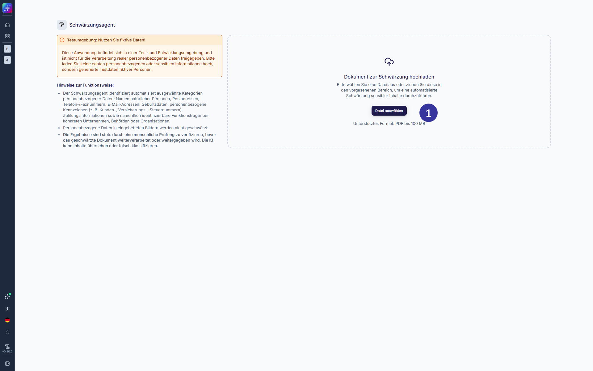

## 6 Prozessübergreifende Funktionen [#kapitel-6]

### 6.1 KI-Werkzeug: Schwärzungsagent [#kapitel-6-1]

*Abbildung 42: KI-Werkzeug: Schwärzungsagent*

**Beschreibung**

Der Schwärzungsagent ist über das Dashboard abrufbar und dient der automatisierten Verarbeitung und Anonymisierung von Dokumenten. Ziel ist es, personenbezogene sowie sonstige schützenswerte Informationen innerhalb der Dokumente unkenntlich zu machen und für eine weiterführende, datenschutzkonforme Nutzung bereitzustellen. Der Schwärzungsagent verarbeitet als Eingabe eine PDF-Datei. Nach Übermittlung erfolgt eine automatisierte Analyse des Dokumenteninhalts. Im Rahmen dieser Analyse werden personenbezogene Daten sowie weitere identifizierende Informationen erkannt. Nach Abschluss des Anonymisierungsvorgangs werden die verarbeiteten PDF-Dateien zum Download bereitgestellt. Die ursprüngliche Dokumentenstruktur bleibt dabei erhalten.

**Hinweise zur Nutzung:**

- Es ist sicherzustellen, dass ausschließlich PDF-Dokumente übermittelt werden.
- Die korrekte Funktion der Anonymisierung ist abhängig von der Qualität und Struktur der Ausgangsdokumente (z. B. durchsuchbarer Text vs. gescannte Inhalte).
- Eine automatisierte Anonymisierung kann keine vollständige Garantie für die Entfernung sämtlicher personenbezogener Daten bieten. Eine ergänzende manuelle Prüfung der Ergebnisse wird empfohlen.
- Digitale Signaturen werden bei der Verarbeitung entfernt. Das geschwärzte Dokument ist nicht mehr signiert.

**Elementbeschreibung**

① Button „Datei auswählen“: ermöglicht die Auswahl eines PDF-Dokuments, das durch den Schwärzungsagenten verarbeitet wird. Dieses kann nach der Verarbeitung heruntergeladen werden. Anschließend ist eine weitere Schwärzung durchführbar.
