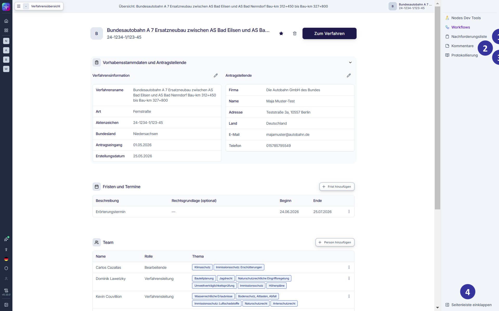
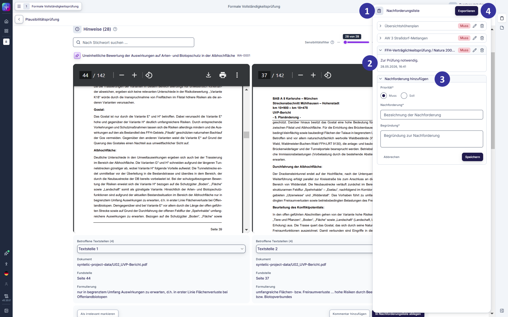
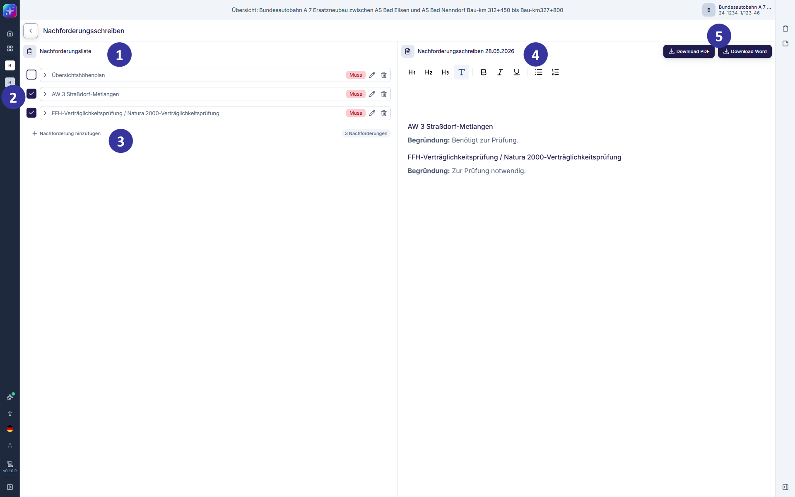
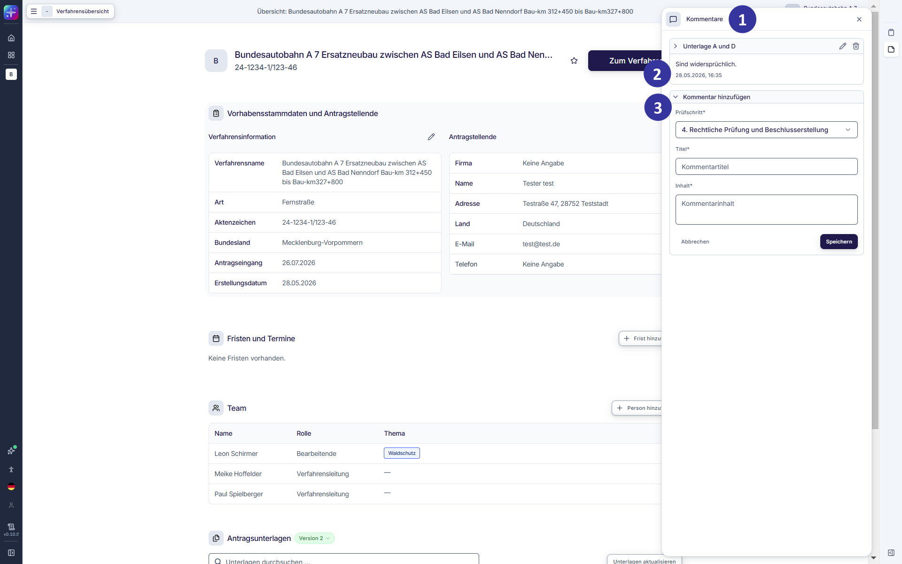
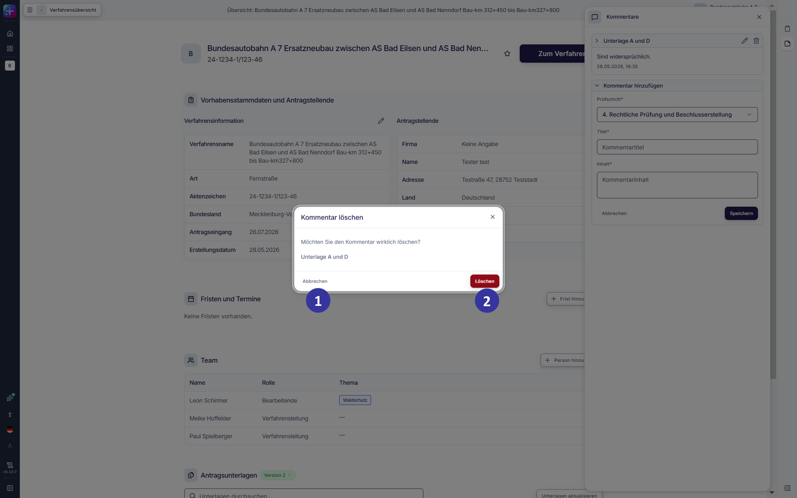
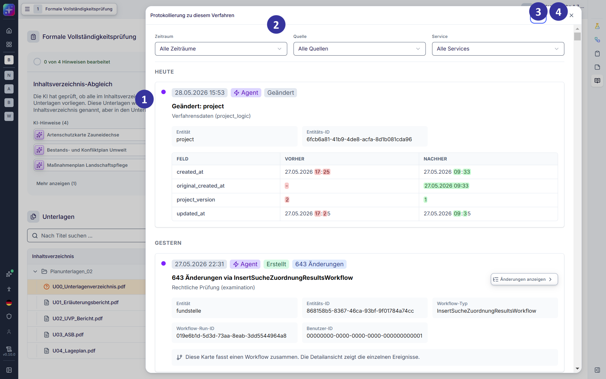

### 6.2 Übersicht: rechte Seitenleiste [#kapitel-6-2]

Die rechte Seitenleiste stellt Funktionen zur Verfügung, die die fachliche Bearbeitung eines Verfahrens unterstützen. Diese Funktionen stehen unabhängig vom jeweiligen Bearbeitungsschritt zur Verfügung.

Über die rechte Seitenleiste können unter anderem Nachforderungen erstellt, Kommentare verfasst sowie das Bearbeitungsprotokoll nachverfolgt werden. Die Nutzung dieser Funktionen wirkt im Bearbeitungsprozess unterstützend, die fachliche Bewertung und Entscheidung verbleiben jedoch stets bei den Nutzenden.

Die einzelnen Funktionen der rechten Seitenleiste werden in den nachfolgenden Kapiteln detailliert erläutert.

#### 6.2.1 Rechte Seitenleiste: ausgeklappte Darstellung [!toc] [#kapitel-6-2-1]

*Abbildung 43: Verfahrensansicht mit ausgeklappter rechter Seitenleiste (Entwicklungsstand: 29.05.2026)*

**Beschreibung**

Diese Ansicht erscheint, wenn Nutzende auf das Ausklappen‑Icon der rechten Seitenleiste klicken. Die rechte Seitenleiste zeigt alle verfügbaren Funktionen in vollständiger Schreibweise. Über die rechte Seitenleiste können Nutzende auf Funktionen zugreifen, die die fachliche Bearbeitung eines Verfahrens ergänzen. Die Nutzung der einzelnen Funktionen ist unabhängig vom aktuell angezeigten Hauptbereich möglich.

**Elementbeschreibungen**

① Icon „Nachforderungsliste“: öffnet die Nachforderungsliste zur Erstellung und Verwaltung von Nachforderungen (s. Kapitel [6.2.2](#kapitel-6-2-2)).

② Icon „Kommentare“: öffnet den Kommentarbereich zur Erfassung und Verwaltung interner Hinweise und Anmerkungen (s. Kapitel [6.2.3](#kapitel-6-2-3)).

③ Icon „Protokollierung“: öffnet den Bereich zur Nachverfolgung und Dokumentation von Bearbeitungsschritten.

④ Icon „Seitenleiste einklappen“: klappt die rechte Seitenleiste aus und ein.

#### 6.2.2 Nachforderungsliste: Nachforderungen hinzufügen [!toc] [#kapitel-6-2-2]

*Abbildung 44: Nachforderungsliste – Nachforderungen hinzufügen (Entwicklungsstand: 29.05.2026)*

**Beschreibung**

Diese Ansicht öffnet sich über den Nachfordern-Button, wenn während der Bearbeitung Nachforderungen angelegt werden, beispielsweise in der formalen Vollständigkeitsprüfung oder in der Plausibilitätsprüfung. Darüber hinaus wird diese Ansicht automatisch geöffnet, wenn Nutzende die Funktion „Nachforderungsliste“ in der rechten Seitenleiste auswählen und auf „Nachforderung hinzufügen“ klicken. Die Nachforderungsliste in der Seitenleiste dient der laufenden Bearbeitung und Ergänzung von Nachforderungen während des Prüfprozesses / Verfahrens. Hier können Nachforderungen erfasst, angepasst und priorisiert werden. Die Ansicht ist darauf ausgelegt, Nutzende bei der fachlichen Arbeit zu unterstützen, ohne den aktuellen Bearbeitungskontext zu verlassen. Eine vollständige Übersicht aller Nachforderungen inklusive der Erstellung und Bearbeitung des Nachforderungsschreibens erfolgt in einer separaten Ansicht.

**Elementbeschreibungen**

① Kachel „Nachforderungsliste“: zeigt alle bislang für das Verfahren angelegten Nachforderungen in einer kompakten Übersicht. Die Nachforderungen sind nach dem jeweiligen Prüfschritt gruppiert, in dem sie angelegt wurden. Innerhalb dieser Gruppen werden die Nachforderungen nach Unterlagennamen angezeigt. Per Klick auf eine Nachforderung können die zugehörigen Details ein‑ oder ausgeblendet werden. Nachgeforderte Elemente tragen eine Indikation zur Priorität („Muss“ oder „Soll“). Hinterlegte Nachforderungen können editiert oder gelöscht werden.

② Nachforderungs-Eintrag: Jede Nachforderung wird als eigener Eintrag in der Nachforderungsliste dargestellt. Der Eintrag zeigt die Nachforderung, die gewählte Priorität sowie die Begründung. Über die zugehörigen Icons können Nachforderungen bearbeitet oder gelöscht werden.

③ Kachel „Nachforderung hinzufügen“: In dieser Kachel werden die inhaltlichen Angaben zu einer Nachforderung erfasst oder angepasst.

- Pflichtangabe „Priorität“: kennzeichnet, ob es sich um eine Muss‑ oder Soll‑Nachforderung handelt. Die Option „Muss“ ist standardmäßig vorausgewählt.
- Pflichtfeld „Nachforderung“: Titel der Nachforderung, z. B. Bezeichnung der nachzufordernden Unterlage. Das Feld ist vorbelegt, wenn die Nachforderung aus einem Hinweis oder aus einer Unterlage heraus angelegt wurde.
- Pflichtfeld „Begründung“: dient der fachlichen Erläuterung oder Einordnung der Nachforderung.
- Button „Abbrechen“: verwirft die Eingaben und schließt die Bearbeitungsansicht.
- Button „Speichern“: speichert die Nachforderung und übernimmt sie in die Nachforderungsliste.

④ Button „Exportieren“: wechselt zur vollständigen Ansicht der Nachforderungsliste, in der alle Nachforderungen gebündelt dargestellt sind und ein Nachforderungsschreiben erstellt bzw. bearbeitet werden kann.

##### 6.2.2.1 Nachforderungsliste verwalten und exportieren [!toc] [#kapitel-6-2-2-1]

*Abbildung 45: Nachforderungsliste – Nachforderungsliste verwalten und exportieren (Entwicklungsstand: 29.05.2026)*

**Beschreibung**

Diese Ansicht öffnet sich, wenn Nutzende in der Nachforderungsliste der rechten Seitenleiste auf den Button „Nachforderungsliste exportieren“ klicken. Die Ansicht bietet eine vollständige, zusammengefasste Übersicht aller im Verfahren angelegten Nachforderungen und dient der Erstellung und Weiterverarbeitung des Nachforderungsschreibens. In dieser Ansicht können Nachforderungen geprüft, ausgewählt und in ein Nachforderungsschreiben übernommen werden. Zudem steht ein Texteditor zur Verfügung, in dem das Nachforderungsschreiben inhaltlich angepasst und finalisiert werden kann, bevor es zum Download bereitgestellt wird.

**Elementbeschreibungen**

① Nachforderungen-Kachel: zeigt alle bislang für das Verfahren angelegten Nachforderungen in einer kompakten Übersicht. Die Nachforderungen sind nach dem jeweiligen Prüfschritt gruppiert, in dem sie angelegt wurden. Innerhalb dieser Gruppen werden die Nachforderungen nach Unterlagennamen angezeigt.

② Nachforderung: Per Klick auf eine Nachforderung können die zugehörigen Details ein‑ oder ausgeblendet werden.

③ Checkbox zur Auswahl von Nachforderungen: ermöglicht die Auswahl einzelner Nachforderungen, die in das Nachforderungsschreiben übernommen werden sollen. Nur ausgewählte Nachforderungen werden im Nachforderungsschreiben angezeigt und im Export berücksichtigt.

④ Button „Nachforderung hinzufügen“: ermöglicht das Hinzufügen weiterer Nachforderungs-Elemente. Per Klick wird ein zusätzlicher Eingabebereich geöffnet, in dem Priorität, Nachforderung und Begründung erfasst werden können.

⑤ Texteditor „Nachforderungsschreiben“: stellt einen Editor zur Verfügung, in dem das Nachforderungsschreiben auf Basis der ausgewählten Nachforderungen erstellt und angepasst werden kann. Der Editor enthält die aus den Nachforderungen generierten Inhalte und ermöglicht deren redaktionelle Überarbeitung, Ergänzung und Strukturierung vor der Weiterverarbeitung.

⑥ Download-Button (PDF / Word): ermöglicht den Download des Nachforderungsschreibens zur Weiterverarbeitung. Das Nachforderungsschreiben kann wahlweise als PDF-Datei oder als Word-Datei heruntergeladen werden.

#### 6.2.3 Kommentare: Ansicht in der rechten Seitenleiste [!toc] [#kapitel-6-2-3]

*Abbildung 46: Ansicht der Kommentarfunktion in der rechten Seitenleiste (Entwicklungsstand: 29.05.2026)*

**Beschreibung**

Diese Ansicht öffnet sich, wenn während der Bearbeitung Kommentare über den Button „Kommentar hinzufügen“ hinzugefügt werden. Darüber hinaus wird diese Ansicht automatisch geöffnet, wenn Nutzende die Funktion „Kommentare“ in der rechten Seitenleiste auswählen und auf „Kommentar hinzufügen“ klicken. Die Kommentarfunktion ist vollständig in die rechte Seitenleiste integriert und hat keine übergeordnete Benutzeroberfläche. Sie dient der internen Dokumentation, Abstimmung und fachlichen Kommentierung während der laufenden Bearbeitung eines Verfahrens.

**Elementbeschreibungen**

① Bereich „Kommentare“: zeigt alle bislang für das Verfahren angelegten Kommentare in einer kompakten Übersicht. Die Kommentare sind nach dem jeweiligen Prüfschritt gruppiert, in dem sie angelegt wurden. Zudem ist eine Anlage „ohne Zuordnung“ möglich.

② Kommentar-Kachel: Innerhalb der Gruppen werden die Kommentare anhand ihres Titels angezeigt. Per Klick auf einen Kommentar können die zugehörigen Inhalte sowie das Erstellungsdatum und die Uhrzeit ein‑ oder ausgeblendet werden. Bestehende Kommentare können bearbeitet oder, je nach Berechtigung, gelöscht werden.

③ Kachel „Kommentar hinzufügen“: ermöglicht das Anlegen eines neuen Kommentars.

- Pflichtfeld „Prüfschritt“: Drop-down, um den zugehörigen Prüfschritt auszuwählen.
- Pflichtfeld „Titel“: Kurzbezeichnung des Kommentars.
- Pflichtfeld „Inhalt“: Inhalt des Kommentars; dient der fachlichen Erläuterung, Einordnung oder internen Abstimmung.
- Button „Abbrechen“: verwirft die Eingaben und schließt die Kachel.
- Button „Speichern“: speichert den Kommentar und übernimmt ihn in die Kommentarübersicht.

##### 6.2.3.1 Kommentare: Kommentar löschen [!toc] [#kapitel-6-2-3-1]

*Abbildung 47: Kommentare – Kommentar löschen (Entwicklungsstand: 29.05.2026)*

**Beschreibung**

Über den Button „Löschen“ in der rechten Seitenleiste im Bereich der Kommentare können einzelne Kommentare gelöscht werden. Klicken Nutzende den Button „Löschen“, öffnet sich ein Dialogfenster, in dem das Löschen bestätigt werden muss. Nutzende haben die Möglichkeit, diesen Schritt abzubrechen.

**Elementbeschreibung**

① Button „Abbrechen“: verwirft die Änderungen und schließt das Dialogfenster.

② Button „Löschen“: bestätigt das Löschen des Kommentars und schließt das Dialogfenster.

#### 6.2.4 Protokollierung [!toc] [#kapitel-6-2-4]

*Abbildung 48: Protokollierung (Entwicklungsstand: 29.05.2026)*

**Beschreibung**

Die Protokollierung dient der transparenten und nachvollziehbaren Dokumentation sämtlicher relevanter Aktivitäten in einem Verfahren. Sie stellt ein revisionssicheres Audit-Log zur Verfügung, in dem Systemereignisse strukturiert erfasst und für berechtigte Nutzende (Administrationsrolle) einsehbar gemacht werden.

Die Protokollierung eines Verfahrens kann über den Protokollierung-Button in der rechten Seitenleiste aufgerufen werden. Nach Öffnung steht eine Übersicht aller protokollierten Ereignisse zur Verfügung. Die angezeigten Einträge können bei Bedarf aktualisiert werden, um den aktuellen Stand abzubilden.

Zur gezielten Auswertung der Protokolldaten stehen Filterfunktionen zur Verfügung. Einträge können nach Zeitraum gefiltert werden. Darüber hinaus ist eine Filterung nach Quellen möglich. Hierbei kann unterschieden werden, ob alle Ereignisse angezeigt werden sollen oder lediglich solche, die durch KI-Agenten bzw. durch Nutzende ausgelöst wurden. Das Audit-Log kann exportiert und als Datei heruntergeladen werden, um eine weiterführende Dokumentation oder externe Prüfung zu unterstützen.

**Elementbeschreibung**

① Protokoll-Einträge: Karten zeigen die vorliegenden Änderungen versehen mit einem Zeitstempel sowie weitergehenden Informationen.

② Filter: filtert die Protokollierung per Klick nach den folgenden Kriterien:

- „Zeitraum“: zeigt nur Änderungen im ausgewählten Zeitraum.
- „Quelle“: zeigt nur Änderungen durch KI-Agenten oder durch Nutzende.
- „Service“: zeigt nur Änderungen in bestimmten Arbeitsschritten.

③ Herunterladen-Icon: ermöglicht das Herunterladen des Protokolls für das gewählte Verfahren.

④ Aktualisieren-Button: aktualisiert die Protokollierungsansicht.
