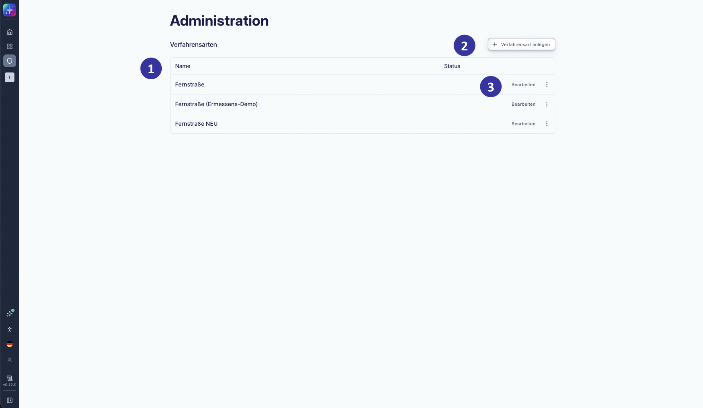
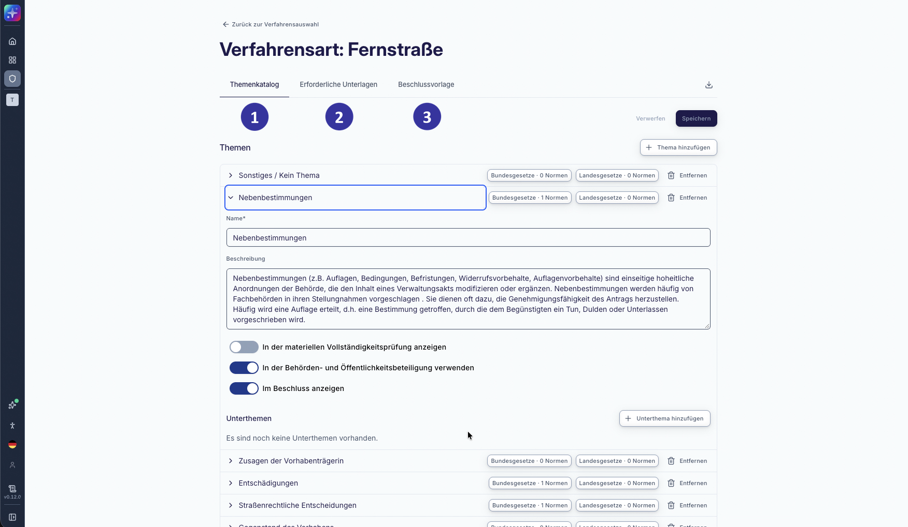

### 6.3 Administration: Übersicht der behördenspezifischen Konfiguration [#kapitel-6-3]

*Abbildung 49: Administration: Übersicht der behördenspezifischen Konfiguration (Entwicklungsstand: 08.10.2026)*

**Voraussetzungen und Einordnung**

Der Administrationsbereich steht ausschließlich Nutzenden mit der systemweiten Rolle „Administration“ zur Verfügung (s. Kapitel [4.3](#kapitel-4-3)). Für alle übrigen Nutzenden entfällt der Navigationspunkt „Administration“; ein direkter Aufruf der Adresse wird abgewiesen und es werden keine Konfigurationsdaten angezeigt.

Die im Administrationsbereich gepflegte Konfiguration wird beim Anlegen eines Verfahrens übernommen. Bereits angelegte Verfahren behalten ihre Themen, Normen, erforderlichen Unterlagen und ihre Beschlussgliederung, auch wenn die Konfiguration im Laufe des Verfahrens oder nach Abschluss des Verfahrens geändert wird.

**Beschreibung**

Diese Ansicht öffnet sich, wenn Nutzende in der Navigationsleiste auf den Navigationspunkt „Administration“ klicken (s. Kapitel [5.2.4](#kapitel-5-2-4)). Der Administrationsbereich dient der Pflege der behördenspezifischen Konfiguration einer SPARK Workflow-Installation. Gepflegt werden die verfügbaren Verfahrensarten sowie je Verfahrensart der Themenkatalog, die erforderlichen Unterlagen und die Beschlussvorlage.

Die Bereiche „Themenkatalog“, „Erforderliche Unterlagen“, „Beschlussvorlage“ und „Katalogexport“ werden angezeigt, sobald eine Verfahrensart ausgewählt ist. Ist für eine Verfahrensart noch kein Katalog vorhanden, wird er über den Button „Katalog anlegen“ angelegt. Änderungen in diesen Bereichen werden jeweils über den Button „Speichern“ übernommen; zwischenzeitlich nicht gespeicherte Änderungen werden über den Button „Verwerfen“ zurückgesetzt.

**Elementbeschreibungen**

① Bereich „Verfahrensarten“: zeigt die verfügbaren Verfahrensarten mit ihrem Status.

② Button „Verfahrensart anlegen“: ermöglicht die Aufnahme / Ergänzung einer Verfahrensart.

③ Aktionsmenü: Über das Aktionsmenü einer Zeile kann eine Verfahrensart umbenannt, deaktiviert, reaktiviert oder gelöscht werden. Eine deaktivierte Verfahrensart wird mit „inaktiv“ gekennzeichnet und steht beim Anlegen eines Verfahrens nicht (mehr) zur Auswahl (s. Kapitel [5.2.6](#kapitel-5-2-6)). Wird eine Verfahrensart in mindestens einem Verfahren verwendet, weist die Applikation das Löschen einer Verfahrensart ab und bietet die Deaktivierung an. Per Klick auf eine Verfahrensart oder auf den Button „Bearbeiten“ werden deren Konfigurationsbereiche geöffnet.

#### 6.3.1 Administration: Konfiguration einer Verfahrensart [!toc] [#kapitel-6-3-1]

*Abbildung 50: Administration: Konfiguration einer Verfahrensart (Entwicklungsstand: 08.10.2026)*

**Beschreibung**

Diese Ansicht dient der behördenspezifischen Konfiguration der Angaben zur „Verfahrensart“.

**Elementbeschreibungen**

① Bereich „Themenkatalog“: zeigt die Themen und Unterthemen der ausgewählten Verfahrensart mit Name, Beschreibung und der Angabe, ob sie in der materiellen Prüfung, in der Behörden- und Öffentlichkeitsbeteiligung und im Beschluss angezeigt werden. Je Thema und Unterthema werden die „Prüfungsnormen“, d. h. materiell-rechtliche Normen und die „Verfahrensnormen“, d. h. verfahrensrechtliche Normen aus Bundes- und Landesgesetzen eingegeben. Beim Anlegen eines Verfahrens werden die Normen für das im Verfahren gewählte Bundesland übernommen.

② Bereich „Erforderliche Unterlagen“: zeigt die behördlicherseits erforderlichen Unterlagen kategorisiert nach Unterlagengruppen. Eine Gruppe kann aufgeklappt werden. Je Gruppe werden die Dokumenttypen mit Beschreibung und erwarteter Anzahl gezeigt. Diese Angaben liegen der Kachel „Benötigte Unterlagen“ in der formalen Vollständigkeitsprüfung zugrunde (s. Kapitel [5.2.13](#kapitel-5-2-13)).

③ Bereich „Beschlussvorlage“: zeigt die Gliederung des Beschlusses mit seinen Beschlusskapiteln mit Titel, Text und optionalem Thema. Kapitel können ergänzt, entfernt und in ihrer Reihenfolge verschoben werden. Ein Kapitel kann nur auf ein Thema verweisen, das der Themenkatalog derselben Verfahrensart enthält; ein Thema, auf das ein Kapitel verweist, kann nicht entfernt werden.

Bereich „Katalogexport“: stellt die Konfiguration der ausgewählten Verfahrensart über den Button „Katalog exportieren“ als YAML-Datei zum Herunterladen bereit. Die Datei kann beim Aufsetzen einer weiteren Installation als Ausgangsstand verwendet werden.
