# (1) Systemarchitektur SPARK Workflow

## Architekturansichten

Die Architektur ist nach dem C4-Modell in den Ebenen 1 bis 3 beschrieben. Alle
Ansichten werden aus einem versionierten Modell reproduzierbar nach SVG
gerendert; die Quelle einer Ansicht liegt als `.d2` daneben und ist eigenständig
erneut renderbar.

| Ansicht | Zeigt |
|---|---|
| [C1 Systemkontext](./views/c1-system-context.svg) | SPARK Workflow, seine Akteure, die angebundenen Behördenplattformen und die Sprachmodelle |
| [C2 Container](./views/c2-container.svg) | Die deploybaren Einheiten im veröffentlichten Architekturumfang, nach Layern und Dienstgruppen |
| [C2 Dienste und Orchestrierung](./views/c2-service-flows.svg) | Frontend, Backend-Pools, Workflow Engine und Plattformdienste mit ihren belegten Laufzeitbeziehungen |
| [C2 Integration](./views/c2-integration.svg) | Integrationsdienste, Rechtsdatenbanken und der Modellzugang über den LLM-Client |
| [C2 KI-Verarbeitung](./views/c2-ai.svg) | KI-Module, Modellzugang, Vorverarbeitung und die Dienste, die sie aufrufen |
| [C3 Komponenten des SPARK Backend](./views/c3-component-spark-backend.svg) | Den Modulithen von innen: Feature-Pakete, geteilte Pakete und die Pools mit eigener Worker-Identität |

Die SVGs sind für die Einbettung oben links ausgerichtet (`xMinYMin`). In
Browsern mit sehr breitem Fenster wirken sie deshalb nicht zentriert; die
Tabelle verlinkt die Dateien direkt, für die Doku empfiehlt sich eine
volle Breite mit horizontalem Scrollen bei sehr breiten Ansichten:

Die C2-Karte zeigt den veröffentlichten Architekturumfang ohne Kanten; die belegten
Laufzeitbeziehungen stehen in den drei fokussierten C2-Ansichten.

> ***Hinweis zur Darstellung der Dienstgruppen***
>
> *Die Dienstgruppen beschreiben fachliche Module, nicht jeweils eigenständig
> deployte Backend-Anwendungen. Die TypeScript-Backend-Module werden als Core-
> und Feature-Pakete in der gemeinsamen Anwendung `spark-backend` ausgeführt.
> Externe Infrastruktur, Datenbankdienste und KI-Module bleiben eigenständige
> Komponenten.*
>
> *Die C2-Ansicht zeigt darüber hinaus die Betriebssicht: `spark-backend` wird als
> fünfzehn Pools desselben Images betrieben. Jeder Pool stellt den vollständigen
> HTTP-Graphen bereit; getrennt sind Name, Service, Routing-Präfix,
> Worker-Identität und Skalierung.*

Die Applikation SPARK Workflow ist als containerisierte Service-Architektur umgesetzt und ist nativ für den Betrieb auf einem, gegebenenfalls gemanagten, Kubernetes-Cluster auf Basis einer (Cloud-)Serverinfrastruktur ausgelegt. SPARK Workflow ist sowohl als Open-Source-Software als auch plattformunabhängig konzipiert und auf jeder Kubernetes-kompatiblen Infrastruktur lauffähig – sei es in Public-Cloud-Umgebungen, in Private-Cloud-Umgebungen oder auf On-Premise-Infrastruktur.

Die Systemarchitektur von SPARK Workflow sieht eine Trennung der Applikation von der für den Betrieb der Applikation benötigten Infrastruktur, den anzubindenden Behördenplattformen und den Sprachmodellen vor. Die Gruppen Infrastruktur, bestehende Behördenplattformen und Sprachmodelle sind nicht Teil der Applikation SPARK Workflow und müssen für die ordnungsgemäße Funktionsfähigkeit der Applikation durch die betreibende Stelle eigenverantwortlich bereitgestellt und angebunden werden.

Dabei ist es der betreibenden Stelle überlassen, ob die Komponenten der Gruppen zum Beispiel als selbst verwaltete Services oder als Managed Services der gewählten Betriebsplattform bereitgestellt werden.

# (2) Applikation SPARK Workflow

Innerhalb der Applikation SPARK Workflow ist eine dreischichtige Architektur mit einem Headless-Frontend für die Anwenderinteraktion realisiert. Diese Trennung wird unter anderem durch das Deployment mit dezidierten Namespaces innerhalb des Kubernetes‑Clusters realisiert.

## (2.1) Service Layer

Der Service Layer umfasst insgesamt sechs Dienstgruppen und drei eigenständige Komponenten. Die sechs Dienstgruppen umfassen wie folgt:

- Die Gruppe „Workflow-Dienste“ umfasst Basisdienste, die Kernfunktionalitäten der Applikation bereitstellen. Dies sind Dienste zur Verfahrensverwaltung, zum Workflowmanagement, zum Dokumentenmanagement, zur Agentenorchestrierung und zur Protokollverwaltung.

- Die Gruppe „Interaktionsdienste“ umfasst Dienste für die Anreicherung des gesamten Planungs- und Genehmigungsprozesses um zusätzliche Eingaben. Dies sind Dienste zur Kommentarverwaltung, zur Nachforderungsverwaltung, zur Identitätsverwaltung, zur Einwendungsverwaltung und zur Feedbackverwaltung.

- Die Gruppe „Datenbankdienste“ umfasst Dienste zur Interaktion mit den angebundenen Datenbanken. Dies sind Dienste für die Gesetz- und Normendatenbank, für die juristische Datenbank und für die Gesetzesbegründungsdatenbank.

- Die Gruppe „Integrationsdienste“ umfasst spezialisierte Dienste für die Anbindung externer Behördenplattformen an die Applikation SPARK Workflow und ermöglicht die dafür notwendigen Datenflüsse. Dies sind Dienste für die Fachplanungsportalintegration und die DiPlan-Integration.

- Die Gruppe „Beschlussdienste“ umfasst einen Dienst zur Erstellung von Beschlüssen (Verwaltungsakt).

- Die Gruppe „Prüfungsdienste“ umfasst Dienste für Funktionalitäten einzelner Prozessbausteine im gesamten Planungs- und Genehmigungsprozess. Dies sind Dienste für die formale Vollständigkeitsprüfung, die Plausibilitätsprüfung und ein Dienst für rechtliche Prüfungen.

Die drei eigenständigen Komponenten umfassen wie folgt:

- Die Komponente „SpiceDB“ dient der granularen Zugriffsautorisierung mittels Relationship-based Access Control und dient der gezielten Zugriffssteuerung auf Daten und Prozesse.
  SpiceDB wird über den SpiceDB-Operator in der Version 1.23.0 implementiert. Das Pod-Deployment wird dabei automatisch auf Basis einer Custom-Resource erzeugt und mithilfe der Datei SpiceDBCluster.spec konfiguriert.

  - Produktdokumentation: <https://authzed.com/spicedb>

- Die Komponente „Unoserver“ dient der Umwandlung von DOCX-Dokumenten in das Dateiformat PDF, um die Weiterverarbeitung mit Intelligent Document Processing (IDP) zu ermöglichen.

  - Produktdokumentation: <https://github.com/unoconv/unoserver>

- Die Komponente „ClamAV“ dient der Prüfung von Dateien auf Signaturen bekannter Computerviren. Dies ist insbesondere deswegen notwendig, da über das Frontend Dateien von außerhalb der Applikation in die Applikation geladen werden und diese – nach Annahme des
  Zero-Trust-Grundsatzes – potenziell schädlich sein könnten.

  - Produktdokumentation: <https://www.clamav.net/>

## (2.2) Orchestration Layer

Der zweite Layer, der „Orchestration Layer“, umfasst ausschließlich die Komponente „Temporal“. Diese ist als Workflow Engine für das Workflowmanagement der gesamten Applikation führend und ermöglicht die Steuerung und Nachverfolgung der Prozesse von SPARK Workflow.

## (2.3) AI Module Layer

Der dritte Layer, der „AI Module Layer“, umfasst insgesamt zehn Modulgruppen und drei eigenständige Komponenten. Die zehn Modulgruppen umfassen wie folgt:

- Die Gruppe „Inhaltsextraktion“ umfasst das gleichnamige Modul. Dieses ist Grundlage für den Prozessschritt „Formale Vollständigkeitsprüfung“ im Frontend.

- Die Gruppe „Formale Vollständigkeitsprüfung“ umfasst das gleichnamige Modul. Dieses stellt die KI-Funktionalitäten für den Prozessschritt „Formale Vollständigkeitsprüfung“ im Frontend bereit.

- Die Gruppe „Plausibilitätsprüfung“ umfasst das gleichnamige Modul. Dieses stellt weitere KI-Funktionalitäten für den Prozessschritt „Formale Vollständigkeitsprüfung“ im Frontend bereit.

- Die Gruppe „Materielle Vollständigkeitsprüfung“ umfasst das Modul „Suche und Zuordnung“. Dieses stellt die KI-Funktionalitäten für den Prozessschritt „Materielle Vollständigkeitsprüfung“ im Frontend bereit.

- Die Gruppe „Einwendungsmanagement“ umfasst das gleichnamige Modul. Dieses stellt die KI-Funktionalitäten für den Prozessschritt „Behörden- und Öffentlichkeitsbeteiligung“ im Frontend bereit.

- Die Gruppe „Rechtliche Prüfung und Bewertung“ umfasst das Modul „Bewertung“. Dieses stellt die KI-Funktionalitäten für den Prozessschritt „Rechtliche Prüfung und Beschlusserstellung“ im Frontend bereit.

- Die Gruppe „Rechtsmethodik“ umfasst das gleichnamige Modul. Dieses dient der Bereitstellung von grundlegenden rechtsmethodischen Funktionalitäten, auf welche die anderen Module zugreifen.

- Die Gruppe „Normenermittlung“ umfasst das gleichnamige Modul. Dieses führt die formale Anwendbarkeitsprüfung und die Auflösung von Normenkollisionen durch und stellt die ermittelten Rechtsnormen für die rechtliche Prüfung bereit.

- Die Gruppe „Anonymisierung“ umfasst das gleichnamige Modul. Dieses stellt die KI-Funktionalitäten für das KI-Werkzeug „Schwärzungsagent“ im Frontend bereit.

- Die Gruppe „Risikohinweiser“ umfasst das gleichnamige Modul. Dieses stellt die KI-Funktionalitäten für den Prozessschritt „Rechtliche Prüfung und Beschlusserstellung“ im Frontend bereit.

Die drei eigenständigen Komponenten umfassen wie folgt:

- Die Komponente „LLM-Proxy“ dient gleichzeitig sowohl als LLM API Abstraction Layer, als LLM-Proxy und als LLM-Gateway. Die Komponente vereinheitlicht, steuert und überwacht das Ansprechen der extern bereitgestellten Sprachmodelle über OpenAI-API-kompatible Schnittstellen. Die Komponente muss durch die Betreiberin der Applikation bereitgestellt werden. Mögliche Umsetzung: „LiteLLM“, Bereitstellung als „litellm-proxy“ und als „llm-client“.

  - Produktdokumentation: <https://www.litellm.ai/>

- Die Komponente „Docling“ dient der Vorverarbeitung von im Verfahren eingegebenen Dokumenten und ermöglicht die Volltext-, Bild- und Tabellenextraktion.

  - Produktdokumentation: <https://www.docling.ai/>

- Die Komponente „Qdrant“ wird als Vektordatenbank für die Speicherung von Textfragmenten, zugeordneten Vektorrepräsentationen und Embeddings eingesetzt.

  - Produktdokumentation: <https://qdrant.tech/>

# (3) Infrastruktur

Die Gruppe Infrastruktur umfasst insgesamt drei Untergruppen. Die drei Untergruppen sind „Sicherheits-, Identitäts- und Vertrauensmanagement“, „Überwachung“ und „Datenhaltung“.

## (3.1) Sicherheits-, Identitäts- und Vertrauensmanagement

Die Untergruppe „Sicherheits-, Identitäts- und Vertrauensmanagement“ umfasst vier Komponentenanforderungen an die Betriebsumgebungen. Diese sind wie folgt:

- Die Komponentenanforderung „mTLS‑Service‑Mesh“ beschreibt die Notwendigkeit der Bereitstellung eines kompatiblen Service-Meshs, um Ingress, Egress und die Kommunikation der Dienste zu steuern und abzusichern. Mögliche Umsetzung: „Istio“ und „Envoy“.

  - Produktdokumentation: <https://istio.io/>, <https://www.cncf.io/projects/envoy/>

- Die Komponentenanforderung „OIDC‑ & OAuth 2.0‑konformer Identitäts‑ und Autorisierungsdienst“ beschreibt die Notwendigkeit der Bereitstellung eines kompatiblen Identitätsverwaltungsdiensts und Reverse-Proxys, um den Zugriff auf die Applikation zu steuern und abzusichern. Für den Betrieb des Envoy-Proxys ist ein OIDC-konformer Identity Provider erforderlich. Damit der Proxy Authentifizierungs- und Autorisierungsentscheidungen treffen kann, müssen ihm außerdem die spezifischen Konfigurationsinformationen des Identity Provider bereitgestellt werden. Mögliche Umsetzung: „Keycloak“ und „OAuth2 Proxy“.

  - Produktdokumentation: <https://www.keycloak.org/>, <https://oauth2-proxy.github.io/oauth2-proxy/>

- Die Komponentenanforderungen „Secrets- & Schlüsselverwaltung“ und „TLS‑Zertifikatsverwaltung (X.509‑PKI)“ beschreiben die Notwendigkeit der Bereitstellung einer kompatiblen Secrets- und Schlüsselverwaltung, einschließlich Schlüsselsynchronisation und Zertifikatsverwaltung. Die Applikation SPARK Workflow setzt dabei einen External-Secrets-Operator-kompatiblen Dienst für ordnungsgemäße Funktionsfähigkeit voraus. Mögliche Umsetzung: „HashiCorp Vault“, „External Secrets Operator“ und „cert-manager“.

  - Produktdokumentation: <https://www.hashicorp.com/de/products/vault>, <https://external-secrets.io/latest/>, <https://cert-manager.io/>

## (3.2) Überwachung

Die Untergruppe „Überwachung“ umfasst zwei Komponentenanforderungen an die Betriebsumgebungen. Diese sind wie folgt:

- Die Komponentenanforderung „Prometheus-Metrics-kompatibler Metrikdienst“ beschreibt die Notwendigkeit der Bereitstellung eines Dienstes, um in den Komponenten der Applikation erzeugte Metriken abzuholen, sie zu aggregieren und für Dashboards vorzuhalten.
  Mögliche Umsetzung: „Prometheus“ und „Grafana“.

  - Produktdokumentation: <https://prometheus.io/>, <https://grafana.com/>

- Die Komponentenanforderung „OpenTelemetry-kompatibler Telemetriedienst“ beschreibt die Notwendigkeit der Bereitstellung eines kompatiblen Dienstes, um in den Komponenten der Applikation erzeugte Logs abzuholen, zu aggregieren und für Abfragen vorzuhalten.
  Mögliche Umsetzung: „OpenTelemetry Collector“ und „Grafana Loki“.

  - Produktdokumentation: <https://opentelemetry.io/docs/collector/>, <https://grafana.com/oss/loki/?plcmt=oss-nav>

## (3.3) Datenhaltung

Die Untergruppe „Datenhaltung“ umfasst drei Komponentenanforderungen an die Betriebsumgebungen. Diese sind wie folgt:

- Die Komponentenanforderung „PostgreSQL“ beschreibt die Notwendigkeit der Bereitstellung eines hochverfügbaren „PostgreSQL“-Datenbankclusters für die Sicherung der Verfahrensdaten. Die PostgreSQL-Datenbank muss aus dem Kubernetes-Cluster heraus erreichbar sein, da mehrere Komponenten auf die relationale Datenbank für ihre ordnungsgemäße Funktionsfähigkeit angewiesen sind. Darüber hinaus muss diese professionell gemanagt sein und muss dynamisch mit den Arbeitslasten der Applikation skalieren. Mögliche Umsetzung: „CloudNativePG“ und „PostgreSQL“.

  - Produktdokumentation: <https://cloudnative-pg.io/>, <https://www.postgresql.org/>

- Die Komponentenanforderung „S3-kompatibler Objektspeicher“ beschreibt die Notwendigkeit der Bereitstellung eines hochverfügbaren verteilten Objektspeichers mit S3-kompatibler Schnittstelle für die Ablage von Arbeitsdaten. Die S3-Kompatibilität ist von kritischer Relevanz für die Applikation, da nahezu alle Komponenten auf diese Datenablage zugreifen. Mögliche Umsetzung: „Rook“ und „Ceph“.

  - Produktdokumentation: <https://rook.io/>, <https://ceph.io/en/>

- Die Komponentenanforderung „Redis“ beschreibt die Notwendigkeit der Bereitstellung der In-Memory-Key-Value-Datenbank „Redis“ für Caching bei der Vorgangsbearbeitung.
  Mögliche Umsetzung: „Redis“.

  - Produktdokumentation: <https://redis.io/>

# (4) Bestehende Behördenplattformen

Die Applikation SPARK Workflow kann mit bestehenden behördlichen Plattformen verbunden werden. Exemplarisch wurde bereits die Anbindung an folgende Plattformen betrachtet:

- [Das Antrags- und Beteiligungsportal](https://beteiligung.bund.de/) für Verkehr und Offshore-Vorhaben (Fachplanungsportal) des Bundesministeriums für Verkehr ermöglicht die digitale Antragseinreichung und Durchführung der Behörden- und Öffentlichkeitsbeteiligung mit Webzugängen. Das Portal umfasst Infrastrukturprojekte im Geschäftsbereich des Bundesministeriums für Verkehr in den Bereichen Eisenbahnen, Fernstraßen und Wasserstraßen des Bundes sowie Windenergie auf See.

- [DiPlanung](https://portal.diplanung.de/) (DiPlan) der Freien und Hansestadt Hamburg stellt Informationen zu räumlichen Plänen und Beteiligungsverfahren zentral und transparent bereit und ermöglicht es Behörden und Öffentlichkeit, dass sich über geltendes und in Aufstellung befindliches Planrecht aller Planungsebenen und aktueller formeller Beteiligungsverfahren in Deutschland informiert werden kann.

# (5) Sprachmodelle

Die Applikation SPARK Workflow ist für die ordnungsgemäße Funktionsfähigkeit der integrierten Agenten auf die Anbindung spezialisierter Sprachmodelle angewiesen. Die Module der Applikation sind dabei jeweils spezifisch auf genau ein Sprachmodell angepasst. Die ordnungsgemäße Funktionsfähigkeit eines Moduls kann nicht gewährleistet werden, wenn ein anderes Sprachmodell als das vorgegebene angebunden wird. Die Anbindung der Sprachmodelle erfolgt über die Bereitstellung OpenAI-API-kompatibler Schnittstellen der Sprachmodelle und über die Konfiguration des LLM-Proxys für den Zugriff auf diese Schnittstellen. Die eingesetzten Sprachmodelle sind wie folgt:

- Das Sprachmodell „BGE-M3“ ist ein Embedding-Modell und dient der Erzeugung hochwertiger, mehrsprachiger Vektorrepräsentationen für Suche, Matching und RAG‑Systeme.

  - Model Card: <https://bge-model.com/bge/bge_m3.html>

- Das Sprachmodell „gpt-oss-120b“ ist ein Mixture-of-Experts-Reasoning‑Modell und dient der mehrschrittigen Problemlösung mit anspruchsvollen Analysen durch spezialisierte Modellsegmente.

  - Model Card: <https://openai.com/de-DE/index/introducing-gpt-oss/>

- Das Sprachmodell „Gemma 4 26B A4B“ ist ein multimodales Mixture-of-Experts-Sprachmodell von Google DeepMind für anspruchsvolle Aufgaben wie Reasoning, Coding, Bildverstehen und mehrsprachige Textgenerierung.

  - Model Card: <https://huggingface.co/google/gemma-4-26B-A4B-it>

- Das Sprachmodell „LightOnOCR-2-1B“ ist ein kompaktes, end-to-end multimodales Vision-Language-Modell von LightOn mit 1 Milliarde Parametern, spezialisiert auf optische Zeichenerkennung (OCR) und Dokumentenverständnis für Aufgaben wie die Texterkennung aus PDFs, Scans, Tabellen und Formularen.

  - Model Card: <https://huggingface.co/lightonai/LightOnOCR-2-1B>

- Das Sprachmodell „Qwen3-235B-A22B-Instruct-2507“ ist ein großes Mixture-of-Experts-Sprachmodell für Aufgaben wie Reasoning und Textgenerierung.

  - Model Card: <https://huggingface.co/Qwen/Qwen3-235B-A22B-Instruct-2507>

Die Auswirkungen von Quantisierung auf die Ergebnisqualität / Modelleffizienz wurden nicht systematisch überprüft. Bei den meisten Modellen – insbesondere solchen, die für die Entwicklungs- und Testumgebung auf dedizierter Infrastruktur betrieben wurden – ist von D-Type 16-Bit-Float auszugehen.

# (6) Kubernetes-Cluster

Kubernetes bildet die zentrale Orchestrierungsplattform für den Betrieb der containerisierten Service-Architektur von SPARK Workflow und ermöglicht die automatisierte Bereitstellung, Skalierung und Überwachung der Applikation. Der gewünschte Systemzustand wird dabei deklarativ beschrieben und durch kontinuierliche Ist-Soll-Abgleiche sichergestellt. Die Applikationskomponenten werden in Form von Pods betrieben und über standardisierte Ressourcen wie Deployments, Services und Ingress gesteuert. Sicherheitsmechanismen wie ReBAC, Namespace-Isolation und Network Policies gewährleisten einen kontrollierten und abgesicherten Betrieb.

## (6.1) Node Pools

Damit die Applikation SPARK Workflow ordnungsgemäß betrieben und gewartet werden kann, müssen die über den Node Pool bereitgestellten Knoten den nachfolgenden Mindesthardwareanforderungen entsprechen. Kubernetes‑Mechanismen wie Pod-Scheduling, Netzwerksegmentierung und Zugriffskontrollen sind obligatorisch zur Absicherung des Kubernetes-Clusters.

### Default Node Pool

Der Default Node Pool umfasst mindestens drei virtuelle Maschinen (VM) mit jeweils mindestens:

- 16 vCPUs

- 64 GB RAM

- Lokaler SSD‑Speicher (ephemeral)

Für den ordnungsgemäßen Betrieb der Applikation werden die Komponenten Docling und Qdrant benötigt. Diese müssen von der Betriebsplattform dediziert bereitgestellt werden. Für den Betrieb dieser Komponenten werden die nachfolgenden zwei Node Pools empfohlen:

### Large Node Pool für Qdrant

Für die Speicherung hochdimensionaler Vektordaten und die Ausführung komplexer Ähnlichkeitssuchen in Qdrant wird ein dedizierter Node Pool mit mindestens einer leistungsstarken VM empfohlen:

- 32 vCPUs

- 128 GB RAM

- Lokaler SSD‑Speicher (ephemeral)

Der Node Pool ist logisch getrennt und folgt einem „Least Privilege“‑Konzept hinsichtlich des Zugangs, Ressourcenverteilung und Netzwerkzugriff.

### GPU Node Pool für Docling

Für die performante Verarbeitung der gelieferten Dokumente wird Docling verwendet. Für den leistungsfähigen Betrieb wird empfohlen, einen dedizierten GPU Node Pool einzurichten. Es wird empfohlen, dass der GPU Node Pool über mindestens eine VM mit der folgenden Ausstattung verfügt:

- 16 vCPUs

- 64 GB RAM

- L4 GPU (24 GB vRAM)

Der Node Pool ist logisch getrennt und folgt einem „Least Privilege“‑Konzept hinsichtlich des Zugangs, Ressourcenverteilung und Netzwerkzugriff.
