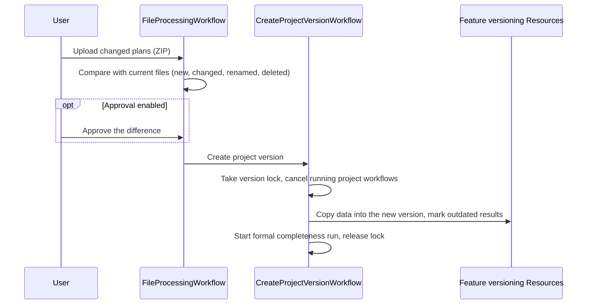

# Core project and document capabilities

`@spark-workflow/core` holds the project itself, its versions, its documents, and the project types that decide what a procedure needs. A project is one planning approval procedure. Every other backend feature builds on this data and reaches it through core's Resources.

## Core Features

- A project holds the applicant, the review topics and subtopics, the norms assigned to each topic, deadlines, and a status from `IN_CREATION` through `UPLOAD_DOCUMENTS`, `OPEN`, and `IN_PROGRESS` to `COMPLETED`.
- A project type defines everything that depends on the kind of procedure: its topics, its norms per federal state, its required documents, and the structure of its decision. The code calls the configuration of a project type a usecase. The repository ships the usecase `fernstrasse` for long-distance roads (Fernstraße).
- Core takes uploads of PDF and ZIP files, scans them for malware before they become available, unpacks ZIP files within safe limits, and stores files in S3.
- When the applicant hands in changed plans, core compares the new ZIP with the current files and creates a new project version. The data of every feature is copied into it, and results based on changed documents are marked as outdated.
- An `ewms_zip` upload holds the statements and objections from the participation of authorities and the public. It starts their processing in Objections Management.

## Architecture

### Overview

#### Usecases

A usecase consists of four YAML documents in `usecases/usecases/<name>/`:

| Document | Content |
| --- | --- |
| `projekttyp.yaml` | ID and name of the project type |
| `gesetzesgrundlage.yaml` | Topics, and the norms that apply per federal state |
| `dokumente.yaml` | Categories of required document types, used by the formal completeness check |
| `beschluss.yaml` | Chapter structure of the decision, used by the decision draft |

`pnpm lint:usecases` validates them. Creating a project runs `ProjectInitializationWorkflow`, which copies the required document types and the decision template into the project and sets its status to `UPLOAD_DOCUMENTS`.

#### Project versions

A project version is the state of a project's documents and of everything the features worked out from them at one point in time. Most feature data has a `projectVersion` column, and only the latest version can be changed. Each write locks the project briefly in the database. It fails with `CONFLICT` while a new version is being created or when the given version is not the latest one.

A new version starts when someone uploads a ZIP file:



Core decides for each row what happens to it. Data of deleted files is not copied. Found passages and documents of changed files, and assessments of changed norm sentences, are marked as outdated. Renamed files keep their results under the new name. If a step fails, the workflow removes the copies, restores the previous state, and releases the lock.

`TEMPORAL_ENABLE_APPROVAL` turns the approval step on.

#### Documents

Uploads go to a separate quarantine storage first, where the virus scanner ClamAV checks each file. A clean file moves to the regular storage, and its status becomes `COMPLETED`. An infected file is deleted, and its status becomes `FAILED`. The quarantine storage and the regular storage must use different buckets or different endpoints. Scanning can be turned off only when `ENV` is `local`, `development`, or `dev`. ZIP files are unpacked one entry at a time, with limits on the number of entries, the size of each entry and of all entries, the compression ratio, and extra data after the end of the archive. See [file and ZIP upload limits](documents/README.md).

#### What other features may do with core data

Core holds the data that other features must refer to or join. A feature may read and join core tables. It changes core data only through core's Resources and routes, so the rules for versions, permissions, and the life of a project stay in one place.

### Components

| Directory | Purpose |
| --- | --- |
| `projects/` | Projects, applicants, topics, deadlines, reference data, statuses, and the workflows that create project versions |
| `documents/` | Uploads, scanning, storage, ZIP processing, and the document workflows |
| `usecases/` | Usecase formats, validation, the catalog, and the shipped usecases |
| `src/manifest.ts` | The combined `coreFeature` |
| `src/schema.ts` | The combined core tables |

### Dependencies

Core exports these Resources to the other features:

| Resource | Used for |
| --- | --- |
| `Projects` | Project data, topics, latest and writable versions, project creation, and export metadata |
| `Applicants` | Applicant data |
| `ProjectLogicVersioning` | Topics, subtopics, and topic norms as versioned nodes |
| `Documents`, `DocumentFiles` | File metadata, content, uploads of generated files, and file topics |
| `DocumentManagementVersioning` | Versioned document nodes |
| `Usecases` | The usecase of a project type |

Outside the backend, core needs S3-compatible storage, ClamAV when scanning is on, and Temporal. The backend serves the project routes under `/api/pls/v1` and the document routes under `/api/dms/v1`. Processes that select `ACTIVE_FEATURE_WORKER=project-logic` or `document-management` run the core workflows.

## Getting Started

### Prerequisites

Set up Bun, pnpm, and the local stack through the [root setup guide](../../README.md#getting-started).

### Environment Variables

`projects/src/env.ts` and `documents/src/env.ts` read these settings. The local stack supplies development values.

| Variable | Description | Default | Required |
| --- | --- | --- | --- |
| `PROJECT_CUT_OFF_DATE` | Optional project date cutoff | none | no |
| `BUCKET_NAME` | Bucket for clean documents | none | yes |
| `DOC_STORE_PATH` | Object key prefix | none | no |
| `S3_ENDPOINT_URL`, `S3_EXTERNAL_URL` | Storage endpoint for the backend and for browsers | none | yes |
| `S3_ACCESS_KEY_ID`, `S3_SECRET_ACCESS_KEY`, `S3_REGION` | Storage credentials and region | none | yes |
| `ENV` | Environment name. Only `local`, `development`, and `dev` allow turning scanning off. | none | yes |
| `CLAMAV_ENABLED`, `CLAMAV_BASE_URL` | Turn malware scanning on and set the scanner address | none | yes |
| `QUARANTINE_BUCKET_NAME`, `QUARANTINE_S3_ENDPOINT_URL` | Quarantine storage | none | when scanning is on |
| `QUARANTINE_S3_ACCESS_KEY_ID`, `QUARANTINE_S3_SECRET_ACCESS_KEY` | Quarantine credentials | none | when scanning is on |
| `MAX_OBJECT_SIZE_MB` | Largest non-ZIP upload or file read into memory | none | yes |
| `TEMPORAL_HOST`, `TEMPORAL_NAMESPACE` | Temporal for the core workflows | none | yes |
| `TEMPORAL_MAX_CONCURRENT_ACTIVITIES`, `TEMPORAL_MAX_TASK_QUEUE_ACTIVITIES_PER_SECOND` | Worker concurrency and rate limit | SDK default | no |
| `TEMPORAL_S3_*` | S3 storage for large Temporal payloads | none | for the core workers |
| `TEMPORAL_ENABLE_APPROVAL` | Require approval of a plan change before a new version | none | for the document worker |
| `CHECKPOINT_RETENTION_PERIOD_DAYS` | How long document checkpoints are kept | none | for the document worker |
| `MAX_ZIP_ENTRIES`, `MAX_SINGLE_ENTRY_SIZE_MB`, `MAX_ZIP_EXTRACTION_SIZE_GB`, `MAX_COMPRESSION_RATIO`, `MAX_ZIP_APPENDED_DATA_BYTES` | ZIP extraction limits | none | for the document worker |

### Running the Module / Service

Core runs inside the SPARK Workflow backend. Start it as described in the [backend README](../../02-backend/apps/spark-backend/README.md#running-the-module--service).

## Testing

From this directory:

```sh
pnpm test
pnpm typecheck
pnpm lint:usecases
```

The backend generates and applies the migrations for the combined schema.
